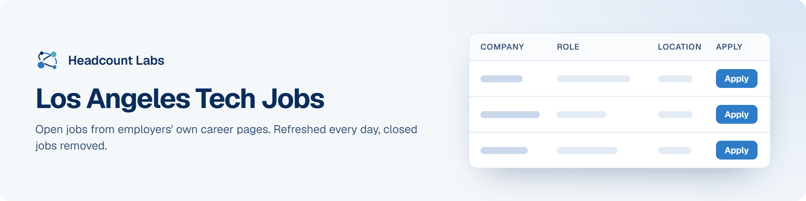

# Los Angeles Tech Jobs

Software, data, AI, product and design jobs in the Los Angeles area, sorted by field.

**201 open jobs** · 7 new since the last update · 85 removed because they closed or left the employer's board · updated November 21, 2026 at 5:22 AM EST

This list is built and refreshed every day by [Headcount Labs](https://headcountlabs.com/?utm_source=github&utm_medium=job-list&utm_campaign=los-angeles-tech-jobs), which reads jobs straight from employers' own career pages and job boards. Every job here was still listed on its source board when we last read that board, within the past 3 days, and was posted in the past 30 days. Copies of the same job are merged into one row, and jobs that close are removed at the next update.

Want this data in your own app or agent? Use the [Headcount Labs jobs API](https://headcountlabs.com/docs/?utm_source=github&utm_medium=job-list&utm_campaign=los-angeles-tech-jobs) (free tier), the [MCP server](https://headcountlabs.com/mcp/?utm_source=github&utm_medium=job-list&utm_campaign=los-angeles-tech-jobs) for Claude, ChatGPT and other AI assistants, or the [public dataset subsets](https://huggingface.co/HeadcountLabs) on Hugging Face (the full dataset is coming soon).

**Full dataset.** A bigger, one-off snapshot dated 2026-10-19 (all matching jobs, not only the open jobs below) is on Hugging Face: [Tech and software jobs](https://huggingface.co/datasets/HeadcountLabs/tech-jobs). It loads with `datasets.load_dataset` and is under the Open Database License (ODbL) 1.0.

**Jump to:** [Software engineering (86)](#software-engineering) · [Data, AI and machine learning (57)](#data-ai-and-machine-learning) · [Product and design (36)](#product-and-design) · [Hardware and engineering (22)](#hardware-and-engineering)

**Columns.** *Apply* opens the original posting on the employer's site. *Details* opens the job on Headcount Labs, with every posting we found for it. *Remote* shows what the employer states; a dash means the posting doesn't say. *Pay* is the range the employer published.

## Software engineering

| Company | Role | Location | Remote | Pay | Posted | Apply | Details |
| --- | --- | --- | --- | --- | --- | :---: | :---: |
| **Tatari** | Staff Backend Engineer | 

3 locations
San Francisco, CA New York, NY Los Angeles, CA
 | Hybrid | $190k–$225k/yr | Nov 20 |  | <a href="https://headcountlabs.com/catalog/jobs/c1e97054-c783-4be1-a9f5-e576352bd86e?utm_source=github&utm_medium=job-list&utm_campaign=los-angeles-tech-jobs">via Headcount Labs</a> |
| **Western Digital** | Spring 2027 Intern - Software Engineering | Irvine, CA | — | $24.13–$32.20/hr | Nov 18 |  | <a href="https://headcountlabs.com/catalog/jobs/fc25dc28-e67b-47f6-8cb6-79b734331aaa?utm_source=github&utm_medium=job-list&utm_campaign=los-angeles-tech-jobs">via Headcount Labs</a> |
| **Ventura Foods** | Associate Applications Developer (Oracle Fusion) | Irvine, CA | On-site | $76k–$97k/yr | Nov 18 |  | <a href="https://headcountlabs.com/catalog/jobs/3c9f7d8e-5e13-4d33-b047-a2e8b37a55a0?utm_source=github&utm_medium=job-list&utm_campaign=los-angeles-tech-jobs">via Headcount Labs</a> |
| **University of California, Irvine** | Cyber Risk Services Manager - Data Security - FT - Day | Irvine, CA | Remote | — | Nov 18 |  | <a href="https://headcountlabs.com/catalog/jobs/fa635b9c-8ef1-4f2f-8324-0b17b684c0e1?utm_source=github&utm_medium=job-list&utm_campaign=los-angeles-tech-jobs">via Headcount Labs</a> |
| **Panasonic** | Sr. Software Engineer | Irvine, CA | — | $119k–$200k/yr | Nov 18 |  | <a href="https://headcountlabs.com/catalog/jobs/b4542c23-a7aa-4706-8edc-77046c8c3a66?utm_source=github&utm_medium=job-list&utm_campaign=los-angeles-tech-jobs">via Headcount Labs</a> |
| **Hadrian Automation** | Software Engineer - Enterprise Apps | 

2 locations
Los Angeles, CA San Francisco Bay Area, CA
 | On-site | $143k–$171k/yr | Nov 18 |  | <a href="https://headcountlabs.com/catalog/jobs/254a4ef3-2a1e-4d4d-8141-565102b5e0dd?utm_source=github&utm_medium=job-list&utm_campaign=los-angeles-tech-jobs">via Headcount Labs</a> |
| **AXS** | Site Reliability Engineer II | Los Angeles, CA | Hybrid | $130k–$145k/yr | Nov 18 |  | <a href="https://headcountlabs.com/catalog/jobs/7211c2c4-2017-488b-8d90-058925f49612?utm_source=github&utm_medium=job-list&utm_campaign=los-angeles-tech-jobs">via Headcount Labs</a> |
| **StubHub** | Senior Software Engineer - Core Compute Platform | 

2 locations
New York, NY Los Angeles, CA
 | — | $200k–$250k/yr | Nov 17 |  | <a href="https://headcountlabs.com/catalog/jobs/7b47ea70-094b-4aec-83f4-cd49e5df7c71?utm_source=github&utm_medium=job-list&utm_campaign=los-angeles-tech-jobs">via Headcount Labs</a> |
| **Snap Inc.** | Embedded Software Engineer, Device Security, Level 4 | 

2 locations
Los Angeles, CA San Diego, CA
 | — | $157k–$235k/yr | Nov 17 |  | <a href="https://headcountlabs.com/catalog/jobs/d8afaa9b-dcf7-4986-a7ec-fc3a0d5a0b1e?utm_source=github&utm_medium=job-list&utm_campaign=los-angeles-tech-jobs">via Headcount Labs</a> |
| **Boeing** | Software Quality Engineer (Associate, Experienced or Senior) | 

2 locations
El Segundo, CA Los Angeles, CA
 | — | $94k–$136k/yr | Nov 17 |  | <a href="https://headcountlabs.com/catalog/jobs/7bc818b1-2d65-48da-9a83-43004003c3f6?utm_source=github&utm_medium=job-list&utm_campaign=los-angeles-tech-jobs">via Headcount Labs</a> |
| **Akima, LLC** | Software Engineer – SOMES Satellite Operations, Maintenance &amp; Engineering | Los Angeles, CA | — | $130k–$185k/yr | Nov 17 |  | <a href="https://headcountlabs.com/catalog/jobs/d9ad051d-cc02-41b9-9255-229c3de225d4?utm_source=github&utm_medium=job-list&utm_campaign=los-angeles-tech-jobs">via Headcount Labs</a> |
| **Rivian and Volkswagen Group Technologies** | Staff Software Systems Engineer | Irvine, CA | Hybrid | $171k–$235k/yr | Nov 16 |  | <a href="https://headcountlabs.com/catalog/jobs/26a9a083-0ff3-4ddb-8d7a-4329b18a0be1?utm_source=github&utm_medium=job-list&utm_campaign=los-angeles-tech-jobs">via Headcount Labs</a> |
| **First Resonance** | DevOps Engineer | Los Angeles, CA | On-site | $150k–$180k/yr | Nov 16 |  | <a href="https://headcountlabs.com/catalog/jobs/1cb06c06-6418-4a28-8d21-970cec657e21?utm_source=github&utm_medium=job-list&utm_campaign=los-angeles-tech-jobs">via Headcount Labs</a> |
| **Boeing** | Satellite Data Systems Full-Stack Software Engineer (Experienced or Senior) | 

2 locations
El Segundo, CA Los Angeles, CA
 | On-site | $127k–$171k/yr | Nov 16 |  | <a href="https://headcountlabs.com/catalog/jobs/2f287534-b653-4d0e-8d04-e30c60c29f33?utm_source=github&utm_medium=job-list&utm_campaign=los-angeles-tech-jobs">via Headcount Labs</a> |
| **Blizzard Entertainment** | Blizzard 2027 Summer Internships - Data Platform Engineering | Irvine, CA | On-site | $20–$50/hr | Nov 16 |  | <a href="https://headcountlabs.com/catalog/jobs/8c185db4-adcb-4044-9453-46b4cb69349a?utm_source=github&utm_medium=job-list&utm_campaign=los-angeles-tech-jobs">via Headcount Labs</a> |
| **Actalent** | Software Engineer 3 | Irvine, CA | On-site | $70–$85/hr | Nov 16 |  | <a href="https://headcountlabs.com/catalog/jobs/e5947102-a2b0-428d-b9f6-6dca47c316ca?utm_source=github&utm_medium=job-list&utm_campaign=los-angeles-tech-jobs">via Headcount Labs</a> |
| **Anduril Industries** | Platform Software Security Engineer, Air Defense | Irvine, CA | — | $167k–$222k/yr | Nov 14 |  | <a href="https://headcountlabs.com/catalog/jobs/a8a0f3d0-95d1-4a8a-ab1f-9ca48d4f8f5b?utm_source=github&utm_medium=job-list&utm_campaign=los-angeles-tech-jobs">via Headcount Labs</a> |
| **WSP** | Full Stack Software Engineer - UI/UX &amp; Web Engineering (Azure) | 

7 locations
Somerville, MA Washington, DC Seattle, WA Los Angeles, CA Chicago, IL Dallas, TX Boston, MA
 | On-site | $135k–$190k/yr | Nov 13 |  | <a href="https://headcountlabs.com/catalog/jobs/9f4b9f68-2704-42a7-b408-bfe1ce666a5e?utm_source=github&utm_medium=job-list&utm_campaign=los-angeles-tech-jobs">via Headcount Labs</a> |
| **Point B** | Manager, Software Engineer | Los Angeles, CA | Hybrid | $150k–$200k/yr | Nov 13 |  | <a href="https://headcountlabs.com/catalog/jobs/6c8b289a-13db-40c5-8c4a-387e38986aac?utm_source=github&utm_medium=job-list&utm_campaign=los-angeles-tech-jobs">via Headcount Labs</a> |
| **Panasonic** | Sr. Software Engineer - Backend | Irvine, CA | — | $100k–$167k/yr | Nov 13 |  | <a href="https://headcountlabs.com/catalog/jobs/0cf90b5a-2443-4b37-92ac-61744fc085cb?utm_source=github&utm_medium=job-list&utm_campaign=los-angeles-tech-jobs">via Headcount Labs</a> |
| **Panasonic** | MTS II, Software | Irvine, CA | — | $39.42–$66.35/hr | Nov 12 |  | <a href="https://headcountlabs.com/catalog/jobs/21063ea8-16a7-4ba8-a5db-5d8c25945be9?utm_source=github&utm_medium=job-list&utm_campaign=los-angeles-tech-jobs">via Headcount Labs</a> |
| **Hadrian Automation** | Software Engineer: Cell Orchestration / Machine Interface | Los Angeles, CA | On-site | $280k–$400k/yr | Nov 12 |  | <a href="https://headcountlabs.com/catalog/jobs/f631a5d3-932a-4000-bd91-3321d3aacaec?utm_source=github&utm_medium=job-list&utm_campaign=los-angeles-tech-jobs">via Headcount Labs</a> |
| **Commure** | Senior Software Engineer, Claims &amp; AI Billing | 

3 locations
Mountain View, CA Los Angeles, CA San Francisco, CA
 | Hybrid | $180k–$230k/yr | Nov 12 |  | <a href="https://headcountlabs.com/catalog/jobs/5cdf0080-8334-4020-af8d-efaf773992b4?utm_source=github&utm_medium=job-list&utm_campaign=los-angeles-tech-jobs">via Headcount Labs</a> |
| **Commure** | Staff Software Engineer, Claims &amp; AI Billing | 

3 locations
Mountain View, CA Los Angeles, CA San Francisco, CA
 | Hybrid | $210k–$275k/yr | Nov 12 |  | <a href="https://headcountlabs.com/catalog/jobs/1fe13523-c3d6-43b4-bc2f-4ea5b7b0d670?utm_source=github&utm_medium=job-list&utm_campaign=los-angeles-tech-jobs">via Headcount Labs</a> |
| **AXS** | Lead Software Engineer - Fullstack | Los Angeles, CA | Hybrid | $165k–$185k/yr | Nov 12 |  | <a href="https://headcountlabs.com/catalog/jobs/09f09b86-fed5-4a60-bfcd-8d8487677351?utm_source=github&utm_medium=job-list&utm_campaign=los-angeles-tech-jobs">via Headcount Labs</a> |
| **Alumni** | Lead Software Engineer – AWS and Terraform | Irvine, CA | Remote | $157k–$215k/yr | Nov 12 |  | <a href="https://headcountlabs.com/catalog/jobs/4e7274d9-50fb-4d62-9886-9765af109e4a?utm_source=github&utm_medium=job-list&utm_campaign=los-angeles-tech-jobs">via Headcount Labs</a> |
| **Commure** | Senior Software Engineer, Data Platform | 

4 locations
Mountain View, CA Los Angeles, CA New York City, NY San Francisco, CA
 | Hybrid | $180k–$230k/yr | Nov 11 |  | <a href="https://headcountlabs.com/catalog/jobs/d75b8cff-c839-422d-a4c2-d53370099304?utm_source=github&utm_medium=job-list&utm_campaign=los-angeles-tech-jobs">via Headcount Labs</a> |
| **Snap Inc.** | Staff Software Engineer, Android, Content | 

5 locations
Bellevue, WA Palo Alto, CA Los Angeles, CA San Francisco, CA New York, NY
 | — | $229k–$343k/yr | Nov 10 |  | <a href="https://headcountlabs.com/catalog/jobs/e11ac657-8e8a-4493-a6f7-02418a44f865?utm_source=github&utm_medium=job-list&utm_campaign=los-angeles-tech-jobs">via Headcount Labs</a> |
| **Rivian and Volkswagen Group Technologies** | Senior Software Systems, Battery Algorithms Engineer | Irvine, CA | Hybrid | $135k–$179k/yr | Nov 10 |  | <a href="https://headcountlabs.com/catalog/jobs/3eb191a1-ef73-479d-8d21-7742beecac86?utm_source=github&utm_medium=job-list&utm_campaign=los-angeles-tech-jobs">via Headcount Labs</a> |
| **Origence** | Staff Software Engineer | Irvine, CA | — | $145k–$185k/yr | Nov 10 |  | <a href="https://headcountlabs.com/catalog/jobs/c0b9dc78-bb18-4d0a-b920-953ce79b034b?utm_source=github&utm_medium=job-list&utm_campaign=los-angeles-tech-jobs">via Headcount Labs</a> |
| **Neon Aerospace** | Senior Embedded Systems Software Engineer | Irvine, CA | — | $150k–$200k/yr | Nov 10 |  | <a href="https://headcountlabs.com/catalog/jobs/7a6b52c5-ac97-4265-b656-8cacb29c9ef9?utm_source=github&utm_medium=job-list&utm_campaign=los-angeles-tech-jobs">via Headcount Labs</a> |
| **Hadrian Automation** | Director of Software Engineering, New Programs | Los Angeles, CA | On-site | $300k–$415k/yr | Nov 10 |  | <a href="https://headcountlabs.com/catalog/jobs/fd7bc0a6-60da-4b18-a589-68bde0efe141?utm_source=github&utm_medium=job-list&utm_campaign=los-angeles-tech-jobs">via Headcount Labs</a> |
| **Apex Technology, Inc.** | Site Reliability Engineer | Los Angeles, CA | On-site | $155k–$195k/yr | Nov 10 |  | <a href="https://headcountlabs.com/catalog/jobs/f3815193-cd80-4e1e-a045-b90a3ab2af9a?utm_source=github&utm_medium=job-list&utm_campaign=los-angeles-tech-jobs">via Headcount Labs</a> |
| **Rivian and Volkswagen Group Technologies** | Embedded Software Engineer II, Vehicle Core Software | Irvine, CA | Hybrid | $107k–$142k/yr | Nov 9 |  | <a href="https://headcountlabs.com/catalog/jobs/33565e2b-c287-409d-8285-2ecfa2cbb3d4?utm_source=github&utm_medium=job-list&utm_campaign=los-angeles-tech-jobs">via Headcount Labs</a> |
| **Rivian and Volkswagen Group Technologies** | Staff Functional Safety Engineer, Software | 

2 locations
Irvine, CA Palo Alto, CA
 | Hybrid | $171k–$227k/yr | Nov 9 |  | <a href="https://headcountlabs.com/catalog/jobs/285b1d8c-b06a-41f4-b7e7-bff26504c692?utm_source=github&utm_medium=job-list&utm_campaign=los-angeles-tech-jobs">via Headcount Labs</a> |
| **Pinterest** | Staff Software Engineer | 

4 locations
San Francisco, CA Los Angeles, CA Seattle, WA New York, NY
 | — | $208k–$365k/yr | Nov 9 |  | <a href="https://headcountlabs.com/catalog/jobs/740915ae-605b-4e53-95b1-13e3c7c621eb?utm_source=github&utm_medium=job-list&utm_campaign=los-angeles-tech-jobs">via Headcount Labs</a> |
| **FanDuel** | Software Engineer - Salesforce Tester | 

3 locations
Atlanta, GA Los Angeles, CA New York City
 | Hybrid | $98k–$122k/yr | Nov 9 |  | <a href="https://headcountlabs.com/catalog/jobs/8bbd9e7a-facb-43f9-b70e-bd232d7075cb?utm_source=github&utm_medium=job-list&utm_campaign=los-angeles-tech-jobs">via Headcount Labs</a> |
| **COGNIZANT TECH SOLUTIONS A** | Service Line Sales Specialist – Software &amp; Platform Engineering - Associate Director | Irvine, CA | Hybrid | $160k–$175k/yr | Nov 9 |  | <a href="https://headcountlabs.com/catalog/jobs/e58e763b-a889-4a63-be20-1f0a27912b16?utm_source=github&utm_medium=job-list&utm_campaign=los-angeles-tech-jobs">via Headcount Labs</a> |
| **Apex Technology, Inc.** | Senior Flight Software Engineer (TS Cleared) | Los Angeles, CA | On-site | $185k–$250k/yr | Nov 9 |  | <a href="https://headcountlabs.com/catalog/jobs/3407d9de-0d2d-4499-a8f6-33e2b5720958?utm_source=github&utm_medium=job-list&utm_campaign=los-angeles-tech-jobs">via Headcount Labs</a> |
| **Apex Technology, Inc.** | Senior Software Engineer, Embedded (TS Cleared) | Los Angeles, CA | — | $185k–$250k/yr | Nov 9 |  | <a href="https://headcountlabs.com/catalog/jobs/07331aaa-24ff-4e21-8b42-d4e991496dbb?utm_source=github&utm_medium=job-list&utm_campaign=los-angeles-tech-jobs">via Headcount Labs</a> |
| **Anduril Industries** | Software Engineer, Sentry Software (Ground Based Air Defense) | Irvine, CA | — | $167k–$222k/yr | Nov 9 |  | <a href="https://headcountlabs.com/catalog/jobs/dcd57577-e98f-460e-9db8-03aefb62fcea?utm_source=github&utm_medium=job-list&utm_campaign=los-angeles-tech-jobs">via Headcount Labs</a> |
| **Anduril Industries** | Software Engineer, Sentry Software (Allied Customer Deployment) | Irvine, CA | — | $167k–$222k/yr | Nov 9 |  | <a href="https://headcountlabs.com/catalog/jobs/6729b83d-890f-4950-badf-800c117f8cda?utm_source=github&utm_medium=job-list&utm_campaign=los-angeles-tech-jobs">via Headcount Labs</a> |
| **Anduril Industries** | Software Engineer, Sentry Software (Manufacturing) | Irvine, CA | — | $220k–$292k/yr | Nov 9 |  | <a href="https://headcountlabs.com/catalog/jobs/41aa23e3-5b3c-4ccb-8758-5d70dd46d956?utm_source=github&utm_medium=job-list&utm_campaign=los-angeles-tech-jobs">via Headcount Labs</a> |
| **Match Group** | iOS Engineer Intern | 

2 locations
Los Angeles, CA Palo Alto, CA
 | Hybrid | $47/hr | Nov 6 |  | <a href="https://headcountlabs.com/catalog/jobs/d8139979-bdfe-4a90-84ff-55161c8b623f?utm_source=github&utm_medium=job-list&utm_campaign=los-angeles-tech-jobs">via Headcount Labs</a> |
| **Match Group** | Android Engineer Intern | Los Angeles, CA | Hybrid | $47/hr | Nov 6 |  | <a href="https://headcountlabs.com/catalog/jobs/d2d9456a-ea73-4398-9daf-ce2cc27bfd21?utm_source=github&utm_medium=job-list&utm_campaign=los-angeles-tech-jobs">via Headcount Labs</a> |
| **Match Group** | Backend Engineer Intern | 

2 locations
Palo Alto, CA Los Angeles, CA
 | Hybrid | $47/hr | Nov 6 |  | <a href="https://headcountlabs.com/catalog/jobs/edaa70b5-fd99-4b14-888c-6478e5ab6292?utm_source=github&utm_medium=job-list&utm_campaign=los-angeles-tech-jobs">via Headcount Labs</a> |
| **Terran Orbital Corporation** | Principal Embedded Software Engineer | Irvine, CA | — | $175k–$230k/yr | Nov 5 |  | <a href="https://headcountlabs.com/catalog/jobs/fe2f0c51-b1a1-4650-88a9-566511774469?utm_source=github&utm_medium=job-list&utm_campaign=los-angeles-tech-jobs">via Headcount Labs</a> |
| **Red River** | Developer II, Software Web Development, Full Stack Developer | 

5 locations
San Francisco, CA Sacramento, CA San Diego, CA Los Angeles, CA San Jose, CA
 | — | $100k–$140k/yr | Nov 5 |  | <a href="https://headcountlabs.com/catalog/jobs/639d1977-369a-4995-b70e-069ed60da5e2?utm_source=github&utm_medium=job-list&utm_campaign=los-angeles-tech-jobs">via Headcount Labs</a> |
| **Panasonic** | Data Software Engineer Staff | Irvine, CA | — | $112k–$188k/yr | Nov 5 |  | <a href="https://headcountlabs.com/catalog/jobs/aa2af02a-602f-448b-85dc-e72f3567ff09?utm_source=github&utm_medium=job-list&utm_campaign=los-angeles-tech-jobs">via Headcount Labs</a> |
| **Apex Technology, Inc.** | Ground Software Engineering Internship (Spring or Summer 2027) | Los Angeles, CA | — | $45/hr | Nov 5 |  | <a href="https://headcountlabs.com/catalog/jobs/46cc8498-ed1a-491a-8903-3841d10e0442?utm_source=github&utm_medium=job-list&utm_campaign=los-angeles-tech-jobs">via Headcount Labs</a> |
| **Apex Technology, Inc.** | Software Engineering Internship, Embedded Systems (Spring or Summer 2027) | Los Angeles, CA | — | $45/hr | Nov 5 |  | <a href="https://headcountlabs.com/catalog/jobs/255961ea-5567-4e97-a6a9-c29442347cab?utm_source=github&utm_medium=job-list&utm_campaign=los-angeles-tech-jobs">via Headcount Labs</a> |
| **Apex Technology, Inc.** | Software Engineering Internship, Test &amp; Automation (Summer 2027) | Los Angeles, CA | — | $45/hr | Nov 5 |  | <a href="https://headcountlabs.com/catalog/jobs/db5db068-ae34-48d7-8035-3f282e7de08a?utm_source=github&utm_medium=job-list&utm_campaign=los-angeles-tech-jobs">via Headcount Labs</a> |
| **Twitch** | Software Dev Engineer I - Security Platform | 

3 locations
Seattle, WA San Francisco, CA Irvine, CA
 | — | $110k–$160k/yr | Nov 4 |  | <a href="https://headcountlabs.com/catalog/jobs/53de88fa-379f-467a-a13e-b1063c29329e?utm_source=github&utm_medium=job-list&utm_campaign=los-angeles-tech-jobs">via Headcount Labs</a> |
| **Quest Global** | Engineer - Software Support Python | Los Angeles, CA | On-site | $43–$62/hr | Nov 4 |  | <a href="https://headcountlabs.com/catalog/jobs/59138a39-c6f6-471c-86d3-458cbca9ef85?utm_source=github&utm_medium=job-list&utm_campaign=los-angeles-tech-jobs">via Headcount Labs</a> |
| **DoorDash USA** | Senior Software Engineer - Developer Experience, Android | 

5 locations
San Francisco, CA Sunnyvale, CA Los Angeles, CA Seattle, WA New York, NY
 | — | $160k–$235k/yr | Nov 4 |  | <a href="https://headcountlabs.com/catalog/jobs/18f8d991-059a-4fc1-b306-af64c1ad1bc2?utm_source=github&utm_medium=job-list&utm_campaign=los-angeles-tech-jobs">via Headcount Labs</a> |
| **K2 Space** | Senior Ground Software Engineer, Top Secret Clearance | Los Angeles, CA | — | $150k–$200k/yr | Nov 3 |  | <a href="https://headcountlabs.com/catalog/jobs/98298089-0824-47b2-a0b3-3a9512804708?utm_source=github&utm_medium=job-list&utm_campaign=los-angeles-tech-jobs">via Headcount Labs</a> |
| **K2 Space** | Ground Software Engineer, Top Secret Clearance | Los Angeles, CA | — | $123k–$150k/yr | Nov 3 |  | <a href="https://headcountlabs.com/catalog/jobs/47179993-daf7-4223-a174-9d5852c1129c?utm_source=github&utm_medium=job-list&utm_campaign=los-angeles-tech-jobs">via Headcount Labs</a> |
| **Apex Technology, Inc.** | Mission Security Engineer | Los Angeles, CA | On-site | $162k–$198k/yr | Nov 3 |  | <a href="https://headcountlabs.com/catalog/jobs/325e932b-bc89-4cc4-8f38-b47a897e0eb4?utm_source=github&utm_medium=job-list&utm_campaign=los-angeles-tech-jobs">via Headcount Labs</a> |
| **Prismatik** | Sr. QA Software Engineer (ISO 13485) | Irvine, CA | On-site | — | Nov 2 |  | <a href="https://headcountlabs.com/catalog/jobs/94d489ee-8ffb-4331-8ee0-a83da4b9f8d9?utm_source=github&utm_medium=job-list&utm_campaign=los-angeles-tech-jobs">via Headcount Labs</a> |
| **Snap Inc.** | Software Engineer, Specs Lenses C++, Level 5 | 

4 locations
Los Angeles, CA Bellevue, WA Palo Alto, CA San Francisco, CA
 | — | $209k–$313k/yr | Nov 1 |  | <a href="https://headcountlabs.com/catalog/jobs/a5e37b07-1d90-44da-b8fc-af99d1014d6f?utm_source=github&utm_medium=job-list&utm_campaign=los-angeles-tech-jobs">via Headcount Labs</a> |
| **Tillster** | SOFTWARE ENGINEER – BACK END | Los Angeles, CA | Hybrid | $95k–$125k/yr | Oct 30 |  | <a href="https://headcountlabs.com/catalog/jobs/f001c05c-0917-40e3-bfc5-b1c5f96724da?utm_source=github&utm_medium=job-list&utm_campaign=los-angeles-tech-jobs">via Headcount Labs</a> |
| **Snap Inc.** | Staff Security Engineer, Level 6, Application Security | 

3 locations
Bellevue, WA Palo Alto, CA Los Angeles, CA
 | — | $251k–$377k/yr | Oct 30 |  | <a href="https://headcountlabs.com/catalog/jobs/cb7e83f5-40cc-43ce-8448-39c602443cc9?utm_source=github&utm_medium=job-list&utm_campaign=los-angeles-tech-jobs">via Headcount Labs</a> |
| **Snap Inc.** | Software Engineer, Augmented Reality, Level 4 | 

3 locations
Palo Alto, CA Los Angeles, CA San Francisco, CA
 | — | $157k–$235k/yr | Oct 30 |  | <a href="https://headcountlabs.com/catalog/jobs/e6a2890b-778b-44ab-86eb-07e9bb53e234?utm_source=github&utm_medium=job-list&utm_campaign=los-angeles-tech-jobs">via Headcount Labs</a> |
| **K2 Space** | Technical Program Manager, Flight Software | Los Angeles, CA | On-site | $165k–$235k/yr | Oct 29 |  | <a href="https://headcountlabs.com/catalog/jobs/7dda2868-0987-48fd-a9ab-10f31b273b97?utm_source=github&utm_medium=job-list&utm_campaign=los-angeles-tech-jobs">via Headcount Labs</a> |
| **Glidewell Dental** | Sr. Information Security Engineer | Irvine, CA | — | $145k–$173k/yr | Oct 29 |  | <a href="https://headcountlabs.com/catalog/jobs/baaa1e1a-289e-42f7-a0c6-2a54c7090b5b?utm_source=github&utm_medium=job-list&utm_campaign=los-angeles-tech-jobs">via Headcount Labs</a> |
| **Antares** | Senior-Staff Enterprise Software Engineer | Los Angeles, CA | — | $175k–$260k/yr | Oct 29 |  | <a href="https://headcountlabs.com/catalog/jobs/0364a534-a32b-4d18-af88-68cceb3d9573?utm_source=github&utm_medium=job-list&utm_campaign=los-angeles-tech-jobs">via Headcount Labs</a> |
| **Anduril Industries** | Senior Software Engineer, Manufacturing | Irvine, CA | — | $191k–$254k/yr | Oct 29 |  | <a href="https://headcountlabs.com/catalog/jobs/0dbd689c-0e8a-405f-a883-b735f26dfa1b?utm_source=github&utm_medium=job-list&utm_campaign=los-angeles-tech-jobs">via Headcount Labs</a> |
| **Snap Inc.** | Staff Software Engineer, Backend, Level 6 | 

5 locations
New York, NY San Francisco, CA Bellevue, WA Los Angeles, CA Palo Alto, CA
 | — | $229k–$343k/yr | Oct 28 |  | <a href="https://headcountlabs.com/catalog/jobs/0f6e2225-7fcc-412d-b9d4-dbd363a039ae?utm_source=github&utm_medium=job-list&utm_campaign=los-angeles-tech-jobs">via Headcount Labs</a> |
| **GoodLeap** | Senior Software Engineer, Payments | 

6 locations
Roseville Irvine, CA Lehi, UT Plano, TX San Francisco, CA United States
 | Hybrid | $146k–$187k/yr | Oct 28 |  | <a href="https://headcountlabs.com/catalog/jobs/9656c556-aa80-4b28-a8ab-961790719e9c?utm_source=github&utm_medium=job-list&utm_campaign=los-angeles-tech-jobs">via Headcount Labs</a> |
| **Commure** | Senior Fullstack Engineer, Air AI | 

4 locations
Mountain View, CA Los Angeles, CA New York City, NY San Francisco, CA
 | — | $170k–$230k/yr | Oct 28 |  | <a href="https://headcountlabs.com/catalog/jobs/37ca1771-dd22-470a-90f9-5ff7a7db6043?utm_source=github&utm_medium=job-list&utm_campaign=los-angeles-tech-jobs">via Headcount Labs</a> |
| **Hadrian Automation** | All Levels: Frontend Software Engineer | 

2 locations
Los Angeles, CA San Francisco Bay Area, CA
 | On-site | $220k–$320k/yr | Oct 27 |  | <a href="https://headcountlabs.com/catalog/jobs/e9506125-797a-41ee-8641-1fc246ca9f7f?utm_source=github&utm_medium=job-list&utm_campaign=los-angeles-tech-jobs">via Headcount Labs</a> |
| **SMX** | JAVA Software Engineer (5775) (Boulder, CO) (TS/SCI) | 

4 locations
Boulder, CO Los Angeles, CA San Diego, CA Washington, DC
 | On-site | $110k–$155k/yr | Oct 26 |  | <a href="https://headcountlabs.com/catalog/jobs/5fcfcfd2-daea-4a1a-88db-ec3b16fd4ea4?utm_source=github&utm_medium=job-list&utm_campaign=los-angeles-tech-jobs">via Headcount Labs</a> |
| **Rivian and Volkswagen Group Technologies** | Software Engineer, ES&amp;D Low Voltage | Irvine, CA | Hybrid | $107k–$147k/yr | Oct 26 |  | <a href="https://headcountlabs.com/catalog/jobs/6c5e01e0-0f84-41b8-88b7-d9b0e92a8868?utm_source=github&utm_medium=job-list&utm_campaign=los-angeles-tech-jobs">via Headcount Labs</a> |
| **Panasonic** | Principal Software Engineer — Distributed Systems, Connected Platforms &amp; AI | Irvine, CA | — | $171k–$268k/yr | Oct 26 |  | <a href="https://headcountlabs.com/catalog/jobs/31a17693-d656-4957-873c-08c9089a8b2d?utm_source=github&utm_medium=job-list&utm_campaign=los-angeles-tech-jobs">via Headcount Labs</a> |
| **LPA, Inc.** | Power Platform Developer | 

7 locations
Irvine, CA Austin, TX Sacramento, CA San Jose, CA San Antonio, TX San Diego, CA Dallas, TX
 | Hybrid | $110k–$130k/yr | Oct 26 |  | <a href="https://headcountlabs.com/catalog/jobs/259dedd8-b6de-4798-b5f9-466189652907?utm_source=github&utm_medium=job-list&utm_campaign=los-angeles-tech-jobs">via Headcount Labs</a> |
| **Lockheed Martin** | Full Stack Engineer Stf - E4 | Irvine, CA | — | — | Oct 26 |  | <a href="https://headcountlabs.com/catalog/jobs/7cf40ec1-415a-4065-bf3f-c13659b57bc3?utm_source=github&utm_medium=job-list&utm_campaign=los-angeles-tech-jobs">via Headcount Labs</a> |
| **Alumni** | Dev Ops Software Engineer II - .NET/C# | Irvine, CA | On-site | $124k–$150k/yr | Oct 26 |  | <a href="https://headcountlabs.com/catalog/jobs/588626f7-c053-48c5-a803-bd036b403c47?utm_source=github&utm_medium=job-list&utm_campaign=los-angeles-tech-jobs">via Headcount Labs</a> |
| **Terran Orbital Corporation** | Flight Software Engineer | Irvine, CA | — | $125k–$150k/yr | Oct 23 |  | <a href="https://headcountlabs.com/catalog/jobs/f72f2b97-0754-468f-8b3f-e8618810a801?utm_source=github&utm_medium=job-list&utm_campaign=los-angeles-tech-jobs">via Headcount Labs</a> |
| **Rivian and Volkswagen Group Technologies** | Staff Data Platform Engineer | Irvine, CA | Hybrid | $154k–$212k/yr | Oct 23 |  | <a href="https://headcountlabs.com/catalog/jobs/7f5078c0-f5fb-4b38-a9b2-97fde5cfcfe5?utm_source=github&utm_medium=job-list&utm_campaign=los-angeles-tech-jobs">via Headcount Labs</a> |
| **Panasonic** | Senior Software​ Engineer - Android/AOSP | Irvine, CA | — | $112k–$188k/yr | Oct 23 |  | <a href="https://headcountlabs.com/catalog/jobs/52a2bcd6-c6ef-4aae-a9a8-bfb75ec98ec4?utm_source=github&utm_medium=job-list&utm_campaign=los-angeles-tech-jobs">via Headcount Labs</a> |
| **Turion Space** | Staff Ground Software Engineer | Irvine, CA | On-site | $175k–$225k/yr | Oct 22 |  | <a href="https://headcountlabs.com/catalog/jobs/2b9f1081-d2eb-4000-8a20-ec7bbfbbf667?utm_source=github&utm_medium=job-list&utm_campaign=los-angeles-tech-jobs">via Headcount Labs</a> |
| **Rivian and Volkswagen Group Technologies** | Software Engineering Intern - Connected Systems (Summer 2027) | 

2 locations
Palo Alto, CA Irvine, CA
 | Hybrid | $47–$51/hr | Oct 22 |  | <a href="https://headcountlabs.com/catalog/jobs/90075345-f0d2-4da4-8cfa-98406679a068?utm_source=github&utm_medium=job-list&utm_campaign=los-angeles-tech-jobs">via Headcount Labs</a> |
| **Rivian and Volkswagen Group Technologies** | Software Engineering Intern - Applications (Summer 2027) | 

2 locations
Palo Alto, CA Irvine, CA
 | Hybrid | $47–$51/hr | Oct 22 |  | <a href="https://headcountlabs.com/catalog/jobs/f05ae9ae-1bb4-4f92-874a-6027d0e1a9aa?utm_source=github&utm_medium=job-list&utm_campaign=los-angeles-tech-jobs">via Headcount Labs</a> |
| **Commure** | Senior Software Engineer, Autonomous Revenue Operations | 

3 locations
Mountain View, CA Los Angeles, CA San Francisco, CA
 | Hybrid | $180k–$230k/yr | Oct 22 |  | <a href="https://headcountlabs.com/catalog/jobs/1eeeb780-445f-481f-acbc-b1ec7984dd40?utm_source=github&utm_medium=job-list&utm_campaign=los-angeles-tech-jobs">via Headcount Labs</a> |
| **CHAOS Industries** | GNC Software Engineer | 

2 locations
El Segundo, CA Los Angeles, CA
 | On-site | $160k–$240k/yr | Oct 22 |  | <a href="https://headcountlabs.com/catalog/jobs/707ea452-7949-4e33-97e2-fa4cdc6a9e64?utm_source=github&utm_medium=job-list&utm_campaign=los-angeles-tech-jobs">via Headcount Labs</a> |
| **Anduril Industries** | Staff Software Engineer | Irvine, CA | — | $220k–$292k/yr | Oct 22 |  | <a href="https://headcountlabs.com/catalog/jobs/789d63e3-e5b1-488b-9338-1ea03b6fbd27?utm_source=github&utm_medium=job-list&utm_campaign=los-angeles-tech-jobs">via Headcount Labs</a> |

## Data, AI and machine learning

| Company | Role | Location | Remote | Pay | Posted | Apply | Details |
| --- | --- | --- | --- | --- | --- | :---: | :---: |
| **OnTarget Communications** | Flight Data Monitoring Manager | 

32 locations
Austin, TX Stans Aix-en-Provence Auch Milan Rome Sevilla Barcelona Rio de Janeiro São José dos Campos Stuttgart Berlin +20 more
 | On-site | — | Nov 19 |  | <a href="https://headcountlabs.com/catalog/jobs/58e2a858-aa46-4645-b73c-4d79e91eb93d?utm_source=github&utm_medium=job-list&utm_campaign=los-angeles-tech-jobs">via Headcount Labs</a> |
| **University of California, Irvine** | IT Architect 4 TX - Enterprise Data and Analytics - FT - Day | Irvine, CA | Remote | — | Nov 18 |  | <a href="https://headcountlabs.com/catalog/jobs/8b1a331f-7cb8-4876-9759-b50d73c4d2fd?utm_source=github&utm_medium=job-list&utm_campaign=los-angeles-tech-jobs">via Headcount Labs</a> |
| **Paramount** | Lead Data Engineer | Los Angeles, CA | On-site | $139k–$209k/yr | Nov 18 |  | <a href="https://headcountlabs.com/catalog/jobs/e398c9ce-23e4-434f-b79a-9c2c4a7309cf?utm_source=github&utm_medium=job-list&utm_campaign=los-angeles-tech-jobs">via Headcount Labs</a> |
| **Paramount** | Lead ML Engineer | Los Angeles, CA | — | $157k–$235k/yr | Nov 18 |  | <a href="https://headcountlabs.com/catalog/jobs/3c5cc97e-dcc5-41b4-9dae-b3623917d5ab?utm_source=github&utm_medium=job-list&utm_campaign=los-angeles-tech-jobs">via Headcount Labs</a> |
| **NORC** | Field Data Collector | Los Angeles, CA | — | $19.50–$24/hr | Nov 18 |  | <a href="https://headcountlabs.com/catalog/jobs/3813dc84-6707-4bf1-8588-681f7ba305ae?utm_source=github&utm_medium=job-list&utm_campaign=los-angeles-tech-jobs">via Headcount Labs</a> |
| **CSHS** | Pharmacy Program Coordinator - Data Analyst | Los Angeles, CA | — | — | Nov 18 |  | <a href="https://headcountlabs.com/catalog/jobs/6f537ff7-957a-4507-bd4a-b1df1cfde934?utm_source=github&utm_medium=job-list&utm_campaign=los-angeles-tech-jobs">via Headcount Labs</a> |
| **CSHS** | Clinical Research Data Specialist I - Heart Institute - Chugh Team | Los Angeles, CA | — | — | Nov 18 |  | <a href="https://headcountlabs.com/catalog/jobs/4bf2caee-aec8-4da0-a2a7-a3c650f2884e?utm_source=github&utm_medium=job-list&utm_campaign=los-angeles-tech-jobs">via Headcount Labs</a> |
| **City National Bank** | Data Associate Analyst | Los Angeles, CA | — | $34.55–$55.19/hr | Nov 18 |  | <a href="https://headcountlabs.com/catalog/jobs/7247527a-e7f7-4b72-a5cf-193054815943?utm_source=github&utm_medium=job-list&utm_campaign=los-angeles-tech-jobs">via Headcount Labs</a> |
| **Cedars-Sinai** | Pharmacy Program Coordinator - Data Analyst | Los Angeles, CA | Hybrid | $78.86–$126.18/hr | Nov 18 |  | <a href="https://headcountlabs.com/catalog/jobs/96535778-e725-44a5-ad5f-be66b9434759?utm_source=github&utm_medium=job-list&utm_campaign=los-angeles-tech-jobs">via Headcount Labs</a> |
| **Cedars-Sinai** | Clinical Research Data Specialist I - Heart Institute - Chugh Team | Los Angeles, CA | On-site | $25–$40.55/hr | Nov 18 |  | <a href="https://headcountlabs.com/catalog/jobs/7ea4ed36-c7b0-41db-94ac-3e6cf2c28b84?utm_source=github&utm_medium=job-list&utm_campaign=los-angeles-tech-jobs">via Headcount Labs</a> |
| **Academy Of Motion Picture Arts and Sciences** | Specialist, Data Analytics | Los Angeles, CA | On-site | $26.44–$28.85/hr | Nov 18 |  | <a href="https://headcountlabs.com/catalog/jobs/8cf33c93-8eed-4726-b0e5-de9ef33379b2?utm_source=github&utm_medium=job-list&utm_campaign=los-angeles-tech-jobs">via Headcount Labs</a> |
| **ŌURA** | Senior Data Analyst, Hardware | 

4 locations
Los Angeles, CA San Francisco, CA Boston, MA New York, NY
 | Remote | $174k–$205k/yr | Nov 17 |  | <a href="https://headcountlabs.com/catalog/jobs/508c0d21-ad0d-4369-9d2e-9e3552a03817?utm_source=github&utm_medium=job-list&utm_campaign=los-angeles-tech-jobs">via Headcount Labs</a> |
| **UCLA Extension** | Data Science Instructor - Pool - UCLA Extension | Los Angeles, CA | — | — | Nov 17 |  | <a href="https://headcountlabs.com/catalog/jobs/4bf91449-4b5e-43f3-b976-93126fd5b592?utm_source=github&utm_medium=job-list&utm_campaign=los-angeles-tech-jobs">via Headcount Labs</a> |
| **STIIIZY** | Data Entry Operator | Los Angeles, CA | On-site | — | Nov 17 |  | <a href="https://headcountlabs.com/catalog/jobs/4a3fd622-d443-4111-8732-542214ef4299?utm_source=github&utm_medium=job-list&utm_campaign=los-angeles-tech-jobs">via Headcount Labs</a> |
| **Oracle** | Senior Data Center Support Services Technician | Los Angeles, CA | On-site | $27.64–$56.83/hr | Nov 17 |  | <a href="https://headcountlabs.com/catalog/jobs/90122b63-20ab-4add-88f6-119dd5a7fde3?utm_source=github&utm_medium=job-list&utm_campaign=los-angeles-tech-jobs">via Headcount Labs</a> |
| **ASPCA** | Senior Enterprise Data Engineer - (on site Los Angeles) | 

2 locations
Los Angeles, CA Los Angeles metropolitan area, CA
 | On-site | $138k–$143k/yr | Nov 17 |  | <a href="https://headcountlabs.com/catalog/jobs/0599f9e7-7463-45f3-88c7-1c0db2002046?utm_source=github&utm_medium=job-list&utm_campaign=los-angeles-tech-jobs">via Headcount Labs</a> |
| **University of California, Irvine** | RESEARCH DATA ANALYST 3 | Irvine, CA | — | $92k–$112k/yr | Nov 16 |  | <a href="https://headcountlabs.com/catalog/jobs/f8409247-e13c-408f-82c6-137ec30330f8?utm_source=github&utm_medium=job-list&utm_campaign=los-angeles-tech-jobs">via Headcount Labs</a> |
| **Rethink recruit** | Founding AI / LLM Engineer | Los Angeles, CA | — | — | Nov 16 |  | <a href="https://headcountlabs.com/catalog/jobs/efc94dd3-cc16-453f-8869-388ac0fc5001?utm_source=github&utm_medium=job-list&utm_campaign=los-angeles-tech-jobs">via Headcount Labs</a> |
| **Oracle** | NA Sales Representative, Data Platform Healthcare | 

3 locations
San Francisco, CA Los Angeles, CA United States
 | Hybrid | $110k–$194k/yr | Nov 16 |  | <a href="https://headcountlabs.com/catalog/jobs/ebe82bfc-45aa-45d2-a2f5-1742089c7cee?utm_source=github&utm_medium=job-list&utm_campaign=los-angeles-tech-jobs">via Headcount Labs</a> |
| **L.A. Care Health Plan** | Risk Adjustment Analytics Data Analyst III | Los Angeles, CA | — | $89k/yr | Nov 16 |  | <a href="https://headcountlabs.com/catalog/jobs/0ae46d7c-e0e2-48d7-abaa-12da21e9e0da?utm_source=github&utm_medium=job-list&utm_campaign=los-angeles-tech-jobs">via Headcount Labs</a> |
| **L.A. Care Health Plan** | Network Strategy Analytics Data Analyst III | Los Angeles, CA | — | $89k/yr | Nov 16 |  | <a href="https://headcountlabs.com/catalog/jobs/03935b81-b4fd-4329-a596-1d417a659e29?utm_source=github&utm_medium=job-list&utm_campaign=los-angeles-tech-jobs">via Headcount Labs</a> |
| **Kia Corporation** | Sr. CRM &amp; CX Data Manager | Irvine, CA | — | $115k–$162k/yr | Nov 16 |  | <a href="https://headcountlabs.com/catalog/jobs/10ae7e76-4422-4122-a331-cb30967ea3dd?utm_source=github&utm_medium=job-list&utm_campaign=los-angeles-tech-jobs">via Headcount Labs</a> |
| **First Resonance** | Data Engineer | Los Angeles, CA | On-site | $140k–$180k/yr | Nov 16 |  | <a href="https://headcountlabs.com/catalog/jobs/07b7f3ee-1fcf-48e7-bc8c-95e4baa57bc3?utm_source=github&utm_medium=job-list&utm_campaign=los-angeles-tech-jobs">via Headcount Labs</a> |
| **The Regents of the University of California on behalf of their Los Angeles Campus** | Inclusive Excellence Researcher and Data Analyst | Los Angeles, CA | — | — | Nov 14 |  | <a href="https://headcountlabs.com/catalog/jobs/67b8af49-6fef-4326-9b10-28420f29228f?utm_source=github&utm_medium=job-list&utm_campaign=los-angeles-tech-jobs">via Headcount Labs</a> |
| **L.A. Care Health Plan** | Senior Data Analyst, (Care Delivery Analytics) | Los Angeles, CA | — | $89k/yr | Nov 14 |  | <a href="https://headcountlabs.com/catalog/jobs/cfb26533-6181-4957-8903-d60f6b189f6c?utm_source=github&utm_medium=job-list&utm_campaign=los-angeles-tech-jobs">via Headcount Labs</a> |
| **Kia Corporation** | Field Data Analysis Engineer | Irvine, CA | — | $77k–$100k/yr | Nov 14 |  | <a href="https://headcountlabs.com/catalog/jobs/a90d837b-1a83-4b22-a754-c1ad5b536e31?utm_source=github&utm_medium=job-list&utm_campaign=los-angeles-tech-jobs">via Headcount Labs</a> |
| **Panasonic** | AI Automation Process Assurance Engineer I | Irvine, CA | — | $69k–$115k/yr | Nov 13 |  | <a href="https://headcountlabs.com/catalog/jobs/439def04-446e-40d5-9dd5-a02f72dabdb2?utm_source=github&utm_medium=job-list&utm_campaign=los-angeles-tech-jobs">via Headcount Labs</a> |
| **BKF** | Senior Data Analyst - Deltek Vantagepoint | 

6 locations
Los Angeles, CA Riverside, CA Sacramento, CA San Diego, CA San Francisco, CA San Luis Obispo, CA
 | Hybrid | — | Nov 13 |  | <a href="https://headcountlabs.com/catalog/jobs/a823b8b5-657f-4c38-b743-6a341d53874e?utm_source=github&utm_medium=job-list&utm_campaign=los-angeles-tech-jobs">via Headcount Labs</a> |
| **Pragmatike** | Research Engineer, Synthetic Data (Pacific Time) | 

4 locations
United States Sacramento, CA Los Angeles, CA San Francisco, CA
 | Remote | — | Nov 12 |  | <a href="https://headcountlabs.com/catalog/jobs/6d1982af-1b5e-479c-96d2-6401cda461ba?utm_source=github&utm_medium=job-list&utm_campaign=los-angeles-tech-jobs">via Headcount Labs</a> |
| **Zones LLC.** | STAFF/Senior Systems Engineer - Data Center &amp; Server Infrastructure | Irvine, CA | On-site | — | Nov 10 |  | <a href="https://headcountlabs.com/catalog/jobs/75442945-fd31-43d6-8e47-a11cd7be54f6?utm_source=github&utm_medium=job-list&utm_campaign=los-angeles-tech-jobs">via Headcount Labs</a> |
| **K2 Space** | Data Engineer | Los Angeles, CA | — | $120k–$160k/yr | Nov 10 |  | <a href="https://headcountlabs.com/catalog/jobs/4773ac47-0cb0-4b51-8777-694ceb8c83c5?utm_source=github&utm_medium=job-list&utm_campaign=los-angeles-tech-jobs">via Headcount Labs</a> |
| **JPMC** | Lead Data Engineer - DBA | Irvine, CA | On-site | $147k–$190k/yr | Nov 9 |  | <a href="https://headcountlabs.com/catalog/jobs/604ef878-f021-46a8-9972-c086e0259923?utm_source=github&utm_medium=job-list&utm_campaign=los-angeles-tech-jobs">via Headcount Labs</a> |
| **Chase-** | Lead Data Engineer - DBA | Irvine, CA | On-site | $147k–$190k/yr | Nov 9 |  | <a href="https://headcountlabs.com/catalog/jobs/a6f98ad3-5ed6-49f2-bb90-61a810acac85?utm_source=github&utm_medium=job-list&utm_campaign=los-angeles-tech-jobs">via Headcount Labs</a> |
| **Alumni** | Lead Data Engineer - DBA | Irvine, CA | On-site | $147k–$190k/yr | Nov 9 |  | <a href="https://headcountlabs.com/catalog/jobs/77fbab47-04e4-47bd-a225-0926cbaf91c4?utm_source=github&utm_medium=job-list&utm_campaign=los-angeles-tech-jobs">via Headcount Labs</a> |
| **Tetra Tech, Inc** | Data Center Commissioning Authority | Los Angeles, CA | — | $140k–$180k/yr | Nov 6 |  | <a href="https://headcountlabs.com/catalog/jobs/44b64f34-a567-4fd6-be3d-5d6f3652dda5?utm_source=github&utm_medium=job-list&utm_campaign=los-angeles-tech-jobs">via Headcount Labs</a> |
| **Tetra Tech, Inc** | Data Center Commissioning Agent | Los Angeles, CA | — | $85k–$100k/yr | Nov 6 |  | <a href="https://headcountlabs.com/catalog/jobs/88f60862-41c0-41cc-acdc-1a6efbcf41d7?utm_source=github&utm_medium=job-list&utm_campaign=los-angeles-tech-jobs">via Headcount Labs</a> |
| **Flexstaf IT** | Oracle Fusion Technical Data Conversion Lead | Irvine, CA | — | — | Nov 6 |  | <a href="https://headcountlabs.com/catalog/jobs/867f1caa-a01d-40e3-ae37-d7cd711ede5c?utm_source=github&utm_medium=job-list&utm_campaign=los-angeles-tech-jobs">via Headcount Labs</a> |
| **DoorDash USA** | Manager, New Verticals - In-Store Data Platform Strategy &amp; Operations | 

7 locations
New York, NY San Francisco, CA Seattle, WA Los Angeles, CA Washington, DC Chicago, IL Tempe, AZ
 | — | $136k–$200k/yr | Nov 6 |  | <a href="https://headcountlabs.com/catalog/jobs/8b2bd479-eeaf-46e5-898a-4f5449c383ff?utm_source=github&utm_medium=job-list&utm_campaign=los-angeles-tech-jobs">via Headcount Labs</a> |
| **StubHub** | Senior Data Scientist | 

2 locations
New York, NY Los Angeles, CA
 | — | $200k–$250k/yr | Nov 5 |  | <a href="https://headcountlabs.com/catalog/jobs/f8d4a328-70f7-41e2-afa3-0f0ee307d026?utm_source=github&utm_medium=job-list&utm_campaign=los-angeles-tech-jobs">via Headcount Labs</a> |
| **Match Group** | Staff Engineer, Applied AI | 

3 locations
Palo Alto, CA Los Angeles, CA San Francisco, CA
 | On-site | $225k–$265k/yr | Nov 5 |  | <a href="https://headcountlabs.com/catalog/jobs/862c5767-fa27-401e-996c-915efa10832a?utm_source=github&utm_medium=job-list&utm_campaign=los-angeles-tech-jobs">via Headcount Labs</a> |
| **TowardJobs** | Work at home Data Entry Clerk - Part Time | Irvine, CA | Remote | — | Nov 4 |  | <a href="https://headcountlabs.com/catalog/jobs/87a0aa6b-c1b3-4d1c-8271-f407e1b52948?utm_source=github&utm_medium=job-list&utm_campaign=los-angeles-tech-jobs">via Headcount Labs</a> |
| **Cedars-Sinai** | Principal Data Intelligence Analyst (Clinical Operations) - Hybrid | Los Angeles, CA | Remote | $144k–$208k/yr | Nov 4 |  | <a href="https://headcountlabs.com/catalog/jobs/3826e7c4-3823-475b-907c-3a0cdcc39024?utm_source=github&utm_medium=job-list&utm_campaign=los-angeles-tech-jobs">via Headcount Labs</a> |
| **Ventura Foods** | Senior Data Engineer | Irvine, CA | Hybrid | $131k–$172k/yr | Nov 3 |  | <a href="https://headcountlabs.com/catalog/jobs/a55b5dc2-de7f-46f1-b938-d535212526e3?utm_source=github&utm_medium=job-list&utm_campaign=los-angeles-tech-jobs">via Headcount Labs</a> |
| **Crowell &amp; Moring** | Director of eDiscovery and Data Solutions | 

7 locations
Boston, MA Chicago, IL Denver, CO Irvine, CA Los Angeles, CA New York, NY Washington, DC
 | Remote | $195k–$290k/yr | Nov 3 |  | <a href="https://headcountlabs.com/catalog/jobs/2abee024-4cb7-4238-a6e7-dc84f8e8c8dd?utm_source=github&utm_medium=job-list&utm_campaign=los-angeles-tech-jobs">via Headcount Labs</a> |
| **Paramount** | Senior Data Engineer | 

3 locations
Los Angeles, CA New York, NY Fort Lauderdale, FL
 | — | $110k–$166k/yr | Nov 2 |  | <a href="https://headcountlabs.com/catalog/jobs/9b54b96e-94b3-4304-a0b8-577c4f3e7f6c?utm_source=github&utm_medium=job-list&utm_campaign=los-angeles-tech-jobs">via Headcount Labs</a> |
| **Auction.com** | Sr. Director of Data Intake Operations | Irvine, CA | On-site | — | Nov 2 |  | <a href="https://headcountlabs.com/catalog/jobs/a775f6f3-9bb7-46d7-92ed-13d941e3e1b0?utm_source=github&utm_medium=job-list&utm_campaign=los-angeles-tech-jobs">via Headcount Labs</a> |
| **COPE Health Solutions** | Senior Consultant, Health Care Data Analytics | Los Angeles, CA | — | $112k–$139k/yr | Oct 30 |  | <a href="https://headcountlabs.com/catalog/jobs/958a8b74-e975-4895-a3c5-dd103e94b743?utm_source=github&utm_medium=job-list&utm_campaign=los-angeles-tech-jobs">via Headcount Labs</a> |
| **Tillster** | Data Analyst | Los Angeles, CA | Hybrid | $90k–$130k/yr | Oct 29 |  | <a href="https://headcountlabs.com/catalog/jobs/c5e9504e-b96c-4278-ac05-942e64f7ae23?utm_source=github&utm_medium=job-list&utm_campaign=los-angeles-tech-jobs">via Headcount Labs</a> |
| **Trace3** | Data Center Technician (On-site) | Irvine, CA | On-site | $32–$39/hr | Oct 27 |  | <a href="https://headcountlabs.com/catalog/jobs/f8c567ef-50d2-41d9-a397-fba08dd8e88f?utm_source=github&utm_medium=job-list&utm_campaign=los-angeles-tech-jobs">via Headcount Labs</a> |
| **Metropolis** | Senior Product Manager, Applied AI | 

3 locations
Seattle, WA New York, NY Los Angeles, CA
 | — | $170k/yr | Oct 27 |  | <a href="https://headcountlabs.com/catalog/jobs/32c55c73-a0e2-43b7-a7a7-135934ea7d09?utm_source=github&utm_medium=job-list&utm_campaign=los-angeles-tech-jobs">via Headcount Labs</a> |
| **Linktree** | Senior Data Scientist | 

4 locations
San Francisco, CA Melbourne Sydney Los Angeles, CA
 | — | $147k–$182k/yr | Oct 27 |  | <a href="https://headcountlabs.com/catalog/jobs/440ab964-adc4-42b0-a0a8-b3a10ab170b8?utm_source=github&utm_medium=job-list&utm_campaign=los-angeles-tech-jobs">via Headcount Labs</a> |
| **Centerfield** | Data Scientist | Los Angeles, CA | Hybrid | $95k–$115k/yr | Oct 26 |  | <a href="https://headcountlabs.com/catalog/jobs/cf5e34c6-3a9f-4028-86d9-2f19e8d32b4f?utm_source=github&utm_medium=job-list&utm_campaign=los-angeles-tech-jobs">via Headcount Labs</a> |
| **Abbvie** | Manager, Market Access Data Strategy and Business Intelligence | Irvine, CA | — | $110k–$208k/yr | Oct 26 |  | <a href="https://headcountlabs.com/catalog/jobs/c74d558f-5b02-490d-8e2e-ce978530deb9?utm_source=github&utm_medium=job-list&utm_campaign=los-angeles-tech-jobs">via Headcount Labs</a> |
| **AXS** | SVP - Data Engineering, Data Science &amp; Analytics | 

2 locations
San Francisco, CA Los Angeles, CA
 | Hybrid | $450k–$500k/yr | Oct 23 |  | <a href="https://headcountlabs.com/catalog/jobs/0fc199fd-9f04-4cf1-80e8-d02c82fe51c6?utm_source=github&utm_medium=job-list&utm_campaign=los-angeles-tech-jobs">via Headcount Labs</a> |
| **Tillster** | Senior Data Engineer | Los Angeles, CA | Hybrid | $140k–$160k/yr | Oct 22 |  | <a href="https://headcountlabs.com/catalog/jobs/5cc508a8-2964-4942-a308-0677f05251e5?utm_source=github&utm_medium=job-list&utm_campaign=los-angeles-tech-jobs">via Headcount Labs</a> |
| **Scribd, Inc.** | Principal Engineer ( AI + Dev Tooling) | 

11 locations
San Francisco, CA Toronto Los Angeles, CA Denver, CO Chicago, IL New York City, NY Vancouver Seattle, WA Austin, TX Boston, MA Dallas, TX
 | Hybrid | — | Oct 22 |  | <a href="https://headcountlabs.com/catalog/jobs/bda31c49-41a4-4a70-9551-8d1dd1d049f6?utm_source=github&utm_medium=job-list&utm_campaign=los-angeles-tech-jobs">via Headcount Labs</a> |
| **Scribd, Inc.** | Senior Machine Learning Engineer, Premium Discovery | 

6 locations
San Francisco, CA Toronto Los Angeles, CA New York City, NY Vancouver Seattle, WA
 | Hybrid | — | Oct 22 |  | <a href="https://headcountlabs.com/catalog/jobs/79abb5ba-1388-4110-a580-157ecdedbaf7?utm_source=github&utm_medium=job-list&utm_campaign=los-angeles-tech-jobs">via Headcount Labs</a> |

## Product and design

| Company | Role | Location | Remote | Pay | Posted | Apply | Details |
| --- | --- | --- | --- | --- | --- | :---: | :---: |
| **True Talent Solutions Partners** | Product Manager, Supply Chain | Los Angeles, CA | On-site | $175k–$200k/yr | Nov 18 |  | <a href="https://headcountlabs.com/catalog/jobs/52510733-ac29-4665-ae25-9075959d51a5?utm_source=github&utm_medium=job-list&utm_campaign=los-angeles-tech-jobs">via Headcount Labs</a> |
| **PRTNR Recruiting** | Designer – Handbags | Los Angeles, CA | — | — | Nov 18 |  | <a href="https://headcountlabs.com/catalog/jobs/6d165f7d-c0f9-4466-a13d-c15e2f21b652?utm_source=github&utm_medium=job-list&utm_campaign=los-angeles-tech-jobs">via Headcount Labs</a> |
| **Pinterest** | Director, Product Management - Personalization &amp; Marketplace | 

4 locations
Palo Alto, CA San Francisco, CA Seattle, WA Los Angeles, CA
 | Hybrid | — | Nov 18 |  | <a href="https://headcountlabs.com/catalog/jobs/b17f4ec5-326d-4de5-ab16-0caf06465609?utm_source=github&utm_medium=job-list&utm_campaign=los-angeles-tech-jobs">via Headcount Labs</a> |
| **Fanatics Collectibles** | Senior Product Designer | Los Angeles, CA | — | $110k–$140k/yr | Nov 18 |  | <a href="https://headcountlabs.com/catalog/jobs/6ac75f05-7c47-430e-ae6f-9549b713b539?utm_source=github&utm_medium=job-list&utm_campaign=los-angeles-tech-jobs">via Headcount Labs</a> |
| **CreatorIQ** | Instructional Designer, Customer Education &amp; Enablement | 

5 locations
United States Chicago, IL Los Angeles, CA San Francisco, CA Austin, TX
 | Remote | $82k–$98k/yr | Nov 18 |  | <a href="https://headcountlabs.com/catalog/jobs/3f4b48b0-e559-4ff2-8fb4-abb8dd1997a7?utm_source=github&utm_medium=job-list&utm_campaign=los-angeles-tech-jobs">via Headcount Labs</a> |
| **PRTNR Recruiting** | Designer / Senior Designer, Woven Missy | Los Angeles, CA | — | — | Nov 17 |  | <a href="https://headcountlabs.com/catalog/jobs/97a2b8f4-2b6f-4e17-981b-2813651aab81?utm_source=github&utm_medium=job-list&utm_campaign=los-angeles-tech-jobs">via Headcount Labs</a> |
| **Madhappy** | Technical Designer | Los Angeles, CA | On-site | $75k–$90k/yr | Nov 17 |  | <a href="https://headcountlabs.com/catalog/jobs/71143148-4876-442c-b882-5421145cfc53?utm_source=github&utm_medium=job-list&utm_campaign=los-angeles-tech-jobs">via Headcount Labs</a> |
| **IA** | Lighting Designer | Los Angeles, CA | — | $70k–$90k/yr | Nov 17 |  | <a href="https://headcountlabs.com/catalog/jobs/ad907a32-d49f-401f-b6a5-e3732f8ff4a8?utm_source=github&utm_medium=job-list&utm_campaign=los-angeles-tech-jobs">via Headcount Labs</a> |
| **CRB** | Mechanical Designer II | Los Angeles, CA | Hybrid | $70k–$92k/yr | Nov 17 |  | <a href="https://headcountlabs.com/catalog/jobs/7e5a8f1c-44d4-4a6a-8ca5-87df43744e80?utm_source=github&utm_medium=job-list&utm_campaign=los-angeles-tech-jobs">via Headcount Labs</a> |
| **Lionakis** | Designer- Education | Irvine, CA | Hybrid | $62k–$99k/yr | Nov 16 |  | <a href="https://headcountlabs.com/catalog/jobs/57f9e3a2-28cc-4a19-84f3-9bfc8e93c3d9?utm_source=github&utm_medium=job-list&utm_campaign=los-angeles-tech-jobs">via Headcount Labs</a> |
| **Hadrian Automation** | Global Product Manager | Los Angeles, CA | On-site | $180k–$270k/yr | Nov 16 |  | <a href="https://headcountlabs.com/catalog/jobs/d9a5c0d0-f8c7-4872-a1f1-474e757036ef?utm_source=github&utm_medium=job-list&utm_campaign=los-angeles-tech-jobs">via Headcount Labs</a> |
| **Actalent** | Architectural Designer | Irvine, CA | Hybrid | $45–$57.69/hr | Nov 16 |  | <a href="https://headcountlabs.com/catalog/jobs/c61ef3c0-5ebd-42f8-8713-358cc7d129ce?utm_source=github&utm_medium=job-list&utm_campaign=los-angeles-tech-jobs">via Headcount Labs</a> |
| **Ware Malcomb** | Senior Experiential Designer, Brand Experience Studio | Los Angeles, CA | Hybrid | $90k–$120k/yr | Nov 13 |  | <a href="https://headcountlabs.com/catalog/jobs/d5ed298c-6c2a-4a0d-8e55-64e018f45f43?utm_source=github&utm_medium=job-list&utm_campaign=los-angeles-tech-jobs">via Headcount Labs</a> |
| **Navan** | Brand Designer | 

2 locations
Los Angeles, CA San Francisco, CA
 | — | $94k–$210k/yr | Nov 11 |  | <a href="https://headcountlabs.com/catalog/jobs/9e85e27d-81bd-4eb9-b909-e85d24d1c1da?utm_source=github&utm_medium=job-list&utm_campaign=los-angeles-tech-jobs">via Headcount Labs</a> |
| **Observable Space** | Sr. Industrial Designer | Los Angeles, CA | Hybrid | $115k–$175k/yr | Nov 9 |  | <a href="https://headcountlabs.com/catalog/jobs/9d7fd9e0-2eee-4cb6-afc9-03a3d3c8229f?utm_source=github&utm_medium=job-list&utm_campaign=los-angeles-tech-jobs">via Headcount Labs</a> |
| **Kia Corporation** | Product Manager -Connected Car | Irvine, CA | — | $109k–$147k/yr | Nov 9 |  | <a href="https://headcountlabs.com/catalog/jobs/ef3c2bf4-a717-4ca1-86b1-01a6fa79f310?utm_source=github&utm_medium=job-list&utm_campaign=los-angeles-tech-jobs">via Headcount Labs</a> |
| **Cantina** | Sr. Product Designer | 

2 locations
Los Angeles, CA San Francisco, CA
 | Hybrid | — | Nov 9 |  | <a href="https://headcountlabs.com/catalog/jobs/06973ee6-0137-4162-b500-0db2765bdcea?utm_source=github&utm_medium=job-list&utm_campaign=los-angeles-tech-jobs">via Headcount Labs</a> |
| **Apex Technology, Inc.** | Graphic Designer, Business Development | Los Angeles, CA | — | $80k–$100k/yr | Nov 9 |  | <a href="https://headcountlabs.com/catalog/jobs/e068b53b-8ca0-44dc-b7c9-bf6e79acf951?utm_source=github&utm_medium=job-list&utm_campaign=los-angeles-tech-jobs">via Headcount Labs</a> |
| **Hyundai Motor Company** | Kia Design - Designer | Irvine, CA | — | $100k–$160k/yr | Nov 8 |  | <a href="https://headcountlabs.com/catalog/jobs/4611f313-7d97-4192-8e3d-879504149b33?utm_source=github&utm_medium=job-list&utm_campaign=los-angeles-tech-jobs">via Headcount Labs</a> |
| **Snap Inc.** | Product Manager, Ad Tech | 

6 locations
Los Angeles, CA Chicago, IL New York, NY San Francisco, CA Bellevue, WA Palo Alto, CA
 | — | $209k–$313k/yr | Nov 7 |  | <a href="https://headcountlabs.com/catalog/jobs/d2ce6fa2-1467-485e-89da-9fa4965aab9c?utm_source=github&utm_medium=job-list&utm_campaign=los-angeles-tech-jobs">via Headcount Labs</a> |
| **IPS-Integrated Project Services** | Architectural Designer I/II | 

9 locations
Blue Bell, PA Burlington, MA Somerset, NJ Cherry Hill, NJ Cary, NC Leawood, KS Emeryville, CA Irvine, CA Germantown, MD
 | — | $67k–$102k/yr | Nov 6 |  | <a href="https://headcountlabs.com/catalog/jobs/d8bc4765-173c-414b-9b2b-2cba44d05bdc?utm_source=github&utm_medium=job-list&utm_campaign=los-angeles-tech-jobs">via Headcount Labs</a> |
| **The Regents of the University of California on behalf of their Los Angeles Campus** | Instructional Designer (ID) | Los Angeles, CA | — | — | Nov 5 |  | <a href="https://headcountlabs.com/catalog/jobs/3458055c-35bc-411b-a02a-3a468abeb47a?utm_source=github&utm_medium=job-list&utm_campaign=los-angeles-tech-jobs">via Headcount Labs</a> |
| **Crunchyroll, LLC** | Staff Product Manager, Access &amp; Identity Management | 

3 locations
Dallas, TX Los Angeles, CA San Francisco, CA
 | Hybrid | $195k–$243k/yr | Nov 5 |  | <a href="https://headcountlabs.com/catalog/jobs/0d10eb6c-c695-4138-9adf-4763b02160cb?utm_source=github&utm_medium=job-list&utm_campaign=los-angeles-tech-jobs">via Headcount Labs</a> |
| **PepsiCo** | Senior Graphic Designer - Culture/Campaign (poppi) | 

4 locations
Austin, TX Los Angeles, CA Purchase, NY Plano, TX
 | — | $88k–$148k/yr | Nov 3 |  | <a href="https://headcountlabs.com/catalog/jobs/f0d6151d-51f9-4285-9851-d3b30e2d7bbe?utm_source=github&utm_medium=job-list&utm_campaign=los-angeles-tech-jobs">via Headcount Labs</a> |
| **AXS** | Sr Product Manager, Resale Platform Experience | 

2 locations
Scottsdale, AZ Los Angeles, CA
 | Hybrid | $127k–$135k/yr | Nov 3 |  | <a href="https://headcountlabs.com/catalog/jobs/e623e1c6-a5d1-40c3-a773-bffd26d2d794?utm_source=github&utm_medium=job-list&utm_campaign=los-angeles-tech-jobs">via Headcount Labs</a> |
| **Cantina** | Sr. Visual Designer | Los Angeles, CA | Hybrid | — | Oct 30 |  | <a href="https://headcountlabs.com/catalog/jobs/a8c31053-fd9c-4ce1-a789-e436b521d028?utm_source=github&utm_medium=job-list&utm_campaign=los-angeles-tech-jobs">via Headcount Labs</a> |
| **MobilityWare** | Systems Designer | Irvine, CA | — | $85k–$105k/yr | Oct 29 |  | <a href="https://headcountlabs.com/catalog/jobs/79518690-08a6-4456-9717-3d36feeaa4ba?utm_source=github&utm_medium=job-list&utm_campaign=los-angeles-tech-jobs">via Headcount Labs</a> |
| **Hyundai Motor Company** | Hyundai Design Center - Sr. Interior Designer | Irvine, CA | — | — | Oct 29 |  | <a href="https://headcountlabs.com/catalog/jobs/70557270-3238-498c-b3ad-29f0804812a2?utm_source=github&utm_medium=job-list&utm_campaign=los-angeles-tech-jobs">via Headcount Labs</a> |
| **Hyundai Motor Company** | Hyundai Design Center - Interior Designer I | Irvine, CA | — | — | Oct 29 |  | <a href="https://headcountlabs.com/catalog/jobs/643beb36-3258-49ca-8509-063fa05b3048?utm_source=github&utm_medium=job-list&utm_campaign=los-angeles-tech-jobs">via Headcount Labs</a> |
| **Crunchyroll, LLC** | Staff Technical Product Manager | Los Angeles, CA | Hybrid | $195k–$243k/yr | Oct 29 |  | <a href="https://headcountlabs.com/catalog/jobs/1e259d55-b89d-4cf3-8ec2-9618c82e946f?utm_source=github&utm_medium=job-list&utm_campaign=los-angeles-tech-jobs">via Headcount Labs</a> |
| **Snap Inc.** | Staff Product Manager, Ads Measurement | 

6 locations
Bellevue, WA Chicago, IL Palo Alto, CA Los Angeles, CA New York, NY San Francisco, CA
 | — | $229k–$343k/yr | Oct 27 |  | <a href="https://headcountlabs.com/catalog/jobs/cc40afb4-6575-415d-8669-fc841c33d8c1?utm_source=github&utm_medium=job-list&utm_campaign=los-angeles-tech-jobs">via Headcount Labs</a> |
| **Nitra** | Product Manager, HealthTech | Los Angeles, CA | Hybrid | $120k–$180k/yr | Oct 27 |  | <a href="https://headcountlabs.com/catalog/jobs/1abc36b4-7278-4f4b-8119-1f980fac2626?utm_source=github&utm_medium=job-list&utm_campaign=los-angeles-tech-jobs">via Headcount Labs</a> |
| **Nitra** | Product Manager, Fintech (Payroll, Recruiting &amp; Staffing) | Los Angeles, CA | Hybrid | $120k–$180k/yr | Oct 27 |  | <a href="https://headcountlabs.com/catalog/jobs/f36240fb-91e0-4eed-ab3c-c7764b7a3ab7?utm_source=github&utm_medium=job-list&utm_campaign=los-angeles-tech-jobs">via Headcount Labs</a> |
| **Fehr &amp; Peers** | Experienced Complete Streets Designer/Civil Engineer | Los Angeles, CA | On-site | $110k–$155k/yr | Oct 26 |  | <a href="https://headcountlabs.com/catalog/jobs/8057fe9a-d010-4693-b097-92e5e0c509fe?utm_source=github&utm_medium=job-list&utm_campaign=los-angeles-tech-jobs">via Headcount Labs</a> |
| **Stantec** | In-Building Wireless (DAS) Designer | 

6 locations
Chicago, IL Atlanta, GA San Francisco, CA Seattle, WA Los Angeles, CA Austin, TX
 | Hybrid | $113k–$170k/yr | Oct 23 |  | <a href="https://headcountlabs.com/catalog/jobs/025eb25a-5b91-4b3a-8715-f24e336f3183?utm_source=github&utm_medium=job-list&utm_campaign=los-angeles-tech-jobs">via Headcount Labs</a> |
| **Scribd, Inc.** | Lead Product Manager, Everand | 

11 locations
San Francisco, CA Toronto Los Angeles, CA Denver, CO Chicago, IL New York City, NY Vancouver Seattle, WA Austin, TX Boston, MA Dallas, TX
 | Hybrid | — | Oct 23 |  | <a href="https://headcountlabs.com/catalog/jobs/848a1874-872e-4d59-bf46-2cf88a21de03?utm_source=github&utm_medium=job-list&utm_campaign=los-angeles-tech-jobs">via Headcount Labs</a> |

## Hardware and engineering

| Company | Role | Location | Remote | Pay | Posted | Apply | Details |
| --- | --- | --- | --- | --- | --- | :---: | :---: |
| **OnTarget Communications** | Senior Mechatronics Systems Engineer | 

51 locations
Austin, TX Stans Milan Rome Sevilla Madrid Barcelona Stuttgart Wessling Berlin São José dos Campos Natal +39 more
 | On-site | — | Nov 19 |  | <a href="https://headcountlabs.com/catalog/jobs/aa94864f-3a80-4725-b1f1-5fd579af1543?utm_source=github&utm_medium=job-list&utm_campaign=los-angeles-tech-jobs">via Headcount Labs</a> |
| **Boeing** | Systems Engineer - Digital Signal Processing (Associate or Mid-level) | 

2 locations
El Segundo, CA Los Angeles, CA
 | — | $99k–$133k/yr | Nov 17 |  | <a href="https://headcountlabs.com/catalog/jobs/07306769-9ee3-4f15-bd39-ee8d8cdcf6df?utm_source=github&utm_medium=job-list&utm_campaign=los-angeles-tech-jobs">via Headcount Labs</a> |
| **Boeing** | Optical Systems Engineer (Entry Level) - Millennium Space Systems | 

2 locations
El Segundo, CA Los Angeles, CA
 | — | $71k–$104k/yr | Nov 16 |  | <a href="https://headcountlabs.com/catalog/jobs/cf150f34-8f17-4a21-a300-bf2c4aa0bbba?utm_source=github&utm_medium=job-list&utm_campaign=los-angeles-tech-jobs">via Headcount Labs</a> |
| **Boeing** | Quality Systems Engineer - Millennium Space Systems | 

2 locations
El Segundo, CA Los Angeles, CA
 | — | $89k–$131k/yr | Nov 16 |  | <a href="https://headcountlabs.com/catalog/jobs/a90ee525-9185-4549-8bf6-1b5ca97716e2?utm_source=github&utm_medium=job-list&utm_campaign=los-angeles-tech-jobs">via Headcount Labs</a> |
| **Boeing** | Optical Systems Engineer (Mid-Career) - Millennium Space Systems | 

2 locations
El Segundo, CA Los Angeles, CA
 | — | $99k–$177k/yr | Nov 16 |  | <a href="https://headcountlabs.com/catalog/jobs/2117d52e-8e43-41bb-a41d-c5590c216662?utm_source=github&utm_medium=job-list&utm_campaign=los-angeles-tech-jobs">via Headcount Labs</a> |
| **Boeing** | Lead or Senior Satellite Systems Ground Systems Engineer | 

3 locations
El Segundo, CA Seal Beach, CA Los Angeles, CA
 | — | $146k–$198k/yr | Nov 15 |  | <a href="https://headcountlabs.com/catalog/jobs/5d144a47-a54a-46b7-b161-30efee619512?utm_source=github&utm_medium=job-list&utm_campaign=los-angeles-tech-jobs">via Headcount Labs</a> |
| **Boeing** | Mid-level Ground Systems Engineer for MILSATCOM Program | 

2 locations
El Segundo, CA Los Angeles, CA
 | — | $120k–$162k/yr | Nov 15 |  | <a href="https://headcountlabs.com/catalog/jobs/9ab88369-b545-490c-969c-828e45f7a622?utm_source=github&utm_medium=job-list&utm_campaign=los-angeles-tech-jobs">via Headcount Labs</a> |
| **JPMC** | Technology Support II - AWS - Systems Engineer | Irvine, CA | On-site | $86k–$130k/yr | Nov 9 |  | <a href="https://headcountlabs.com/catalog/jobs/712f7831-64cd-43dc-b424-4618b424404c?utm_source=github&utm_medium=job-list&utm_campaign=los-angeles-tech-jobs">via Headcount Labs</a> |
| **Chase-** | Technology Support II - AWS - Systems Engineer | Irvine, CA | On-site | $86k–$130k/yr | Nov 9 |  | <a href="https://headcountlabs.com/catalog/jobs/70b660a9-8f14-4134-8561-10d2ceba7053?utm_source=github&utm_medium=job-list&utm_campaign=los-angeles-tech-jobs">via Headcount Labs</a> |
| **Alumni** | Technology Support II - AWS - Systems Engineer | Irvine, CA | On-site | $86k–$130k/yr | Nov 9 |  | <a href="https://headcountlabs.com/catalog/jobs/107df589-d464-403e-888a-dde79a9698ee?utm_source=github&utm_medium=job-list&utm_campaign=los-angeles-tech-jobs">via Headcount Labs</a> |
| **Turion Space** | Systems Engineer, Electro-Optical Payload Electronics &amp; Integration | Irvine, CA | On-site | $125k–$175k/yr | Nov 5 |  | <a href="https://headcountlabs.com/catalog/jobs/f8c367dc-57cb-4e48-ae29-117d4974035a?utm_source=github&utm_medium=job-list&utm_campaign=los-angeles-tech-jobs">via Headcount Labs</a> |
| **Glidewell Dental** | Sr. Network Engineer | Irvine, CA | — | $118k–$155k/yr | Nov 4 |  | <a href="https://headcountlabs.com/catalog/jobs/6720c798-d340-4ec6-9b7d-92d8704e08c0?utm_source=github&utm_medium=job-list&utm_campaign=los-angeles-tech-jobs">via Headcount Labs</a> |
| **Karman Industries** | Lead Fluid Systems Engineer | Los Angeles, CA | On-site | $125k–$175k/yr | Oct 30 |  | <a href="https://headcountlabs.com/catalog/jobs/f889f15b-c4aa-4463-9fb8-8fe0c925948b?utm_source=github&utm_medium=job-list&utm_campaign=los-angeles-tech-jobs">via Headcount Labs</a> |
| **Karman Industries** | Senior Embedded Systems Engineer | Los Angeles, CA | On-site | $125k–$175k/yr | Oct 30 |  | <a href="https://headcountlabs.com/catalog/jobs/f55b3471-9b4d-4367-a9bf-fe815893616f?utm_source=github&utm_medium=job-list&utm_campaign=los-angeles-tech-jobs">via Headcount Labs</a> |
| **Karman Industries** | Senior Thermal Systems Engineer | Los Angeles, CA | On-site | $125k–$175k/yr | Oct 30 |  | <a href="https://headcountlabs.com/catalog/jobs/ebd4d87f-6d0d-47e2-ab7a-0385d7133bdd?utm_source=github&utm_medium=job-list&utm_campaign=los-angeles-tech-jobs">via Headcount Labs</a> |
| **Karman Industries** | Staff Embedded Systems Engineer | Los Angeles, CA | On-site | $155k–$225k/yr | Oct 30 |  | <a href="https://headcountlabs.com/catalog/jobs/6896a988-0236-4f99-9d7c-4db1fc44df0d?utm_source=github&utm_medium=job-list&utm_campaign=los-angeles-tech-jobs">via Headcount Labs</a> |
| **Turion Space** | Spacecraft Systems Engineer | Irvine, CA | On-site | $125k–$175k/yr | Oct 29 |  | <a href="https://headcountlabs.com/catalog/jobs/a4635224-4f21-4cfb-aa7f-69bdeb53cfee?utm_source=github&utm_medium=job-list&utm_campaign=los-angeles-tech-jobs">via Headcount Labs</a> |
| **Neon Aerospace** | Senior Systems Engineer | Irvine, CA | — | $150k–$175k/yr | Oct 28 |  | <a href="https://headcountlabs.com/catalog/jobs/38c6fc11-d2a4-4446-abc1-7fa6c4dd480b?utm_source=github&utm_medium=job-list&utm_campaign=los-angeles-tech-jobs">via Headcount Labs</a> |
| **OSI Digital** | Systems Engineer - Windows Server, VMware, and AWS ,Citrix | Irvine, CA | On-site | $20–$65/hr | Oct 27 |  | <a href="https://headcountlabs.com/catalog/jobs/a561f5d8-b8ce-4e23-bcaf-ae428c2be697?utm_source=github&utm_medium=job-list&utm_campaign=los-angeles-tech-jobs">via Headcount Labs</a> |
| **OSI Digital** | Network Engineer | Irvine, CA | On-site | $25–$65/hr | Oct 27 |  | <a href="https://headcountlabs.com/catalog/jobs/4ca49e17-ddd9-4bb8-b81b-b5c8371bc67a?utm_source=github&utm_medium=job-list&utm_campaign=los-angeles-tech-jobs">via Headcount Labs</a> |
| **AnySignal** | Senior RF Systems Engineer - Ground Systems | Los Angeles, CA | On-site | $150k–$180k/yr | Oct 27 |  | <a href="https://headcountlabs.com/catalog/jobs/99528877-931a-4970-a5c0-edb91454aed2?utm_source=github&utm_medium=job-list&utm_campaign=los-angeles-tech-jobs">via Headcount Labs</a> |
| **Freeform** | Senior IT Systems Engineer | Los Angeles, CA | On-site | $160k–$215k/yr | Oct 22 |  | <a href="https://headcountlabs.com/catalog/jobs/117b6982-9d65-4900-8766-9727882947c2?utm_source=github&utm_medium=job-list&utm_campaign=los-angeles-tech-jobs">via Headcount Labs</a> |

## Related data on Headcount Labs

- [Job postings data for California](https://headcountlabs.com/data/job-postings-california-us/)
- [Software engineer salary data from posted pay](https://headcountlabs.com/salary-data/software-engineer/)
- [US job market report: open jobs by state, top employers, pay and remote share](https://headcountlabs.com/reports/us-job-market/)

## More lists from Headcount Labs

[Software Engineering Internships](https://github.com/HeadcountLabs/software-engineering-internships) · [Data Science, AI and Machine Learning Internships](https://github.com/HeadcountLabs/data-science-ai-internships) · [Engineering Internships](https://github.com/HeadcountLabs/engineering-internships) · [Business, Finance and Marketing Internships](https://github.com/HeadcountLabs/business-finance-internships) · [Internships in the US](https://github.com/HeadcountLabs/internships) · [New Grad Software Engineer Jobs](https://github.com/HeadcountLabs/new-grad-software-engineer-jobs) · [Entry-Level and New Grad Jobs](https://github.com/HeadcountLabs/entry-level-jobs) · [Entry-Level Data Analyst Jobs](https://github.com/HeadcountLabs/entry-level-data-analyst-jobs) · [Remote Software Engineer Jobs](https://github.com/HeadcountLabs/remote-software-engineer-jobs) · [Remote Data, AI and Machine Learning Jobs](https://github.com/HeadcountLabs/remote-data-jobs) · [Remote Product Manager Jobs](https://github.com/HeadcountLabs/remote-product-manager-jobs) · [Remote Marketing Jobs](https://github.com/HeadcountLabs/remote-marketing-jobs) · [Remote Sales Jobs](https://github.com/HeadcountLabs/remote-sales-jobs) · [Remote Customer Support and Success Jobs](https://github.com/HeadcountLabs/remote-customer-support-jobs) · [Remote Healthcare Jobs](https://github.com/HeadcountLabs/remote-healthcare-jobs) · [Remote Finance and Accounting Jobs](https://github.com/HeadcountLabs/remote-finance-accounting-jobs) · [Remote Jobs in the US](https://github.com/HeadcountLabs/remote-jobs) · [AI and Machine Learning Engineer Jobs](https://github.com/HeadcountLabs/ai-ml-engineer-jobs) · [Data Engineer Jobs](https://github.com/HeadcountLabs/data-engineer-jobs) · [Cybersecurity Jobs](https://github.com/HeadcountLabs/cybersecurity-jobs) · [Product Manager Jobs](https://github.com/HeadcountLabs/product-manager-jobs) · [Registered Nurse Jobs](https://github.com/HeadcountLabs/registered-nurse-jobs) · [Software Jobs Paying $200k+](https://github.com/HeadcountLabs/high-paying-software-jobs) · [Tech and Software Jobs in the US](https://github.com/HeadcountLabs/tech-jobs) · [Jobs with Salary Listed in the US](https://github.com/HeadcountLabs/pay-transparency-jobs) · [San Francisco Bay Area Tech Jobs](https://github.com/HeadcountLabs/bay-area-tech-jobs) · [New York City Tech Jobs](https://github.com/HeadcountLabs/new-york-tech-jobs) · [Seattle Tech Jobs](https://github.com/HeadcountLabs/seattle-tech-jobs) · [Austin Tech Jobs](https://github.com/HeadcountLabs/austin-tech-jobs) · [Boston Tech Jobs](https://github.com/HeadcountLabs/boston-tech-jobs) · [Washington, DC Tech Jobs](https://github.com/HeadcountLabs/washington-dc-tech-jobs)

## Contributing

This README is generated, so edits to it are overwritten at the next update. If a job is closed, a link is broken or a detail is wrong, [open an issue](../../issues/new) with the link and we'll fix it in the data, which fixes it everywhere. Requests for new lists are welcome too.

## License

The list data is under the [Open Database License (ODbL) 1.0](LICENSE). Our own values in it are under the [Database Contents License (DbCL) 1.0](https://opendatacommons.org/licenses/dbcl/1-0/). Credit "Headcount Labs (https://headcountlabs.com)" when you reuse it. Job description text is the employer's own text and is not licensed by us. Takedown requests: [https://headcountlabs.com/remove/](https://headcountlabs.com/remove/). Location data includes data from OpenStreetMap contributors (ODbL) and Overture Maps. The same rows are in [`data/jobs.csv`](data/jobs.csv).

Generated by Headcount Labs from the jobs API on November 21, 2026 at 5:22 AM EST. At most 8 jobs per employer are shown in each list.
