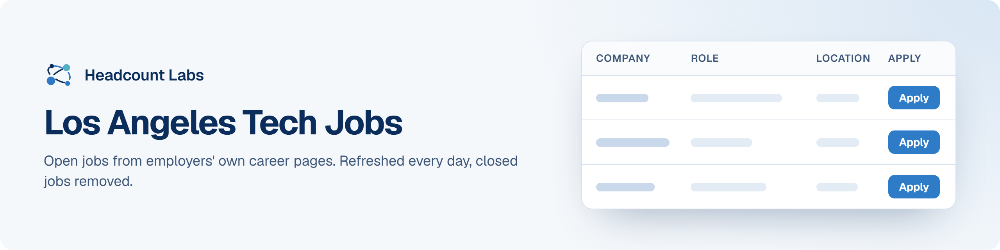

# Los Angeles Tech Jobs

Software, data, AI, product and design jobs in the Los Angeles area, sorted by field.

**316 open jobs** · 166 new since the last update · 152 removed because they closed or left the employer's board · updated November 7, 2026 at 5:11 AM EST

This list is built and refreshed every day by [Headcount Labs](https://headcountlabs.com/?utm_source=github&utm_medium=job-list&utm_campaign=los-angeles-tech-jobs), which reads jobs straight from employers' own career pages and job boards. Every job here was still listed on its source board when we last read that board, within the past 3 days, and was posted in the past 30 days. Copies of the same job are merged into one row, and jobs that close are removed at the next update.

Want this data in your own app or agent? Use the [Headcount Labs jobs API](https://headcountlabs.com/docs/?utm_source=github&utm_medium=job-list&utm_campaign=los-angeles-tech-jobs) (free tier), the [MCP server](https://headcountlabs.com/mcp/?utm_source=github&utm_medium=job-list&utm_campaign=los-angeles-tech-jobs) for Claude, ChatGPT and other AI assistants, or the [public dataset subsets](https://huggingface.co/HeadcountLabs) on Hugging Face (the full dataset is coming soon).

**Full dataset.** A bigger, one-off snapshot dated 2026-10-19 (all matching jobs, not only the open jobs below) is on Hugging Face: [Tech and software jobs](https://huggingface.co/datasets/HeadcountLabs/tech-jobs). It loads with `datasets.load_dataset` and is under the Open Database License (ODbL) 1.0.

**Jump to:** [Software engineering (131)](#software-engineering) · [Data, AI and machine learning (101)](#data-ai-and-machine-learning) · [Product and design (59)](#product-and-design) · [Hardware and engineering (25)](#hardware-and-engineering)

**Columns.** *Apply* opens the original posting on the employer's site. *Details* opens the job on Headcount Labs, with every posting we found for it. *Remote* shows what the employer states; a dash means the posting doesn't say. *Pay* is the range the employer published.

## Software engineering

| Company | Role | Location | Remote | Pay | Posted | Apply | Details |
| --- | --- | --- | --- | --- | --- | :---: | :---: |
| **Hanley Wood** | Senior Cloud Platform Security Engineer | 

3 locations
Arlington, VA Irvine, CA Richmond, VA
 | On-site | $115k–$203k/yr | Nov 7 |  | <a href="https://headcountlabs.com/catalog/jobs/2faef692-7d42-4e2e-82fa-9b64fd7fa293?utm_source=github&utm_medium=job-list&utm_campaign=los-angeles-tech-jobs">via Headcount Labs</a> |
| **Disney Entertainment** | Product Software Engineer II | Santa Monica, CA | — | $119k–$160k/yr | Nov 6 |  | <a href="https://headcountlabs.com/catalog/jobs/7fd81f9b-e894-45e1-8d50-1405e3b2d4c7?utm_source=github&utm_medium=job-list&utm_campaign=los-angeles-tech-jobs">via Headcount Labs</a> |
| **Terran Orbital Corporation** | Principal Embedded Software Engineer | Irvine, CA | — | $175k–$230k/yr | Nov 5 |  | <a href="https://headcountlabs.com/catalog/jobs/fe2f0c51-b1a1-4650-88a9-566511774469?utm_source=github&utm_medium=job-list&utm_campaign=los-angeles-tech-jobs">via Headcount Labs</a> |
| **Becton, Dickinson and Company** | Staff Software Engineer | 

2 locations
California Irvine, CA
 | On-site | $130k–$207k/yr | Nov 5 |  | <a href="https://headcountlabs.com/catalog/jobs/501709af-7082-47c8-a54e-b8cadcc22f76?utm_source=github&utm_medium=job-list&utm_campaign=los-angeles-tech-jobs">via Headcount Labs</a> |
| **Becton, Dickinson and Company** | Senior Software Engineer | 

3 locations
California Irvine, CA United States
 | On-site | $106k–$169k/yr | Nov 5 |  | <a href="https://headcountlabs.com/catalog/jobs/d00bb0e5-4a6a-47fe-b49b-614e33abd40d?utm_source=github&utm_medium=job-list&utm_campaign=los-angeles-tech-jobs">via Headcount Labs</a> |
| **Apex Technology, Inc.** | Software Engineering Internship, Test &amp; Automation (Summer 2027) | Los Angeles, CA | — | $45/hr | Nov 5 |  | <a href="https://headcountlabs.com/catalog/jobs/db5db068-ae34-48d7-8035-3f282e7de08a?utm_source=github&utm_medium=job-list&utm_campaign=los-angeles-tech-jobs">via Headcount Labs</a> |
| **Apex Technology, Inc.** | Ground Software Engineering Internship (Spring or Summer 2027) | Los Angeles, CA | — | $45/hr | Nov 5 |  | <a href="https://headcountlabs.com/catalog/jobs/46cc8498-ed1a-491a-8903-3841d10e0442?utm_source=github&utm_medium=job-list&utm_campaign=los-angeles-tech-jobs">via Headcount Labs</a> |
| **Apex Technology, Inc.** | Software Engineering Internship, Embedded Systems (Spring or Summer 2027) | Los Angeles, CA | — | $45/hr | Nov 5 |  | <a href="https://headcountlabs.com/catalog/jobs/255961ea-5567-4e97-a6a9-c29442347cab?utm_source=github&utm_medium=job-list&utm_campaign=los-angeles-tech-jobs">via Headcount Labs</a> |
| **Anduril Industries** | Senior Software Engineer, Sentry Software (Ground Based Air Defense) | Irvine, CA | — | $220k–$292k/yr | Nov 5 |  | <a href="https://headcountlabs.com/catalog/jobs/8607a71f-b1d9-4f2a-a2ee-cb21cc6b62ad?utm_source=github&utm_medium=job-list&utm_campaign=los-angeles-tech-jobs">via Headcount Labs</a> |
| **AECOM** | Cority Developer | 

8 locations
Conshohocken, PA Boston, MA Houston, TX Chicago, IL Raleigh, NC Orlando, FL Denver, CO Los Angeles, CA
 | Remote | $105k–$145k/yr | Nov 5 |  | <a href="https://headcountlabs.com/catalog/jobs/120d52e4-9830-4100-a976-a4d6e9fa0d0d?utm_source=github&utm_medium=job-list&utm_campaign=los-angeles-tech-jobs">via Headcount Labs</a> |
| **ACTIVISION PUBLISHING, INC.** | Senior Software Engineer, Data Activation &amp; Products - Activision | Santa Monica, CA | — | $103k–$190k/yr | Nov 5 |  | <a href="https://headcountlabs.com/catalog/jobs/08f386f7-6708-4ddc-b6e8-21826501d591?utm_source=github&utm_medium=job-list&utm_campaign=los-angeles-tech-jobs">via Headcount Labs</a> |
| **Activision Blizzard** | Senior Software Engineer, Data Activation &amp; Products - Activision | Santa Monica, CA | On-site | $103k–$190k/yr | Nov 5 |  | <a href="https://headcountlabs.com/catalog/jobs/4746c18e-b588-47de-8bb6-24f65de1b546?utm_source=github&utm_medium=job-list&utm_campaign=los-angeles-tech-jobs">via Headcount Labs</a> |
| **Activision** | Senior Software Engineer, Data Activation &amp; Products - Activision | Santa Monica, CA | On-site | $103k–$190k/yr | Nov 5 |  | <a href="https://headcountlabs.com/catalog/jobs/8b452d00-b721-4253-8170-aaade994c0a9?utm_source=github&utm_medium=job-list&utm_campaign=los-angeles-tech-jobs">via Headcount Labs</a> |
| **Voxology, Inc.** | Senior Software Development Engineer (Full Stack) | Irvine, CA | Remote | — | Nov 4 |  | <a href="https://headcountlabs.com/catalog/jobs/6cc657e2-20ae-470e-8282-b22d10dd1f4a?utm_source=github&utm_medium=job-list&utm_campaign=los-angeles-tech-jobs">via Headcount Labs</a> |
| **Twitch** | Software Dev Engineer I - Security Platform | 

3 locations
Seattle, WA San Francisco, CA Irvine, CA
 | — | $110k–$160k/yr | Nov 4 |  | <a href="https://headcountlabs.com/catalog/jobs/ae8691d0-e334-4518-b3b8-472dddb07e89?utm_source=github&utm_medium=job-list&utm_campaign=los-angeles-tech-jobs">via Headcount Labs</a> |
| **Taco Bell** | Software Engineer III | Irvine, CA | Hybrid | $118k–$140k/yr | Nov 4 |  | <a href="https://headcountlabs.com/catalog/jobs/4e832705-e8b9-4ca6-b208-a1652ed47e42?utm_source=github&utm_medium=job-list&utm_campaign=los-angeles-tech-jobs">via Headcount Labs</a> |
| **Panasonic** | MTS IV, Software | Irvine, CA | — | $112k–$188k/yr | Nov 4 |  | <a href="https://headcountlabs.com/catalog/jobs/451a23ba-c62e-48a7-9010-adfc346e64f1?utm_source=github&utm_medium=job-list&utm_campaign=los-angeles-tech-jobs">via Headcount Labs</a> |
| **Fincons.US, Inc.** | Full Stack Engineer | Los Angeles, CA | Remote | — | Nov 4 |  | <a href="https://headcountlabs.com/catalog/jobs/ce6348df-e4f2-459b-8ada-335bb74b3505?utm_source=github&utm_medium=job-list&utm_campaign=los-angeles-tech-jobs">via Headcount Labs</a> |
| **DoorDash USA** | Senior Software Engineer - Developer Experience, Android | 

5 locations
San Francisco, CA Sunnyvale, CA Los Angeles, CA Seattle, WA New York, NY
 | — | $160k–$235k/yr | Nov 4 |  | <a href="https://headcountlabs.com/catalog/jobs/ea61d376-c77c-4071-bad9-cb31c1302612?utm_source=github&utm_medium=job-list&utm_campaign=los-angeles-tech-jobs">via Headcount Labs</a> |
| **CreatorIQ** | MLOps / DevOps Engineer – AI Infrastructure | 

3 locations
United States Los Angeles, CA San Francisco, CA
 | Remote | $121k–$155k/yr | Nov 4 |  | <a href="https://headcountlabs.com/catalog/jobs/9293b941-bc75-4cdd-aa9d-30d5a816eb6f?utm_source=github&utm_medium=job-list&utm_campaign=los-angeles-tech-jobs">via Headcount Labs</a> |
| **B.S.D. Capital Inc. dba Lendistry** | Sr Staff Engineer Frontend UI | 

3 locations
Tustin, CA Dallas, TX Los Angeles, CA
 | On-site | $111k–$185k/yr | Nov 4 |  | <a href="https://headcountlabs.com/catalog/jobs/af05fc68-586a-4588-ba29-62ee1d61267c?utm_source=github&utm_medium=job-list&utm_campaign=los-angeles-tech-jobs">via Headcount Labs</a> |
| **330779353 CoreLogic Solutions, LLC** | Senior Software Engineer (Location Services) | 

4 locations
Austin, TX Dallas, TX Irvine, CA San Diego, CA
 | Hybrid | $112k–$160k/yr | Nov 4 |  | <a href="https://headcountlabs.com/catalog/jobs/447cd8d0-f7c6-446e-b0d6-968456d965c1?utm_source=github&utm_medium=job-list&utm_campaign=los-angeles-tech-jobs">via Headcount Labs</a> |
| **ZipRecruiter** | Software Engineer, Big Data, Tech Enablement | Santa Monica, CA | Remote | $135k–$185k/yr | Nov 3 |  | <a href="https://headcountlabs.com/catalog/jobs/bee48282-d313-47b2-9cbd-5188fd3a3025?utm_source=github&utm_medium=job-list&utm_campaign=los-angeles-tech-jobs">via Headcount Labs</a> |
| **ZipRecruiter** | Senior Software Engineer, Big Data, Tech Enablement | Santa Monica, CA | Remote | $190k–$250k/yr | Nov 3 |  | <a href="https://headcountlabs.com/catalog/jobs/56fc9cad-a6f9-496f-8b33-c0f1bcf44607?utm_source=github&utm_medium=job-list&utm_campaign=los-angeles-tech-jobs">via Headcount Labs</a> |
| **Rivian** | Sr. Cybersecurity Engineer | 

3 locations
Atlanta, GA Irvine, CA Palo Alto, CA
 | — | $132k–$165k/yr | Nov 3 |  | <a href="https://headcountlabs.com/catalog/jobs/23f4344a-e5ad-457b-b636-dd3fe45d808b?utm_source=github&utm_medium=job-list&utm_campaign=los-angeles-tech-jobs">via Headcount Labs</a> |
| **Panasonic** | MTS II, Software (SDET) | Irvine, CA | — | $39.42–$66.35/hr | Nov 3 |  | <a href="https://headcountlabs.com/catalog/jobs/a4413b9e-d5cb-4e01-bd7b-d6020c22a2f6?utm_source=github&utm_medium=job-list&utm_campaign=los-angeles-tech-jobs">via Headcount Labs</a> |
| **Military Spouse Jobs &amp; VetJobs** | Associate Device Software Engineer - Irvine, CA | Irvine, CA | — | — | Nov 3 |  | <a href="https://headcountlabs.com/catalog/jobs/9c28374b-0a8e-40d2-9c22-851bb117c68a?utm_source=github&utm_medium=job-list&utm_campaign=los-angeles-tech-jobs">via Headcount Labs</a> |
| **loanDepot** | Principal Software Engineer (C#/SQL/Azure) | 

2 locations
Irvine, CA Plano, TX
 | — | $141k–$233k/yr | Nov 3 |  | <a href="https://headcountlabs.com/catalog/jobs/d79d5e02-1be2-4d41-ad86-661aefd7347f?utm_source=github&utm_medium=job-list&utm_campaign=los-angeles-tech-jobs">via Headcount Labs</a> |
| **Google** | Staff Software Engineer, Gemini App, Data Engineering, DeepMind | 

4 locations
Mountain View, CA New York, NY Seattle, WA Irvine, CA
 | — | $207k–$300k/yr | Nov 3 |  | <a href="https://headcountlabs.com/catalog/jobs/079666ff-2f1b-4dff-b2bc-2c84250dd7f4?utm_source=github&utm_medium=job-list&utm_campaign=los-angeles-tech-jobs">via Headcount Labs</a> |
| **DIGITL Fox Digital &amp; Technology Group** | Software Engineer II | 

2 locations
Los Angeles, CA New York, NY
 | Hybrid | $92k–$145k/yr | Nov 3 |  | <a href="https://headcountlabs.com/catalog/jobs/3de6333d-2373-44ee-84eb-820414bc9cf8?utm_source=github&utm_medium=job-list&utm_campaign=los-angeles-tech-jobs">via Headcount Labs</a> |
| **Chase-** | Lead Software Engineer – AWS and Terraform | Irvine, CA | Remote | $157k–$215k/yr | Nov 3 |  | <a href="https://headcountlabs.com/catalog/jobs/0fbf3bd5-49f6-4316-8df0-5905e67e9864?utm_source=github&utm_medium=job-list&utm_campaign=los-angeles-tech-jobs">via Headcount Labs</a> |
| **Alumni** | Lead Software Engineer – AWS and Terraform | Irvine, CA | Remote | $157k–$215k/yr | Nov 3 |  | <a href="https://headcountlabs.com/catalog/jobs/4e7274d9-50fb-4d62-9886-9765af109e4a?utm_source=github&utm_medium=job-list&utm_campaign=los-angeles-tech-jobs">via Headcount Labs</a> |
| **Alteryx, Inc.** | Principal Offensive Security Engineer | Irvine, CA | Remote | $183k–$200k/yr | Nov 3 |  | <a href="https://headcountlabs.com/catalog/jobs/b188f52b-633e-4764-b9a7-d351f4c18683?utm_source=github&utm_medium=job-list&utm_campaign=los-angeles-tech-jobs">via Headcount Labs</a> |
| **TAE Power Solutions** | Embedded Software Engineer | Irvine, CA | On-site | — | Nov 2 |  | <a href="https://headcountlabs.com/catalog/jobs/f3a9ef02-0aff-406c-876e-c37b2d2158dd?utm_source=github&utm_medium=job-list&utm_campaign=los-angeles-tech-jobs">via Headcount Labs</a> |
| **Prismatik** | Sr. QA Software Engineer (ISO 13485) | Irvine, CA | On-site | — | Nov 2 |  | <a href="https://headcountlabs.com/catalog/jobs/76963536-1d10-43cf-9a3e-0f869d1e4501?utm_source=github&utm_medium=job-list&utm_campaign=los-angeles-tech-jobs">via Headcount Labs</a> |
| **Hudson Manpower** | Android Developer - Full Time and Contract Role - USC and GC's | 

92 locations
UNITED STATES, AK Bloomington, MN Allentown, PA Dayton, OH Denver, CO San Jose, CA Spring, TX West Chester Township, OH Wilton, CT Woonsocket, RI Albany, NY Alpharetta, GA +80 more
 | — | — | Nov 2 |  | <a href="https://headcountlabs.com/catalog/jobs/8350ce12-29c1-45ad-93a4-a0993182556f?utm_source=github&utm_medium=job-list&utm_campaign=los-angeles-tech-jobs">via Headcount Labs</a> |
| **Easter Seals Southern California, Inc.** | Vocational Specialist - M-F Days - Job Developer - *Meaningful Employment* - Disability Services | 

3 locations
Culver City, CA United States Irvine, CA
 | Hybrid | $25/hr | Nov 2 |  | <a href="https://headcountlabs.com/catalog/jobs/5ba78df3-04ed-42ba-8ef0-ece138ae2ab1?utm_source=github&utm_medium=job-list&utm_campaign=los-angeles-tech-jobs">via Headcount Labs</a> |
| **AbbVie** | Associate Device Software Engineer | Irvine, CA | — | $59k–$104k/yr | Nov 2 |  | <a href="https://headcountlabs.com/catalog/jobs/44590f66-e53f-4e71-8742-f66eb3b899a9?utm_source=github&utm_medium=job-list&utm_campaign=los-angeles-tech-jobs">via Headcount Labs</a> |
| **Ventura Foods** | Principal Data Platform Engineer | Irvine, CA | Hybrid | $150k–$200k/yr | Oct 30 |  | <a href="https://headcountlabs.com/catalog/jobs/b2c6433c-63e2-4937-8b79-af100dc28dbf?utm_source=github&utm_medium=job-list&utm_campaign=los-angeles-tech-jobs">via Headcount Labs</a> |
| **Plug Technologies Inc** | Sr. Software Engineer, Agents | Los Angeles, CA | On-site | — | Oct 30 |  | <a href="https://headcountlabs.com/catalog/jobs/b15f6016-9522-43f7-9458-b7cf861327c7?utm_source=github&utm_medium=job-list&utm_campaign=los-angeles-tech-jobs">via Headcount Labs</a> |
| **Axle Health** | Senior Software Engineer, Integrations | Santa Monica, CA | On-site | $170k–$200k/yr | Oct 30 |  | <a href="https://headcountlabs.com/catalog/jobs/dece3378-60f3-4d7b-8652-47b8bd5fea5a?utm_source=github&utm_medium=job-list&utm_campaign=los-angeles-tech-jobs">via Headcount Labs</a> |
| **Adidev Technologies Inc** | Android Developer | Irvine, CA | On-site | $60k–$85k/yr | Oct 30 |  | <a href="https://headcountlabs.com/catalog/jobs/5437e36d-05e1-4806-89b2-8659360d30c4?utm_source=github&utm_medium=job-list&utm_campaign=los-angeles-tech-jobs">via Headcount Labs</a> |
| **Ventura Foods** | Sr. Integration Developer | Irvine, CA | Hybrid | $131k–$172k/yr | Oct 29 |  | <a href="https://headcountlabs.com/catalog/jobs/f11d294c-3889-43c2-8afa-f3065fa03e59?utm_source=github&utm_medium=job-list&utm_campaign=los-angeles-tech-jobs">via Headcount Labs</a> |
| **Syntiant** | Internship - DevOps Machine Learning Infrastructure | Irvine, CA | On-site | — | Oct 29 |  | <a href="https://headcountlabs.com/catalog/jobs/aa1834b4-0833-4637-bb9b-c2e78b3dc416?utm_source=github&utm_medium=job-list&utm_campaign=los-angeles-tech-jobs">via Headcount Labs</a> |
| **Glidewell Dental** | Sr. Information Security Engineer | Irvine, CA | — | $145k–$173k/yr | Oct 29 |  | <a href="https://headcountlabs.com/catalog/jobs/386271e8-1af2-4eb6-bed0-6c76cf91ceef?utm_source=github&utm_medium=job-list&utm_campaign=los-angeles-tech-jobs">via Headcount Labs</a> |
| **Compa** | Staff Security Engineer, AI | 

2 locations
Irvine, CA Denver, CO
 | Hybrid | $225k–$275k/yr | Oct 29 |  | <a href="https://headcountlabs.com/catalog/jobs/4c8844b2-105c-4c60-bd4e-6433ad02141f?utm_source=github&utm_medium=job-list&utm_campaign=los-angeles-tech-jobs">via Headcount Labs</a> |
| **Apple** | Software Engineer, Employee Experience &amp; Productivity | Culver City, CA | On-site | $142k–$214k/yr | Oct 29 |  | <a href="https://headcountlabs.com/catalog/jobs/d7175800-b255-40ca-9f58-97113d713946?utm_source=github&utm_medium=job-list&utm_campaign=los-angeles-tech-jobs">via Headcount Labs</a> |
| **Apple** | Sr Software Engineer, Employee Experience &amp; Productivity | Culver City, CA | On-site | $205k–$308k/yr | Oct 29 |  | <a href="https://headcountlabs.com/catalog/jobs/32d3bc49-18ff-4de1-bcea-6808eb7583dd?utm_source=github&utm_medium=job-list&utm_campaign=los-angeles-tech-jobs">via Headcount Labs</a> |
| **Snap Inc.** | Staff Software Engineer, Spam and Abuse | 

3 locations
Palo Alto, CA Bellevue, WA Santa Monica, CA
 | — | $229k–$343k/yr | Oct 28 |  | <a href="https://headcountlabs.com/catalog/jobs/c66af044-c0f3-4590-aabf-436627f5f73f?utm_source=github&utm_medium=job-list&utm_campaign=los-angeles-tech-jobs">via Headcount Labs</a> |
| **loanDepot** | Principal Software Architect (C#/SQL/Azure Services) | 

2 locations
Irvine, CA Plano, TX
 | — | $182k–$251k/yr | Oct 28 |  | <a href="https://headcountlabs.com/catalog/jobs/e818d885-0e9a-47b2-a457-ddbd7b23207e?utm_source=github&utm_medium=job-list&utm_campaign=los-angeles-tech-jobs">via Headcount Labs</a> |
| **GoodLeap** | Senior Software Engineer, Payments | 

6 locations
Roseville Irvine, CA Lehi, UT Plano, TX San Francisco, CA United States
 | Hybrid | $146k–$187k/yr | Oct 28 |  | <a href="https://headcountlabs.com/catalog/jobs/9656c556-aa80-4b28-a8ab-961790719e9c?utm_source=github&utm_medium=job-list&utm_campaign=los-angeles-tech-jobs">via Headcount Labs</a> |
| **Disney Entertainment** | Sr Product Software Engineer | 

2 locations
Santa Monica, CA New York, NY
 | — | $144k–$193k/yr | Oct 28 |  | <a href="https://headcountlabs.com/catalog/jobs/592b2572-18bf-44c4-9142-d0bcff63fe80?utm_source=github&utm_medium=job-list&utm_campaign=los-angeles-tech-jobs">via Headcount Labs</a> |
| **Pivotal Health** | Staff Software Engineer (New Products) | 

3 locations
Santa Monica, CA Williamsburg, NY United States
 | Hybrid | $210k–$235k/yr | Oct 27 |  | <a href="https://headcountlabs.com/catalog/jobs/b5a46564-9258-4e7f-87d4-d1e621cf4780?utm_source=github&utm_medium=job-list&utm_campaign=los-angeles-tech-jobs">via Headcount Labs</a> |
| **Jobs for Humanity** | Lead Software Engineer | Irvine, CA | Hybrid | $157k–$215k/yr | Oct 27 |  | <a href="https://headcountlabs.com/catalog/jobs/030e8d0a-4254-4747-a7ad-fac595420936?utm_source=github&utm_medium=job-list&utm_campaign=los-angeles-tech-jobs">via Headcount Labs</a> |
| **Google** | Software Engineer, Agentic AI and LLMs, Google Ads | Irvine, CA | — | $147k–$210k/yr | Oct 27 |  | <a href="https://headcountlabs.com/catalog/jobs/3a4e7102-95db-4110-8773-0f15989e1c66?utm_source=github&utm_medium=job-list&utm_campaign=los-angeles-tech-jobs">via Headcount Labs</a> |
| **Rivian and Volkswagen Group Technologies** | Software Engineer, ES&amp;D Low Voltage | Irvine, CA | Hybrid | $107k–$147k/yr | Oct 26 |  | <a href="https://headcountlabs.com/catalog/jobs/6c5e01e0-0f84-41b8-88b7-d9b0e92a8868?utm_source=github&utm_medium=job-list&utm_campaign=los-angeles-tech-jobs">via Headcount Labs</a> |
| **Panasonic** | Principal Software Engineer — Distributed Systems, Connected Platforms &amp; AI | Irvine, CA | — | $171k–$268k/yr | Oct 26 |  | <a href="https://headcountlabs.com/catalog/jobs/31a17693-d656-4957-873c-08c9089a8b2d?utm_source=github&utm_medium=job-list&utm_campaign=los-angeles-tech-jobs">via Headcount Labs</a> |
| **LPA, Inc.** | Power Platform Developer | 

7 locations
Irvine, CA Austin, TX Sacramento, CA San Jose, CA San Antonio, TX San Diego, CA Dallas, TX
 | Hybrid | $110k–$130k/yr | Oct 26 |  | <a href="https://headcountlabs.com/catalog/jobs/259dedd8-b6de-4798-b5f9-466189652907?utm_source=github&utm_medium=job-list&utm_campaign=los-angeles-tech-jobs">via Headcount Labs</a> |
| **Lockheed Martin** | Full Stack Engineer Stf - E4 | Irvine, CA | — | — | Oct 26 |  | <a href="https://headcountlabs.com/catalog/jobs/7cf40ec1-415a-4065-bf3f-c13659b57bc3?utm_source=github&utm_medium=job-list&utm_campaign=los-angeles-tech-jobs">via Headcount Labs</a> |
| **JPMC** | Dev Ops Software Engineer II - .NET/C# | Irvine, CA | On-site | $124k–$150k/yr | Oct 26 |  | <a href="https://headcountlabs.com/catalog/jobs/3fc7dee1-97c8-44ce-b523-d22e80b2c875?utm_source=github&utm_medium=job-list&utm_campaign=los-angeles-tech-jobs">via Headcount Labs</a> |
| **Apple** | iOS Analytics Software Engineer - Video Applications | 

5 locations
Boulder, CO Culver City, CA Cupertino, CA Seattle, WA Vancouver, WA
 | On-site | $150k–$278k/yr | Oct 26 |  | <a href="https://headcountlabs.com/catalog/jobs/e60f5409-c2bc-43e0-ba93-523d52f7ce65?utm_source=github&utm_medium=job-list&utm_campaign=los-angeles-tech-jobs">via Headcount Labs</a> |
| **Alumni** | Dev Ops Software Engineer II - .NET/C# | Irvine, CA | On-site | $124k–$150k/yr | Oct 26 |  | <a href="https://headcountlabs.com/catalog/jobs/588626f7-c053-48c5-a803-bd036b403c47?utm_source=github&utm_medium=job-list&utm_campaign=los-angeles-tech-jobs">via Headcount Labs</a> |
| **The Walt Disney Company** | Product &amp; Technology Software Engineering Intern, Summer 2027 | 

6 locations
New York, NY Santa Monica, CA Seattle, WA Glendale, CA Bristol, CT San Francisco, CA
 | — | — | Oct 24 |  | <a href="https://headcountlabs.com/catalog/jobs/1181018c-ce9e-404a-8c66-8f4711c66f9c?utm_source=github&utm_medium=job-list&utm_campaign=los-angeles-tech-jobs">via Headcount Labs</a> |
| **USABB ABB Inc.** | Senior Technical Business Developer – Sub-transmission Products | 

128 locations
Cary, NC North Carolina United States Birmingham, AL Courtland, AL Montgomery, AL Muscle Shoals, AL Prattville, AL Theodore, AL Ashdown, AR Clarksville, AR Crossett, AR +116 more
 | Remote | $119k–$190k/yr | Oct 23 |  | <a href="https://headcountlabs.com/catalog/jobs/f62d7fb5-d3e7-4345-8edd-9aa0a94ca0c2?utm_source=github&utm_medium=job-list&utm_campaign=los-angeles-tech-jobs">via Headcount Labs</a> |
| **USABB ABB Inc.** | Senior Technical Business Developer – Grid Automation | 

128 locations
Cary, NC North Carolina United States Birmingham, AL Courtland, AL Montgomery, AL Muscle Shoals, AL Prattville, AL Theodore, AL Ashdown, AR Clarksville, AR Crossett, AR +116 more
 | Remote | $119k–$190k/yr | Oct 23 |  | <a href="https://headcountlabs.com/catalog/jobs/d47e8cb7-edf5-4dc4-a599-04c32164af4d?utm_source=github&utm_medium=job-list&utm_campaign=los-angeles-tech-jobs">via Headcount Labs</a> |
| **Terran Orbital Corporation** | Flight Software Engineer | Irvine, CA | — | $125k–$150k/yr | Oct 23 |  | <a href="https://headcountlabs.com/catalog/jobs/f72f2b97-0754-468f-8b3f-e8618810a801?utm_source=github&utm_medium=job-list&utm_campaign=los-angeles-tech-jobs">via Headcount Labs</a> |
| **TEKsystems** | Principal Software Architect | Irvine, CA | On-site | $182k–$251k/yr | Oct 23 |  | <a href="https://headcountlabs.com/catalog/jobs/8cc232d7-39b5-4d18-9f44-735f80e2621f?utm_source=github&utm_medium=job-list&utm_campaign=los-angeles-tech-jobs">via Headcount Labs</a> |
| **TEKsystems** | Principal Software Engineer | Irvine, CA | On-site | $170k–$233k/yr | Oct 23 |  | <a href="https://headcountlabs.com/catalog/jobs/5308ae50-86e3-433b-8d0e-6dfb5b8da1ef?utm_source=github&utm_medium=job-list&utm_campaign=los-angeles-tech-jobs">via Headcount Labs</a> |
| **Rivian and Volkswagen Group Technologies** | Staff Data Platform Engineer | Irvine, CA | Hybrid | $154k–$212k/yr | Oct 23 |  | <a href="https://headcountlabs.com/catalog/jobs/7f5078c0-f5fb-4b38-a9b2-97fde5cfcfe5?utm_source=github&utm_medium=job-list&utm_campaign=los-angeles-tech-jobs">via Headcount Labs</a> |
| **Panasonic** | Senior Software​ Engineer - Android/AOSP | Irvine, CA | — | $112k–$188k/yr | Oct 23 |  | <a href="https://headcountlabs.com/catalog/jobs/52a2bcd6-c6ef-4aae-a9a8-bfb75ec98ec4?utm_source=github&utm_medium=job-list&utm_campaign=los-angeles-tech-jobs">via Headcount Labs</a> |
| **Absurd Ventures** | Software Engineer, Gameplay Animation | Santa Monica, CA | — | $120k–$150k/yr | Oct 23 |  | <a href="https://headcountlabs.com/catalog/jobs/a07c90bc-0e97-4271-a34c-4f776d872e26?utm_source=github&utm_medium=job-list&utm_campaign=los-angeles-tech-jobs">via Headcount Labs</a> |
| **UnitedHealth Group** | Senior Software Engineer | Irvine, CA | — | $73k–$130k/yr | Oct 22 |  | <a href="https://headcountlabs.com/catalog/jobs/30327dfb-f7d7-43b4-b435-0a76ca8599bc?utm_source=github&utm_medium=job-list&utm_campaign=los-angeles-tech-jobs">via Headcount Labs</a> |
| **Turion Space** | Staff Ground Software Engineer | Irvine, CA | On-site | $175k–$225k/yr | Oct 22 |  | <a href="https://headcountlabs.com/catalog/jobs/2b9f1081-d2eb-4000-8a20-ec7bbfbbf667?utm_source=github&utm_medium=job-list&utm_campaign=los-angeles-tech-jobs">via Headcount Labs</a> |
| **Rivian and Volkswagen Group Technologies** | Software Engineering Intern - Applications (Summer 2027) | 

2 locations
Palo Alto, CA Irvine, CA
 | Hybrid | $47–$51/hr | Oct 22 |  | <a href="https://headcountlabs.com/catalog/jobs/f05ae9ae-1bb4-4f92-874a-6027d0e1a9aa?utm_source=github&utm_medium=job-list&utm_campaign=los-angeles-tech-jobs">via Headcount Labs</a> |
| **Rivian and Volkswagen Group Technologies** | Software Engineering Intern - Connected Systems (Summer 2027) | 

2 locations
Palo Alto, CA Irvine, CA
 | Hybrid | $47–$51/hr | Oct 22 |  | <a href="https://headcountlabs.com/catalog/jobs/90075345-f0d2-4da4-8cfa-98406679a068?utm_source=github&utm_medium=job-list&utm_campaign=los-angeles-tech-jobs">via Headcount Labs</a> |
| **Rivian and Volkswagen Group Technologies** | Software Engineering Intern - Embedded Platforms (Summer 2027) | 

3 locations
Palo Alto, CA Irvine, CA Champaign, IL
 | Hybrid | $47–$51/hr | Oct 22 |  | <a href="https://headcountlabs.com/catalog/jobs/2599938c-e6a4-4490-a19c-6c080b2d4fd0?utm_source=github&utm_medium=job-list&utm_campaign=los-angeles-tech-jobs">via Headcount Labs</a> |
| **Rivian and Volkswagen Group Technologies** | Software Engineering Intern - Vehicle Controls (Summer 2027) | 

2 locations
Palo Alto, CA Irvine, CA
 | Hybrid | $47–$51/hr | Oct 22 |  | <a href="https://headcountlabs.com/catalog/jobs/08d622d5-bb94-4ffa-9755-86fb69590f72?utm_source=github&utm_medium=job-list&utm_campaign=los-angeles-tech-jobs">via Headcount Labs</a> |
| **Pall Corporation** | Engineer II, Software Automation | Irvine, CA | On-site | — | Oct 22 |  | <a href="https://headcountlabs.com/catalog/jobs/c3a4b29d-d088-45c8-847e-b0fa296b8a03?utm_source=github&utm_medium=job-list&utm_campaign=los-angeles-tech-jobs">via Headcount Labs</a> |
| **Pall Corporation** | Engineer II, Software Test | Irvine, CA | On-site | $80k–$105k/yr | Oct 22 |  | <a href="https://headcountlabs.com/catalog/jobs/0f1fdb9f-2a84-437b-b28d-67eba3d922c8?utm_source=github&utm_medium=job-list&utm_campaign=los-angeles-tech-jobs">via Headcount Labs</a> |
| **Oracle** | Oracle NetSuite - Account Executive - Corporate - Software West | 

2 locations
Santa Monica, CA United States
 | On-site | $31.73–$50.72/hr | Oct 22 |  | <a href="https://headcountlabs.com/catalog/jobs/ffaf8e93-103e-4569-943f-0171818be25d?utm_source=github&utm_medium=job-list&utm_campaign=los-angeles-tech-jobs">via Headcount Labs</a> |
| **Northrop Grumman** | C/C++ Software Engineer 3 or 4 (AHT) | Los Angeles, CA | — | $114k–$171k/yr | Oct 22 |  | <a href="https://headcountlabs.com/catalog/jobs/ee5e6b47-297a-4c8a-952a-da17af83aa0a?utm_source=github&utm_medium=job-list&utm_campaign=los-angeles-tech-jobs">via Headcount Labs</a> |
| **Northrop Grumman** | Software Test Engineer 2 or 3 (AHT) | Los Angeles, CA | — | $104k–$155k/yr | Oct 22 |  | <a href="https://headcountlabs.com/catalog/jobs/e0e8b924-65d3-406d-94ef-25fea02c61a8?utm_source=github&utm_medium=job-list&utm_campaign=los-angeles-tech-jobs">via Headcount Labs</a> |
| **Disney Entertainment** | Principal Software Development Engineer in Test | 

2 locations
New York, NY Santa Monica, CA
 | — | $174k–$234k/yr | Oct 22 |  | <a href="https://headcountlabs.com/catalog/jobs/a4d3cbc8-768f-467c-b5f1-fdf2dffcd340?utm_source=github&utm_medium=job-list&utm_campaign=los-angeles-tech-jobs">via Headcount Labs</a> |
| **Disney Entertainment** | Sr Product Software Engineer, Android | 

3 locations
Seattle, WA Santa Monica, CA New York, NY
 | — | $151k–$202k/yr | Oct 22 |  | <a href="https://headcountlabs.com/catalog/jobs/2f926551-7424-4770-b13c-bc367037a5bf?utm_source=github&utm_medium=job-list&utm_campaign=los-angeles-tech-jobs">via Headcount Labs</a> |
| **Altura, LLC** | Director of Software Engineering | Irvine, CA | Hybrid | $190k–$220k/yr | Oct 22 |  | <a href="https://headcountlabs.com/catalog/jobs/f2103cf0-c945-4638-a9e5-218640bc3668?utm_source=github&utm_medium=job-list&utm_campaign=los-angeles-tech-jobs">via Headcount Labs</a> |
| **Alteryx, Inc.** | Lead Software Development Engineer in Test | Irvine, CA | Remote | $165k–$185k/yr | Oct 22 |  | <a href="https://headcountlabs.com/catalog/jobs/e0fc6599-eea4-4e9c-ad19-a7b3e92f7996?utm_source=github&utm_medium=job-list&utm_campaign=los-angeles-tech-jobs">via Headcount Labs</a> |
| **UCLA Health** | Salesforce Developer IV | Los Angeles, CA | — | $98k–$215k/yr | Oct 21 |  | <a href="https://headcountlabs.com/catalog/jobs/0e41fd6c-46fb-4736-9632-799cfeab0820?utm_source=github&utm_medium=job-list&utm_campaign=los-angeles-tech-jobs">via Headcount Labs</a> |
| **Northrop Grumman** | Principal Engineer Software/Sr. Principal Engineer Software | 

2 locations
Beavercreek, OH Los Angeles, CA
 | On-site | $114k–$171k/yr | Oct 21 |  | <a href="https://headcountlabs.com/catalog/jobs/794d418a-ecdb-4018-87fd-aa06117140fe?utm_source=github&utm_medium=job-list&utm_campaign=los-angeles-tech-jobs">via Headcount Labs</a> |
| **Google** | Software Engineer III | Irvine, CA | — | $147k–$210k/yr | Oct 21 |  | <a href="https://headcountlabs.com/catalog/jobs/bdd6700d-8f34-46cc-acfd-a21e10a0e55b?utm_source=github&utm_medium=job-list&utm_campaign=los-angeles-tech-jobs">via Headcount Labs</a> |
| **Generac Power Systems Inc** | Senior Staff Software Engineer- Infrastructure and Security | 

4 locations
Pewaukee, WI Oakland, CA Santa Monica, CA Toronto
 | On-site | $141k–$191k/yr | Oct 21 |  | <a href="https://headcountlabs.com/catalog/jobs/d989294c-f74a-4e63-8fc6-a608e048a7ab?utm_source=github&utm_medium=job-list&utm_campaign=los-angeles-tech-jobs">via Headcount Labs</a> |
| **ETAP Operation Technology, Inc.** | Software Engineer | Irvine, CA | — | $74k–$123k/yr | Oct 21 |  | <a href="https://headcountlabs.com/catalog/jobs/1e6a7feb-36e1-4b5d-80fb-3133fc37f949?utm_source=github&utm_medium=job-list&utm_campaign=los-angeles-tech-jobs">via Headcount Labs</a> |
| **Disney Entertainment &amp; Sports LLC** | Principal Software Development Engineer in Test | 

2 locations
New York, NY Santa Monica, CA
 | Hybrid | $174k–$234k/yr | Oct 21 |  | <a href="https://headcountlabs.com/catalog/jobs/3748a53d-6e5b-423a-99f4-80fc3ad2eb5f?utm_source=github&utm_medium=job-list&utm_campaign=los-angeles-tech-jobs">via Headcount Labs</a> |
| **Disney Entertainment &amp; Sports LLC** | Sr Product Software Engineer, Android | 

3 locations
Santa Monica, CA New York, NY Seattle, WA
 | Hybrid | $151k–$202k/yr | Oct 21 |  | <a href="https://headcountlabs.com/catalog/jobs/0a2cca3c-3920-4955-a296-61bfd1d1b16b?utm_source=github&utm_medium=job-list&utm_campaign=los-angeles-tech-jobs">via Headcount Labs</a> |
| **AXON-Networks** | Network Operations Security Engineer (US - Remote) | Irvine, CA | Remote | $120k–$175k/yr | Oct 21 |  | <a href="https://headcountlabs.com/catalog/jobs/e3376c5b-00c2-41f9-a098-36cadbc52737?utm_source=github&utm_medium=job-list&utm_campaign=los-angeles-tech-jobs">via Headcount Labs</a> |
| **Armanino Advisory LLC** | ServiceNow Business Systems Developer | 

20 locations
New York City, NY Atlanta, GA Austin, TX Bellevue, WA Boca Raton, FL Century City, CA Chicago, IL Dallas, TX Denver, CO Downtown Los Angeles, CA Garden City, NY Irvine, CA +8 more
 | — | $134k–$183k/yr | Oct 21 |  | <a href="https://headcountlabs.com/catalog/jobs/72d143b1-a13b-4fc0-b472-3d3ff9c5113e?utm_source=github&utm_medium=job-list&utm_campaign=los-angeles-tech-jobs">via Headcount Labs</a> |
| **Apple** | Senior Site Reliability Engineer - Apple Services Engineering / iCloud | 

3 locations
Culver City, CA San Diego, CA Seattle, WA
 | On-site | $142k–$263k/yr | Oct 21 |  | <a href="https://headcountlabs.com/catalog/jobs/d764dcf6-160b-497f-a64e-57622061f67b?utm_source=github&utm_medium=job-list&utm_campaign=los-angeles-tech-jobs">via Headcount Labs</a> |
| **330779353 CoreLogic Solutions, LLC** | Principal, Software Development Engineering | 

3 locations
Dallas, TX Austin, TX Irvine, CA
 | — | $134k–$180k/yr | Oct 21 |  | <a href="https://headcountlabs.com/catalog/jobs/e55a78c0-18af-4e99-8c0b-dd59fb7c97b3?utm_source=github&utm_medium=job-list&utm_campaign=los-angeles-tech-jobs">via Headcount Labs</a> |
| **Alteryx, Inc.** | Sr. Software Engineer, Dataplane | Irvine, CA | Remote | $130k–$175k/yr | Oct 20 |  | <a href="https://headcountlabs.com/catalog/jobs/72bc3d29-66d5-45f8-bea9-46ea94298edb?utm_source=github&utm_medium=job-list&utm_campaign=los-angeles-tech-jobs">via Headcount Labs</a> |
| **ALTEN Technology USA** | Lead Software Engineer, RTOS-based Automotive Platforms | Irvine, CA | On-site | $140k–$160k/yr | Oct 20 |  | <a href="https://headcountlabs.com/catalog/jobs/a8c67619-53b3-43c1-9a08-6baee428b3ff?utm_source=github&utm_medium=job-list&utm_campaign=los-angeles-tech-jobs">via Headcount Labs</a> |
| **Plug Technologies Inc** | Full-Stack Software Engineer | Los Angeles, CA | On-site | — | Oct 19 |  | <a href="https://headcountlabs.com/catalog/jobs/74c4c358-ab21-44dd-82e9-bc1fb42e432f?utm_source=github&utm_medium=job-list&utm_campaign=los-angeles-tech-jobs">via Headcount Labs</a> |
| **Plug Technologies Inc** | Principal Software Engineer, Fintech | 

2 locations
Los Angeles, CA San Francisco, CA
 | On-site | — | Oct 19 |  | <a href="https://headcountlabs.com/catalog/jobs/18789176-8d36-466d-b285-2117e2e6f0ad?utm_source=github&utm_medium=job-list&utm_campaign=los-angeles-tech-jobs">via Headcount Labs</a> |
| **Panasonic** | Software Engineer III | Irvine, CA | Hybrid | $97k–$157k/yr | Oct 19 |  | <a href="https://headcountlabs.com/catalog/jobs/ba61951e-5b79-4a88-b00f-9e485f1aabd9?utm_source=github&utm_medium=job-list&utm_campaign=los-angeles-tech-jobs">via Headcount Labs</a> |
| **Panasonic** | MTS I, Software​ Engineer | Irvine, CA | — | $33.17–$55.29/hr | Oct 19 |  | <a href="https://headcountlabs.com/catalog/jobs/3130b433-6820-4ec8-934f-243c8cb57d6b?utm_source=github&utm_medium=job-list&utm_campaign=los-angeles-tech-jobs">via Headcount Labs</a> |
| **Panasonic** | MTS II, Software | Irvine, CA | On-site | $39–$64/hr | Oct 19 |  | <a href="https://headcountlabs.com/catalog/jobs/ffe24a65-41bc-48c6-b9bf-5a0228210a1e?utm_source=github&utm_medium=job-list&utm_campaign=los-angeles-tech-jobs">via Headcount Labs</a> |
| **FieldAI** | Robotics Software Engineer, Mission Evaluation &amp; Fine-Tuning | Irvine, CA | On-site | — | Oct 19 |  | <a href="https://headcountlabs.com/catalog/jobs/a44780b2-abb1-4414-99a3-1989f8bef736?utm_source=github&utm_medium=job-list&utm_campaign=los-angeles-tech-jobs">via Headcount Labs</a> |
| **FieldAI** | Robotics Software Engineer, Multimodal Inspection | Irvine, CA | On-site | — | Oct 19 |  | <a href="https://headcountlabs.com/catalog/jobs/004ee312-8a7e-410e-8882-1af3e192d0d8?utm_source=github&utm_medium=job-list&utm_campaign=los-angeles-tech-jobs">via Headcount Labs</a> |
| **FieldAI** | Robotics Software Engineer, Vision-Language Reasoning &amp; Behaviors | Irvine, CA | On-site | — | Oct 19 |  | <a href="https://headcountlabs.com/catalog/jobs/0a74e66c-312f-4006-865b-f0e9226ad831?utm_source=github&utm_medium=job-list&utm_campaign=los-angeles-tech-jobs">via Headcount Labs</a> |
| **Becton, Dickinson and Company** | Product Security Engineer - Embedded | 

2 locations
California Irvine, CA
 | On-site | $106k–$169k/yr | Oct 19 |  | <a href="https://headcountlabs.com/catalog/jobs/1586c600-496b-4730-b18c-701dcbe70cd9?utm_source=github&utm_medium=job-list&utm_campaign=los-angeles-tech-jobs">via Headcount Labs</a> |
| **Northrop Grumman** | Embedded Software Engineering Manager Level 2 (AHT) | Los Angeles, CA | On-site | $161k–$242k/yr | Oct 17 |  | <a href="https://headcountlabs.com/catalog/jobs/5bf70765-9bb4-4698-aabd-29fce867a1a2?utm_source=github&utm_medium=job-list&utm_campaign=los-angeles-tech-jobs">via Headcount Labs</a> |
| **Axos Bank** | AVP, Software Development Manager – OutSystems | 

7 locations
San Diego, CA Centennial, CO Edison, NJ Irvine, CA Las Vegas, NV Los Angeles, CA Omaha, NE
 | — | — | Oct 16 |  | <a href="https://headcountlabs.com/catalog/jobs/9872ebe6-0bd6-4e3f-ae72-7472e2e521d6?utm_source=github&utm_medium=job-list&utm_campaign=los-angeles-tech-jobs">via Headcount Labs</a> |
| **Snap Inc.** | Software Engineer, ML Infrastructure, ML Platform Level 5 | 

3 locations
Los Angeles, CA Bellevue, WA Palo Alto, CA
 | — | $209k–$313k/yr | Oct 15 |  | <a href="https://headcountlabs.com/catalog/jobs/3f817d39-4af4-47c3-a0c5-7fe51785dec4?utm_source=github&utm_medium=job-list&utm_campaign=los-angeles-tech-jobs">via Headcount Labs</a> |
| **Healthpeak Properties, Inc.** | Forward Deployed Software Engineer Internship | Irvine, CA | On-site | $25/hr | Oct 15 |  | <a href="https://headcountlabs.com/catalog/jobs/4d1c8eb4-85a3-4921-9dff-a6fff99dbcbb?utm_source=github&utm_medium=job-list&utm_campaign=los-angeles-tech-jobs">via Headcount Labs</a> |
| **Dentsply Sirona, Inc** | Senior Security Engineer, PKI &amp; Network Edge | 

15 locations
Charlotte, NC York, PA Lancaster, PA Milford, DE Woodbridge, Ont. San Jose, CA, CA Farmington, CT Richardson, TX Santa Monica, CA Sarasota, FL Johnson City, TN Waltham, MA +3 more
 | — | $187k–$198k/yr | Oct 14 |  | <a href="https://headcountlabs.com/catalog/jobs/bddc09e3-eb35-496a-b78f-514d50f4cff4?utm_source=github&utm_medium=job-list&utm_campaign=los-angeles-tech-jobs">via Headcount Labs</a> |
| **Charles River Systems Inc MA** | Principal Implementation Manager - Equities / Investment Software Implementation - Charles River Development | 

10 locations
Burlington, MA Burlington Massachusetts Berwyn, PA Boston, MA Clifton, NJ Irvine, CA New York, NY Princeton, NJ Sacramento, CA Toronto
 | — | — | Oct 14 |  | <a href="https://headcountlabs.com/catalog/jobs/fe84dbef-1538-4c03-a841-6620631187e8?utm_source=github&utm_medium=job-list&utm_campaign=los-angeles-tech-jobs">via Headcount Labs</a> |
| **Charles River Systems Inc MA** | Front-Office Software Technical Trading Engineers AVP (API, ETL, Java, C#), AVP - Charles River Development | 

7 locations
New York, NY New York Boston, MA Burlington Massachusetts Irvine, CA Princeton, NJ Stamford, CT
 | — | $100k–$168k/yr | Oct 14 |  | <a href="https://headcountlabs.com/catalog/jobs/26608d77-7146-4470-8f8b-11bb38e7334f?utm_source=github&utm_medium=job-list&utm_campaign=los-angeles-tech-jobs">via Headcount Labs</a> |
| **Brown and Caldwell** | Senior Cyber Security Engineer | 

13 locations
Lakewood, CO Nashville, TN Chicago, IL Walnut Creek, CA New York City, NY Alexandria, VA Houston, TX Atlanta, GA West Palm Beach, FL Seattle, WA Los Angeles, CA Irvine, CA +1 more
 | Hybrid | $129k–$177k/yr | Oct 14 |  | <a href="https://headcountlabs.com/catalog/jobs/72235f00-1387-4188-b5ba-0e20b92af53b?utm_source=github&utm_medium=job-list&utm_campaign=los-angeles-tech-jobs">via Headcount Labs</a> |
| **Pivotal Health** | Senior Full-Stack Engineer (Case Strategy) | 

3 locations
Santa Monica, CA Williamsburg, NY United States
 | Hybrid | $165k–$200k/yr | Oct 13 |  | <a href="https://headcountlabs.com/catalog/jobs/c345d8ca-43f8-453f-b8b3-b337649d4cae?utm_source=github&utm_medium=job-list&utm_campaign=los-angeles-tech-jobs">via Headcount Labs</a> |
| **NOX METALS** | Full Stack Engineer | 

2 locations
Los Angeles, CA San Francisco
 | On-site | $154k–$170k/yr | Oct 11 |  | <a href="https://headcountlabs.com/catalog/jobs/7516bd7a-05da-4f57-8583-cb9b70d4b850?utm_source=github&utm_medium=job-list&utm_campaign=los-angeles-tech-jobs">via Headcount Labs</a> |
| **Disney Entertainment &amp; Sports LLC** | Senior Software Engineer - Build Tooling Infrastructure | 

3 locations
New York, NY Glendale, CA Santa Monica, CA
 | Hybrid | $144k–$193k/yr | Oct 11 |  | <a href="https://headcountlabs.com/catalog/jobs/159c89c4-56ec-4a2e-9ef4-f6779f35c89a?utm_source=github&utm_medium=job-list&utm_campaign=los-angeles-tech-jobs">via Headcount Labs</a> |
| **Disney Entertainment &amp; Sports LLC** | Senior Software Developer - AWS / Platform | 

3 locations
Santa Monica, CA Glendale, CA New York, CA
 | On-site | $144k–$193k/yr | Oct 11 |  | <a href="https://headcountlabs.com/catalog/jobs/96536544-d488-4b4b-b5c6-525c7b602039?utm_source=github&utm_medium=job-list&utm_campaign=los-angeles-tech-jobs">via Headcount Labs</a> |
| **Disney Entertainment &amp; Sports LLC** | Senior Software Engineer - Cloud Account Management | 

2 locations
Santa Monica, CA New York, NY
 | On-site | $144k–$193k/yr | Oct 11 |  | <a href="https://headcountlabs.com/catalog/jobs/aa0e46f8-23f1-4b62-bff5-7163b532564d?utm_source=github&utm_medium=job-list&utm_campaign=los-angeles-tech-jobs">via Headcount Labs</a> |
| **Ventura Foods** | Sr. Applications Developer - Order to Deliver | Irvine, CA | Hybrid | $114k–$149k/yr | Oct 10 |  | <a href="https://headcountlabs.com/catalog/jobs/bb520e20-6c87-4f6f-904d-fc3acebdb1b2?utm_source=github&utm_medium=job-list&utm_campaign=los-angeles-tech-jobs">via Headcount Labs</a> |
| **Rivian** | Electrical &amp; Software Systems - Summer 2027 Internships | 

3 locations
Palo Alto, CA Irvine, CA Torrance, CA
 | — | $33–$51/hr | Oct 9 |  | <a href="https://headcountlabs.com/catalog/jobs/832df95d-2154-4292-9b40-0190cab6b15d?utm_source=github&utm_medium=job-list&utm_campaign=los-angeles-tech-jobs">via Headcount Labs</a> |
| **Rivian** | Computer Vision Software - Summer 2027 Internships | 

5 locations
Palo Alto, CA Irvine, CA Plymouth, MI Atlanta, GA Normal, IL
 | — | $33–$51/hr | Oct 9 |  | <a href="https://headcountlabs.com/catalog/jobs/b6b7c592-42f9-41b0-af31-1e1bc41fb001?utm_source=github&utm_medium=job-list&utm_campaign=los-angeles-tech-jobs">via Headcount Labs</a> |
| **Rivian** | Controls, Automation &amp; Embedded Software - Summer 2027 Internships | 

2 locations
Palo Alto, CA Irvine, CA
 | — | $33–$51/hr | Oct 9 |  | <a href="https://headcountlabs.com/catalog/jobs/7c00b221-d04c-41a5-900b-d3ae73c6d994?utm_source=github&utm_medium=job-list&utm_campaign=los-angeles-tech-jobs">via Headcount Labs</a> |
| **Rivian** | Software Engineering - Summer 2027 Internships | 

5 locations
Palo Alto, CA Atlanta, GA Irvine, CA Normal, IL Plymouth, MI
 | — | $33–$51/hr | Oct 9 |  | <a href="https://headcountlabs.com/catalog/jobs/7d965c38-7c34-43d3-a06d-87683454203c?utm_source=github&utm_medium=job-list&utm_campaign=los-angeles-tech-jobs">via Headcount Labs</a> |
| **Helios WorldWide** | Junior Front-End Engineer | Santa Monica, CA | On-site | — | Oct 9 |  | <a href="https://headcountlabs.com/catalog/jobs/937c5a0b-9c8f-42f4-8cdd-6b0164632192?utm_source=github&utm_medium=job-list&utm_campaign=los-angeles-tech-jobs">via Headcount Labs</a> |
| **Ventura Foods** | Sr. Applications Developer - Idea to Market (PLM) | Irvine, CA | Hybrid | $114k–$149k/yr | Oct 8 |  | <a href="https://headcountlabs.com/catalog/jobs/26cd63f9-3370-49f4-94c0-26e8c47a113a?utm_source=github&utm_medium=job-list&utm_campaign=los-angeles-tech-jobs">via Headcount Labs</a> |
| **TRUECar, Inc.** | Software Engineer 2 | Santa Monica, CA | Hybrid | — | Oct 8 |  | <a href="https://headcountlabs.com/catalog/jobs/7470b1a2-d22d-4092-9efa-769b6f7d68df?utm_source=github&utm_medium=job-list&utm_campaign=los-angeles-tech-jobs">via Headcount Labs</a> |
| **Altruist** | Senior Back End Engineer, Data | 

2 locations
San Francisco, CA Los Angeles, CA
 | — | $200k–$240k/yr | Oct 8 |  | <a href="https://headcountlabs.com/catalog/jobs/960fe86e-7b76-4d9f-a4c2-e56afa2a66f0?utm_source=github&utm_medium=job-list&utm_campaign=los-angeles-tech-jobs">via Headcount Labs</a> |
| **Altruist** | Staff Back End Engineer, Data | 

2 locations
San Francisco, CA Los Angeles, CA
 | — | $203k–$275k/yr | Oct 8 |  | <a href="https://headcountlabs.com/catalog/jobs/5fda7da5-c912-4915-9765-c52e8681fff0?utm_source=github&utm_medium=job-list&utm_campaign=los-angeles-tech-jobs">via Headcount Labs</a> |

## Data, AI and machine learning

| Company | Role | Location | Remote | Pay | Posted | Apply | Details |
| --- | --- | --- | --- | --- | --- | :---: | :---: |
| **loanDepot** | Director, Data Governance | 

2 locations
Irvine, CA Plano, TX
 | — | $141k–$233k/yr | Nov 6 |  | <a href="https://headcountlabs.com/catalog/jobs/da6892f9-68ec-4e4f-a701-28187c3cd9db?utm_source=github&utm_medium=job-list&utm_campaign=los-angeles-tech-jobs">via Headcount Labs</a> |
| **loanDepot** | Manager, Data Engineering | 

2 locations
Irvine, CA Plano, TX
 | — | $149k–$204k/yr | Nov 6 |  | <a href="https://headcountlabs.com/catalog/jobs/9b57fd8e-7598-4d54-9325-df52d8e29323?utm_source=github&utm_medium=job-list&utm_campaign=los-angeles-tech-jobs">via Headcount Labs</a> |
| **FASHIONPHILE** | Associate Data Scientist | 

3 locations
Carlsbad, CA Lehi, UT Los Angeles, CA
 | — | $90k–$110k/yr | Nov 6 |  | <a href="https://headcountlabs.com/catalog/jobs/11ba81c8-cfa9-496e-bbdd-6eeaaae4547b?utm_source=github&utm_medium=job-list&utm_campaign=los-angeles-tech-jobs">via Headcount Labs</a> |
| **DoorDash USA** | Manager, New Verticals - In-Store Data Platform Strategy &amp; Operations | 

7 locations
New York, NY San Francisco, CA Seattle, WA Los Angeles, CA Washington, DC Chicago, IL Tempe, AZ
 | — | $136k–$200k/yr | Nov 6 |  | <a href="https://headcountlabs.com/catalog/jobs/50eac0ee-f3f7-4641-b3aa-f3f3abbe672b?utm_source=github&utm_medium=job-list&utm_campaign=los-angeles-tech-jobs">via Headcount Labs</a> |
| **Disney Entertainment** | Data Engineer II | 

2 locations
Santa Monica, CA New York, NY
 | — | $112k–$150k/yr | Nov 6 |  | <a href="https://headcountlabs.com/catalog/jobs/4e7b59b2-ced9-4f45-ac0e-abbb31922e89?utm_source=github&utm_medium=job-list&utm_campaign=los-angeles-tech-jobs">via Headcount Labs</a> |
| **AECOM** | Senior Mechanical Engineer, Data Centers - Remote (U.S.) | Los Angeles, CA | Remote | $170k–$200k/yr | Nov 6 |  | <a href="https://headcountlabs.com/catalog/jobs/e550e71f-8bac-4d22-88e4-80e90cef0263?utm_source=github&utm_medium=job-list&utm_campaign=los-angeles-tech-jobs">via Headcount Labs</a> |
| **TMS LLC** | Hiring &#124; AI Engineer – Agent Evaluation Specialist &#124; C2C/W2 &#124; 14+ Years Experience &#124; Remote | Los Angeles, CA | Remote | — | Nov 5 |  | <a href="https://headcountlabs.com/catalog/jobs/e16ef221-7f1e-4749-ad3b-b15c4c3411e7?utm_source=github&utm_medium=job-list&utm_campaign=los-angeles-tech-jobs">via Headcount Labs</a> |
| **SBT Global, Inc.** | Azure Cloud Data Engineer(Korean Bilingual) | Irvine, CA | — | $105k/yr | Nov 5 |  | <a href="https://headcountlabs.com/catalog/jobs/18ab3acd-f1a0-433e-86c5-18141c82c470?utm_source=github&utm_medium=job-list&utm_campaign=los-angeles-tech-jobs">via Headcount Labs</a> |
| **Mischler Financial Group** | Financial Data Analyst - Operations | Irvine, CA | On-site | $90k–$110k/yr | Nov 5 |  | <a href="https://headcountlabs.com/catalog/jobs/d88251e9-4f14-4b9f-b2c4-bdad79e03383?utm_source=github&utm_medium=job-list&utm_campaign=los-angeles-tech-jobs">via Headcount Labs</a> |
| **Match Group** | Staff Engineer, Applied AI | 

3 locations
Palo Alto, CA Los Angeles, CA San Francisco, CA
 | On-site | $225k–$265k/yr | Nov 5 |  | <a href="https://headcountlabs.com/catalog/jobs/5a8a62de-814f-4532-8c6f-77839d355288?utm_source=github&utm_medium=job-list&utm_campaign=los-angeles-tech-jobs">via Headcount Labs</a> |
| **HDR** | Federal Business Group Data Steward | 

75 locations
Omaha, NE Cincinnati, OH Charlotte, NC Bellevue, WA Cheyenne, WY Kansas City, MO Sioux Falls, SD Saint Louis Park, MN Fort Lauderdale, FL Nashville, TN Newark, NJ Baltimore, MD +63 more
 | — | — | Nov 5 |  | <a href="https://headcountlabs.com/catalog/jobs/ca5e0c53-93d7-401f-9a72-916742054483?utm_source=github&utm_medium=job-list&utm_campaign=los-angeles-tech-jobs">via Headcount Labs</a> |
| **Cedars-Sinai** | Principal Data Intelligence Analyst (Clinical Operations) - Hybrid | 

2 locations
United States Los Angeles, CA
 | Hybrid | $144k–$208k/yr | Nov 5 |  | <a href="https://headcountlabs.com/catalog/jobs/8dbecc1d-18d1-4be7-a522-59126dcb9763?utm_source=github&utm_medium=job-list&utm_campaign=los-angeles-tech-jobs">via Headcount Labs</a> |
| **AstraZeneca** | Scientist, Data Engineering | Santa Monica, CA | — | $90k–$135k/yr | Nov 5 |  | <a href="https://headcountlabs.com/catalog/jobs/82f02b77-d314-42da-a940-b6dee5f5b427?utm_source=github&utm_medium=job-list&utm_campaign=los-angeles-tech-jobs">via Headcount Labs</a> |
| **AECOM** | ICT Consultant, Data Centers - Remote (US) | 

4 locations
Phoenix, AZ Los Angeles, CA Atlanta, GA Chicago, IL
 | Remote | $165k–$185k/yr | Nov 5 |  | <a href="https://headcountlabs.com/catalog/jobs/3ccbb3ae-48fb-4e74-b4f8-b93e5371e599?utm_source=github&utm_medium=job-list&utm_campaign=los-angeles-tech-jobs">via Headcount Labs</a> |
| **Activision Blizzard** | Senior Data Analyst, Analytics Insights - Studios and CoD Live Services | Santa Monica, CA | On-site | $95k–$175k/yr | Nov 5 |  | <a href="https://headcountlabs.com/catalog/jobs/bd6d0140-3dd8-480b-a4f6-fae4fa75bffd?utm_source=github&utm_medium=job-list&utm_campaign=los-angeles-tech-jobs">via Headcount Labs</a> |
| **Activision** | Senior Data Analyst, Analytics Insights - Studios and CoD Live Services | Santa Monica, CA | On-site | $95k–$175k/yr | Nov 5 |  | <a href="https://headcountlabs.com/catalog/jobs/6acc82a6-d118-4449-aca4-ba817d1246d7?utm_source=github&utm_medium=job-list&utm_campaign=los-angeles-tech-jobs">via Headcount Labs</a> |
| **AbbVie** | Clinical Data Strategy and Operations Program Lead I - Oncology | 

4 locations
Florham Park, NJ Chicago, IL South San Francisco, CA Irvine, CA
 | Hybrid | $84k–$162k/yr | Nov 5 |  | <a href="https://headcountlabs.com/catalog/jobs/8176d3ce-bcce-4906-8cfb-a8bce20a8ec1?utm_source=github&utm_medium=job-list&utm_campaign=los-angeles-tech-jobs">via Headcount Labs</a> |
| **ZipRecruiter** | Engineering Manager, Machine Learning, Ranking | Santa Monica, CA | Remote | $200k–$265k/yr | Nov 4 |  | <a href="https://headcountlabs.com/catalog/jobs/e74d4cde-4a0f-4ac0-b097-39a29a0487e3?utm_source=github&utm_medium=job-list&utm_campaign=los-angeles-tech-jobs">via Headcount Labs</a> |
| **TowardJobs** | Work at home Data Entry Clerk - Part Time | Irvine, CA | Remote | — | Nov 4 |  | <a href="https://headcountlabs.com/catalog/jobs/87a0aa6b-c1b3-4d1c-8271-f407e1b52948?utm_source=github&utm_medium=job-list&utm_campaign=los-angeles-tech-jobs">via Headcount Labs</a> |
| **EWOR GmbH** | Founding AI Engineer (On-site / Remote / Hybrid) (m/f/d) | Irvine, CA | — | — | Nov 4 |  | <a href="https://headcountlabs.com/catalog/jobs/693e14eb-a517-45a5-81d0-02cc93f1c638?utm_source=github&utm_medium=job-list&utm_campaign=los-angeles-tech-jobs">via Headcount Labs</a> |
| **Cedars-Sinai** | Clinical Research Data Associate II - The Angeles Clinic &amp; Research Institute | Los Angeles, CA | — | — | Nov 4 |  | <a href="https://headcountlabs.com/catalog/jobs/3bcf7ecb-dfe9-4bdf-b926-9b190c9eae14?utm_source=github&utm_medium=job-list&utm_campaign=los-angeles-tech-jobs">via Headcount Labs</a> |
| **Cedars-Sinai** | Clinical Research Data Specialist III - Heart Institute - Bairey-Merz Lab | Los Angeles, CA | — | — | Nov 4 |  | <a href="https://headcountlabs.com/catalog/jobs/911a858d-0691-4797-980d-c438a66cc79f?utm_source=github&utm_medium=job-list&utm_campaign=los-angeles-tech-jobs">via Headcount Labs</a> |
| **Americor** | Associate Product Manager – AI &amp; Voice Technology | Irvine, CA | Remote | $65k–$90k/yr | Nov 4 |  | <a href="https://headcountlabs.com/catalog/jobs/893f9bcd-b3b2-42cf-a076-70bdc9d5f93f?utm_source=github&utm_medium=job-list&utm_campaign=los-angeles-tech-jobs">via Headcount Labs</a> |
| **aKube Inc** | Data Engineer - 1668 | Santa Monica, CA | — | — | Nov 4 |  | <a href="https://headcountlabs.com/catalog/jobs/42d9c6bd-9f56-4680-9b83-239d43a23afc?utm_source=github&utm_medium=job-list&utm_campaign=los-angeles-tech-jobs">via Headcount Labs</a> |
| **The Boeing Company** | Entry Level Command and Data Handling Network Engineer (Autonomous Navigation Systems) | 

2 locations
El Segundo, CA Los Angeles, CA
 | On-site | $81k–$109k/yr | Nov 3 |  | <a href="https://headcountlabs.com/catalog/jobs/2795455b-d744-4531-9fbb-1e588e44ca53?utm_source=github&utm_medium=job-list&utm_campaign=los-angeles-tech-jobs">via Headcount Labs</a> |
| **Plug Technologies Inc** | Sr. Applied Machine Learning Engineer | Los Angeles, CA | On-site | — | Nov 3 |  | <a href="https://headcountlabs.com/catalog/jobs/c1f37154-5bc6-452c-b080-abe948dadee6?utm_source=github&utm_medium=job-list&utm_campaign=los-angeles-tech-jobs">via Headcount Labs</a> |
| **Crowell &amp; Moring** | Director of eDiscovery and Data Solutions | 

7 locations
Boston, MA Chicago, IL Denver, CO Irvine, CA Los Angeles, CA New York, NY Washington, DC
 | Remote | $195k–$290k/yr | Nov 3 |  | <a href="https://headcountlabs.com/catalog/jobs/2cf8e9ac-b91d-493f-8f79-bdaf72eacb6f?utm_source=github&utm_medium=job-list&utm_campaign=los-angeles-tech-jobs">via Headcount Labs</a> |
| **Community Bank of the Bay** | Data Engineer | Irvine, CA | Hybrid | $150k–$170k/yr | Nov 3 |  | <a href="https://headcountlabs.com/catalog/jobs/40634ce8-b8a4-46f7-a430-3584094fe314?utm_source=github&utm_medium=job-list&utm_campaign=los-angeles-tech-jobs">via Headcount Labs</a> |
| **CBC** | Data Engineer | Irvine, CA | Hybrid | $150k–$170k/yr | Nov 3 |  | <a href="https://headcountlabs.com/catalog/jobs/24f57d57-05b2-4f41-a968-1b63387854ce?utm_source=github&utm_medium=job-list&utm_campaign=los-angeles-tech-jobs">via Headcount Labs</a> |
| **COGNIZANT TECH SOLUTIONS A** | Data Engineer | Irvine, CA | On-site | $64k–$94k/yr | Nov 2 |  | <a href="https://headcountlabs.com/catalog/jobs/5967d24b-ab75-4315-8d7e-ec70319f34fa?utm_source=github&utm_medium=job-list&utm_campaign=los-angeles-tech-jobs">via Headcount Labs</a> |
| **Becton Dickinson &amp; Company** | Manager, APM Business Process and Data Lead, ATS | Irvine, CA | — | $116k–$185k/yr | Nov 2 |  | <a href="https://headcountlabs.com/catalog/jobs/22f0e719-de26-4391-8e8f-094cdee75e37?utm_source=github&utm_medium=job-list&utm_campaign=los-angeles-tech-jobs">via Headcount Labs</a> |
| **Auction.com** | VP, Data Intake Operations | Irvine, CA | On-site | — | Nov 2 |  | <a href="https://headcountlabs.com/catalog/jobs/a775f6f3-9bb7-46d7-92ed-13d941e3e1b0?utm_source=github&utm_medium=job-list&utm_campaign=los-angeles-tech-jobs">via Headcount Labs</a> |
| **aKube Inc** | Senior Machine Learning Engineer - 1665 | Santa Monica, CA | — | — | Nov 2 |  | <a href="https://headcountlabs.com/catalog/jobs/964ee846-ab57-464b-8978-4467bc013599?utm_source=github&utm_medium=job-list&utm_campaign=los-angeles-tech-jobs">via Headcount Labs</a> |
| **OTHER DETAILS Our Company** | Sr. AI Product Manager | Irvine, CA | — | — | Oct 30 |  | <a href="https://headcountlabs.com/catalog/jobs/9e2434fe-4b54-42bd-8565-0cc3887bacea?utm_source=github&utm_medium=job-list&utm_campaign=los-angeles-tech-jobs">via Headcount Labs</a> |
| **OTHER DETAILS Our Company** | Data Science Manager | Irvine, CA | — | — | Oct 30 |  | <a href="https://headcountlabs.com/catalog/jobs/5fa139a6-0e50-43d6-b5c3-2477dd0226d8?utm_source=github&utm_medium=job-list&utm_campaign=los-angeles-tech-jobs">via Headcount Labs</a> |
| **Ingram Micro Inc** | Sr Principal, Product Manager - Unified Support &amp; AI Experience | Irvine, CA | — | $159k–$270k/yr | Oct 30 |  | <a href="https://headcountlabs.com/catalog/jobs/66396016-baeb-4283-997b-40fd744432a0?utm_source=github&utm_medium=job-list&utm_campaign=los-angeles-tech-jobs">via Headcount Labs</a> |
| **Disney Entertainment** | Sr Machine Learning Engineer | Santa Monica, CA | — | $144k–$193k/yr | Oct 30 |  | <a href="https://headcountlabs.com/catalog/jobs/97bd4cf7-e22f-40fc-a76f-49cdddeab12d?utm_source=github&utm_medium=job-list&utm_campaign=los-angeles-tech-jobs">via Headcount Labs</a> |
| **Disney Entertainment** | Lead Data Scientist - Ad Platforms | 

3 locations
Glendale, CA Santa Monica, CA Seattle, WA
 | — | $165k–$222k/yr | Oct 30 |  | <a href="https://headcountlabs.com/catalog/jobs/d306497d-d5ca-4a86-84a2-bd98d3381207?utm_source=github&utm_medium=job-list&utm_campaign=los-angeles-tech-jobs">via Headcount Labs</a> |
| **Cedars-Sinai** | Clinical Research Data Specialist I - Karsh Division of Gastroenterology and Hepatology (On-site) | Los Angeles, CA | On-site | — | Oct 30 |  | <a href="https://headcountlabs.com/catalog/jobs/8e6f433f-3444-44e2-ad6e-8eb2032348da?utm_source=github&utm_medium=job-list&utm_campaign=los-angeles-tech-jobs">via Headcount Labs</a> |
| **ACTIVISION BLIZZARD SHARED SERVICES, INC.** | Supervisor, Reporting and Financial Data Governance | Santa Monica, CA | Remote | $74k–$137k/yr | Oct 30 |  | <a href="https://headcountlabs.com/catalog/jobs/b32ca44e-caa2-4208-9c4f-49eab6d90647?utm_source=github&utm_medium=job-list&utm_campaign=los-angeles-tech-jobs">via Headcount Labs</a> |
| **AbbVie** | Principal Data Scientist | Irvine, CA | Hybrid | $124k–$236k/yr | Oct 30 |  | <a href="https://headcountlabs.com/catalog/jobs/90042735-c99f-48d6-81b1-5b45e5d74ee5?utm_source=github&utm_medium=job-list&utm_campaign=los-angeles-tech-jobs">via Headcount Labs</a> |
| **University of California, Irvine** | Temporary Part-Time Systems Data Assistant | Irvine, CA | — | $30.32/hr | Oct 29 |  | <a href="https://headcountlabs.com/catalog/jobs/4ae4d036-bebd-446d-958f-5d400294b1e2?utm_source=github&utm_medium=job-list&utm_campaign=los-angeles-tech-jobs">via Headcount Labs</a> |
| **Archdiocese of LA** | Project Data Management Support Specialist (PT) | LOS ANGELES, CA | — | — | Oct 29 |  | <a href="https://headcountlabs.com/catalog/jobs/0b4feb7b-9a2e-4ae3-8c53-2d996959ec96?utm_source=github&utm_medium=job-list&utm_campaign=los-angeles-tech-jobs">via Headcount Labs</a> |
| **Apple** | Engineering Program Manager, Services Data Science &amp; Analytics | 

2 locations
Culver City, CA Cupertino, CA
 | On-site | $176k–$264k/yr | Oct 29 |  | <a href="https://headcountlabs.com/catalog/jobs/d8d302a4-5618-4fa0-aa03-ca373f229f09?utm_source=github&utm_medium=job-list&utm_campaign=los-angeles-tech-jobs">via Headcount Labs</a> |
| **UMG Recordings Inc** | Senior Data Product Manager- eCommerce | 

3 locations
Philadelphia, PA New York, NY Santa Monica, CA
 | — | $122k–$175k/yr | Oct 28 |  | <a href="https://headcountlabs.com/catalog/jobs/c5056fb1-fef1-4fd4-a008-9a3ec49c9e9a?utm_source=github&utm_medium=job-list&utm_campaign=los-angeles-tech-jobs">via Headcount Labs</a> |
| **Restaurant365** | Manager, Payroll Data Implementation | 

6 locations
Irvine, CA, Austin, TX, San Francisco Bay Area, CA, Denver, CO Austin, CO Irvine, CA Akron, OH Denver, CO SF Bay Area/Northern California
 | Hybrid | $96k–$145k/yr | Oct 28 |  | <a href="https://headcountlabs.com/catalog/jobs/e49d899f-4a5d-4281-ab56-1370d0d387c4?utm_source=github&utm_medium=job-list&utm_campaign=los-angeles-tech-jobs">via Headcount Labs</a> |
| **Fanatics Collectibles** | Senior Analytics Engineer, Topps Digital | 

2 locations
Los Angeles, CA New York, NY
 | — | $140k–$175k/yr | Oct 28 |  | <a href="https://headcountlabs.com/catalog/jobs/e82d74a7-ecc3-4c4d-9934-749baa70cb81?utm_source=github&utm_medium=job-list&utm_campaign=los-angeles-tech-jobs">via Headcount Labs</a> |
| **AbbVie** | Data Science Program Lead III- Oncology | Irvine, CA | Hybrid | $124k–$236k/yr | Oct 28 |  | <a href="https://headcountlabs.com/catalog/jobs/795816e2-bdfd-4b87-b279-eb6d974d8072?utm_source=github&utm_medium=job-list&utm_campaign=los-angeles-tech-jobs">via Headcount Labs</a> |
| **31 MSI - (Marvell Semiconductor Inc.) US** | AI Sr. Principal Engineer | Irvine, CA | — | $203k–$300k/yr | Oct 28 |  | <a href="https://headcountlabs.com/catalog/jobs/68b3ce9c-4fe4-4d3c-9299-d611b068e25c?utm_source=github&utm_medium=job-list&utm_campaign=los-angeles-tech-jobs">via Headcount Labs</a> |
| **Trace3** | Data Center Technician (On-site) | Irvine, CA | On-site | $32–$39/hr | Oct 27 |  | <a href="https://headcountlabs.com/catalog/jobs/f8c567ef-50d2-41d9-a397-fba08dd8e88f?utm_source=github&utm_medium=job-list&utm_campaign=los-angeles-tech-jobs">via Headcount Labs</a> |
| **Red Bull** | Specialist, Talent Data | Santa Monica, CA | — | $68k–$102k/yr | Oct 27 |  | <a href="https://headcountlabs.com/catalog/jobs/4f19544b-e56b-4813-94f4-af0c5dff6087?utm_source=github&utm_medium=job-list&utm_campaign=los-angeles-tech-jobs">via Headcount Labs</a> |
| **CSQUARE** | Data Center Operations Technician 1 | IRVINE, CA | On-site | $70k–$83k/yr | Oct 27 |  | <a href="https://headcountlabs.com/catalog/jobs/3270fda1-b2cd-4247-a224-e5ce6fb42c52?utm_source=github&utm_medium=job-list&utm_campaign=los-angeles-tech-jobs">via Headcount Labs</a> |
| **Becton, Dickinson and Company** | Staff Machine Learning Engineer | 

2 locations
Irvine, CA California
 | On-site | $130k–$207k/yr | Oct 27 |  | <a href="https://headcountlabs.com/catalog/jobs/e3e908c5-be11-4941-af9e-f78b89cda649?utm_source=github&utm_medium=job-list&utm_campaign=los-angeles-tech-jobs">via Headcount Labs</a> |
| **Archipelago Companies** | OluKai, melin, Roark (Tradewind Services) Lead Data Engineer | Irvine, CA | On-site | $160k–$198k/yr | Oct 27 |  | <a href="https://headcountlabs.com/catalog/jobs/70794e50-aef0-4107-af38-b2a004dfa2a9?utm_source=github&utm_medium=job-list&utm_campaign=los-angeles-tech-jobs">via Headcount Labs</a> |
| **AbbVie** | Manager, Market Access Data Strategy and Business Intelligence | Irvine, CA | Hybrid | $110k–$208k/yr | Oct 26 |  | <a href="https://headcountlabs.com/catalog/jobs/266f2322-ea57-4ced-8a0b-c178b388a326?utm_source=github&utm_medium=job-list&utm_campaign=los-angeles-tech-jobs">via Headcount Labs</a> |
| **AbbVie** | Scientist II, Biologics Drug Product Development | Irvine, CA | — | $84k–$162k/yr | Oct 26 |  | <a href="https://headcountlabs.com/catalog/jobs/15cef08c-37ec-4bae-b669-88800f3e7098?utm_source=github&utm_medium=job-list&utm_campaign=los-angeles-tech-jobs">via Headcount Labs</a> |
| **UCLA Health** | Senior Data Engineer | Los Angeles, CA | — | $109k–$242k/yr | Oct 24 |  | <a href="https://headcountlabs.com/catalog/jobs/85063caa-c916-48bb-b498-984484fdf7a5?utm_source=github&utm_medium=job-list&utm_campaign=los-angeles-tech-jobs">via Headcount Labs</a> |
| **CompassX Group** | Technical Product Manager (GenAI &amp; Data) - Contract | Irvine, CA | Hybrid | $130k–$180k/yr | Oct 23 |  | <a href="https://headcountlabs.com/catalog/jobs/ebd29535-0c96-4cbd-a7e7-63f24483f162?utm_source=github&utm_medium=job-list&utm_campaign=los-angeles-tech-jobs">via Headcount Labs</a> |
| **Cedars-Sinai** | Senior Health Equity Analyst (Data Intelligence Analyst) - Remote | Los Angeles, CA | Remote | — | Oct 23 |  | <a href="https://headcountlabs.com/catalog/jobs/44e7c57f-b8c0-4bc8-9ccb-50b776e512d0?utm_source=github&utm_medium=job-list&utm_campaign=los-angeles-tech-jobs">via Headcount Labs</a> |
| **Auction.com** | Data Operations Specialist II - Irvine, CA | Irvine, CA | On-site | — | Oct 23 |  | <a href="https://headcountlabs.com/catalog/jobs/aeba3c9c-bbe0-4d49-8202-cb3bb09db70d?utm_source=github&utm_medium=job-list&utm_campaign=los-angeles-tech-jobs">via Headcount Labs</a> |
| **Rivian and Volkswagen Group Technologies** | Data Engineering Intern - AI &amp; Analytics (Summer 2027) | 

2 locations
Palo Alto, CA Irvine, CA
 | Hybrid | $47–$51/hr | Oct 22 |  | <a href="https://headcountlabs.com/catalog/jobs/04626f44-f961-4b03-a20d-44e16ec220c2?utm_source=github&utm_medium=job-list&utm_campaign=los-angeles-tech-jobs">via Headcount Labs</a> |
| **Langan Engineering &amp; Environmental Services** | Part-Time On-Call Staff Environmental Engineer, Scientist, or Geologist | Irvine, CA | — | $32–$37/hr | Oct 22 |  | <a href="https://headcountlabs.com/catalog/jobs/a80e14a2-84e0-44b8-99df-4326b8af7f8f?utm_source=github&utm_medium=job-list&utm_campaign=los-angeles-tech-jobs">via Headcount Labs</a> |
| **AbbVie** | Data Science Program Lead I - Oncology | Irvine, CA | Remote | $84k–$162k/yr | Oct 22 |  | <a href="https://headcountlabs.com/catalog/jobs/e0781fa5-f860-4eb2-8e3e-9d668cf45549?utm_source=github&utm_medium=job-list&utm_campaign=los-angeles-tech-jobs">via Headcount Labs</a> |
| **AbbVie** | Data Science Program Lead I - Neurology | Irvine, CA | Hybrid | $84k–$162k/yr | Oct 22 |  | <a href="https://headcountlabs.com/catalog/jobs/a08dcefa-7637-473e-8859-a06b258aac99?utm_source=github&utm_medium=job-list&utm_campaign=los-angeles-tech-jobs">via Headcount Labs</a> |
| **Trace3** | Data &amp; Analytics Intern | Irvine, CA | — | $18–$27/hr | Oct 21 |  | <a href="https://headcountlabs.com/catalog/jobs/03c44868-48e5-407a-a6a8-41173dd7c328?utm_source=github&utm_medium=job-list&utm_campaign=los-angeles-tech-jobs">via Headcount Labs</a> |
| **Taco Bell** | Asset &amp; Data Steward, U.S. Development | Irvine, CA | Hybrid | $88k–$104k/yr | Oct 21 |  | <a href="https://headcountlabs.com/catalog/jobs/9b4432e4-2537-4f2a-829a-3c2a2221227e?utm_source=github&utm_medium=job-list&utm_campaign=los-angeles-tech-jobs">via Headcount Labs</a> |
| **Comcast** | Machine Learning Engineer-Xumo | Irvine, CA | — | $143k–$190k/yr | Oct 21 |  | <a href="https://headcountlabs.com/catalog/jobs/0e9899af-78e2-4def-b2bb-74280cd219b1?utm_source=github&utm_medium=job-list&utm_campaign=los-angeles-tech-jobs">via Headcount Labs</a> |
| **Snap Inc.** | Data Scientist, Level 4 | 

6 locations
Los Angeles, CA Bellevue, WA New York, NY Palo Alto, CA San Francisco, CA Seattle, WA
 | — | $157k–$235k/yr | Oct 20 |  | <a href="https://headcountlabs.com/catalog/jobs/7df87b50-9024-4b83-97c4-ff1446678b55?utm_source=github&utm_medium=job-list&utm_campaign=los-angeles-tech-jobs">via Headcount Labs</a> |
| **Rivian** | Staff Machine Learning Engineer- Large Driving Model (LDM), Motion Planning, Autonomy | 

2 locations
Palo Alto, CA Irvine, CA
 | — | $210k–$285k/yr | Oct 20 |  | <a href="https://headcountlabs.com/catalog/jobs/4c8e2fb2-c7c8-4aae-ad91-565a7a63f611?utm_source=github&utm_medium=job-list&utm_campaign=los-angeles-tech-jobs">via Headcount Labs</a> |
| **Pathnostics** | Accessioner/QC (Clinical Data Entry) | Irvine, CA | — | $18/hr | Oct 20 |  | <a href="https://headcountlabs.com/catalog/jobs/670a152e-a0dc-43cd-85df-a1892e93596c?utm_source=github&utm_medium=job-list&utm_campaign=los-angeles-tech-jobs">via Headcount Labs</a> |
| **Computacenter AG &amp; Co. oHG** | Services Specialist (Networking &amp; Data Center IT Professional Services) | 

6 locations
Atlanta, GA Chicago, IL Dallas, TX San Francisco, CA Irvine, CA New York City, NY
 | — | — | Oct 20 |  | <a href="https://headcountlabs.com/catalog/jobs/60923864-967a-4848-bab2-9e3dc36d8366?utm_source=github&utm_medium=job-list&utm_campaign=los-angeles-tech-jobs">via Headcount Labs</a> |
| **SSB&amp;T** | Security Data Solutions Engineer | 

6 locations
Austin, TX Boston, MA Irvine, CA Princeton, NJ Sacramento, CA Quincy, MA
 | On-site | $120k–$202k/yr | Oct 19 |  | <a href="https://headcountlabs.com/catalog/jobs/46e2ebac-6174-493f-9d53-6c8f4f280fbf?utm_source=github&utm_medium=job-list&utm_campaign=los-angeles-tech-jobs">via Headcount Labs</a> |
| **Easter Seals Southern California, Inc.** | Data Engineer | Irvine, CA | — | $87k–$110k/yr | Oct 19 |  | <a href="https://headcountlabs.com/catalog/jobs/2e99a2a8-ebc6-4d7e-aae8-c5ed9bb05282?utm_source=github&utm_medium=job-list&utm_campaign=los-angeles-tech-jobs">via Headcount Labs</a> |
| **Computacenter AG &amp; Co. oHG** | Senior Service Designer (Networking &amp; Data Center IT Professional Services) | 

6 locations
Atlanta, GA Chicago, IL San Francisco, CA Dallas, TX Irvine, CA New York City, NY
 | — | $160k–$180k/yr | Oct 19 |  | <a href="https://headcountlabs.com/catalog/jobs/b4dc91d6-13fe-4643-af36-7522b910d41d?utm_source=github&utm_medium=job-list&utm_campaign=los-angeles-tech-jobs">via Headcount Labs</a> |
| **Kia Corporation** | Sr. CRM &amp; CX Data Manager | Irvine, CA | — | $115k–$162k/yr | Oct 18 |  | <a href="https://headcountlabs.com/catalog/jobs/10ae7e76-4422-4122-a331-cb30967ea3dd?utm_source=github&utm_medium=job-list&utm_campaign=los-angeles-tech-jobs">via Headcount Labs</a> |
| **Google** | Data Cloud Sales Specialist III, Google Cloud | 

11 locations
San Francisco, CA Atlanta, GA Austin, TX Boulder, CO Cambridge, MA Chicago, IL Irvine, CA New York, NY Los Angeles, CA Seattle, WA Sunnyvale, CA
 | — | $138k–$200k/yr | Oct 17 |  | <a href="https://headcountlabs.com/catalog/jobs/bd8f4c05-4d1c-43a1-a587-0ae55b00cd64?utm_source=github&utm_medium=job-list&utm_campaign=los-angeles-tech-jobs">via Headcount Labs</a> |
| **UCLA Health** | Business Data Analyst, Medicare Advantage | Los Angeles, CA | — | $82k–$172k/yr | Oct 16 |  | <a href="https://headcountlabs.com/catalog/jobs/9aa3db93-f6e8-4b85-916e-580c70077be8?utm_source=github&utm_medium=job-list&utm_campaign=los-angeles-tech-jobs">via Headcount Labs</a> |
| **OTHER DETAILS Our Company** | Senior Agentic AI engineer | Irvine, CA | — | — | Oct 16 |  | <a href="https://headcountlabs.com/catalog/jobs/f26516ff-3214-4150-b584-89d32d6b13f8?utm_source=github&utm_medium=job-list&utm_campaign=los-angeles-tech-jobs">via Headcount Labs</a> |
| **HDR** | Applied Data Scientist - AI Enablement (Transportation) | 

102 locations
Omaha, NE Round Rock, TX Charlotte, NC Doral, FL Cheyenne, WY Long Beach, CA Saint Louis Park, MN Fort Lauderdale, FL Weirton, WV Salem, OR Baltimore, MD Fort Worth, TX +90 more
 | — | — | Oct 16 |  | <a href="https://headcountlabs.com/catalog/jobs/723775f9-0fa1-449d-bd5e-33b9762c5b0b?utm_source=github&utm_medium=job-list&utm_campaign=los-angeles-tech-jobs">via Headcount Labs</a> |
| **Cedars-Sinai** | Research Data Scientist - Artificial Intelligence in Medicine Research Center - Agarwal Lab | Los Angeles, CA | — | — | Oct 16 |  | <a href="https://headcountlabs.com/catalog/jobs/6bb61d42-cbd5-4671-876b-f1cf3a8e1794?utm_source=github&utm_medium=job-list&utm_campaign=los-angeles-tech-jobs">via Headcount Labs</a> |
| **Proper Hospitality** | Analytics Engineer, Data Platform | Santa Monica, CA | Hybrid | $140k–$160k/yr | Oct 15 |  | <a href="https://headcountlabs.com/catalog/jobs/695a797c-a818-4548-8e1a-9f0c432fc877?utm_source=github&utm_medium=job-list&utm_campaign=los-angeles-tech-jobs">via Headcount Labs</a> |
| **Angel City** | Data Analytics Intern | Santa Monica, CA | — | $19/hr | Oct 15 |  | <a href="https://headcountlabs.com/catalog/jobs/3ddf8731-2107-4e57-9f4a-25f384206012?utm_source=github&utm_medium=job-list&utm_campaign=los-angeles-tech-jobs">via Headcount Labs</a> |
| **Lionsgate** | Project Manager - Data &amp; Analytics IT, - Office of the CIO | Santa Monica, CA | — | $135k–$150k/yr | Oct 14 |  | <a href="https://headcountlabs.com/catalog/jobs/57f489e8-7f05-4f66-94c4-820fff648803?utm_source=github&utm_medium=job-list&utm_campaign=los-angeles-tech-jobs">via Headcount Labs</a> |
| **Fanatics Commerce** | AI Production Designer | 

2 locations
Irvine, CA Seattle, WA
 | — | — | Oct 14 |  | <a href="https://headcountlabs.com/catalog/jobs/5df391f6-beea-48ec-834f-a2e4cd8f3ae7?utm_source=github&utm_medium=job-list&utm_campaign=los-angeles-tech-jobs">via Headcount Labs</a> |
| **Hanley Wood** | Account Executive, CoStar Data &amp; Analytics - Orange County, CA | Irvine, CA | On-site | $75k–$95k/yr | Oct 13 |  | <a href="https://headcountlabs.com/catalog/jobs/51b9eb5c-fc91-4fa5-b579-568c1007a273?utm_source=github&utm_medium=job-list&utm_campaign=los-angeles-tech-jobs">via Headcount Labs</a> |
| **Google** | Data Cloud Sales Specialist II, Google Cloud | 

11 locations
San Francisco, CA Atlanta, GA Austin, TX Boulder, CO Cambridge, MA Chicago, IL Irvine, CA New York, NY Los Angeles, CA Seattle, WA Sunnyvale, CA
 | — | $116k–$169k/yr | Oct 13 |  | <a href="https://headcountlabs.com/catalog/jobs/795d781d-c8e7-4cbf-9273-3b699eb0ada0?utm_source=github&utm_medium=job-list&utm_campaign=los-angeles-tech-jobs">via Headcount Labs</a> |
| **Cedars-Sinai** | Heart Institute - Lead Data/Report System Analyst - Dr. Susan Cheng Lab (Onsite) | Los Angeles, CA | On-site | — | Oct 13 |  | <a href="https://headcountlabs.com/catalog/jobs/d9cd8ebf-ecd5-4b8c-be3d-4f465a160afd?utm_source=github&utm_medium=job-list&utm_campaign=los-angeles-tech-jobs">via Headcount Labs</a> |
| **UnitedHealth Group** | Senior Data Engineer | 

3 locations
Eden Prairie, MN Minneapolis, MN Irvine, CA
 | — | $92k–$164k/yr | Oct 12 |  | <a href="https://headcountlabs.com/catalog/jobs/5733f9d5-4223-43c5-b47e-0060cb226b29?utm_source=github&utm_medium=job-list&utm_campaign=los-angeles-tech-jobs">via Headcount Labs</a> |
| **Sony Pictures Television, Inc** | Data Engineer II - Insights, Strategy &amp; Analytics | Culver City, CA | Hybrid | $120k–$160k/yr | Oct 12 |  | <a href="https://headcountlabs.com/catalog/jobs/e1ab0fcf-5f68-4e08-8162-5643db3210d8?utm_source=github&utm_medium=job-list&utm_campaign=los-angeles-tech-jobs">via Headcount Labs</a> |
| **EVERSANA** | Technology Product Owner, Commercial Analytics &amp; Data - Contract - Local ORANGE COUNTY, CA REQUIRED | Irvine, CA | Hybrid | — | Oct 12 |  | <a href="https://headcountlabs.com/catalog/jobs/2d0c29bc-76bc-4ca2-9f9e-d4f0a024f053?utm_source=github&utm_medium=job-list&utm_campaign=los-angeles-tech-jobs">via Headcount Labs</a> |
| **Alteryx, Inc.** | Director, Product Management - AI | Irvine, CA | Remote | $216k–$236k/yr | Oct 12 |  | <a href="https://headcountlabs.com/catalog/jobs/5ddd87dd-bcc8-481b-9c0a-23329b82e6b9?utm_source=github&utm_medium=job-list&utm_campaign=los-angeles-tech-jobs">via Headcount Labs</a> |
| **NOX METALS** | Machine Learning Engineer | 

2 locations
Los Angeles, CA San Francisco
 | On-site | $152k–$168k/yr | Oct 11 |  | <a href="https://headcountlabs.com/catalog/jobs/8821ebcf-41b7-433d-a6c5-966553ad0e8b?utm_source=github&utm_medium=job-list&utm_campaign=los-angeles-tech-jobs">via Headcount Labs</a> |
| **Kia Corporation** | Emerging Field Data Engineer / Specialist | Irvine, CA | — | $77k–$100k/yr | Oct 11 |  | <a href="https://headcountlabs.com/catalog/jobs/a83169b5-5a11-49ea-9d42-0bcbe1d88544?utm_source=github&utm_medium=job-list&utm_campaign=los-angeles-tech-jobs">via Headcount Labs</a> |
| **Disney Entertainment &amp; Sports LLC** | Senior Machine Learning Engineering Manager, Ad Platforms | 

2 locations
Seattle, WA Santa Monica, CA
 | Hybrid | $210k–$282k/yr | Oct 11 |  | <a href="https://headcountlabs.com/catalog/jobs/d7387725-a312-4e00-b26d-d871a53bfbb1?utm_source=github&utm_medium=job-list&utm_campaign=los-angeles-tech-jobs">via Headcount Labs</a> |
| **Disney Entertainment &amp; Sports LLC** | Manager, Machine Learning Engineering - Ad Platforms | 

2 locations
Seattle, WA Santa Monica, CA
 | Hybrid | $174k–$234k/yr | Oct 11 |  | <a href="https://headcountlabs.com/catalog/jobs/acbf5344-fc55-4c2f-88d7-e3d9158d4654?utm_source=github&utm_medium=job-list&utm_campaign=los-angeles-tech-jobs">via Headcount Labs</a> |
| **Advanced Systems Group** | Senior Airtable Data Operations Architect | 

3 locations
Culver City, CA New York, NY Seattle, WA
 | On-site | $175k–$210k/yr | Oct 11 |  | <a href="https://headcountlabs.com/catalog/jobs/dd36aa0b-409f-4cc9-ab8b-ddab380f8de3?utm_source=github&utm_medium=job-list&utm_campaign=los-angeles-tech-jobs">via Headcount Labs</a> |
| **Snap Inc.** | Principal Machine Learning Engineer, Platform Integrity Engineering, Level 7 | 

6 locations
Bellevue, WA Los Angeles, CA New York, NY Palo Alto, CA San Francisco, CA Seattle, WA
 | — | $276k–$414k/yr | Oct 9 |  | <a href="https://headcountlabs.com/catalog/jobs/29af10c0-42d9-4029-9722-a720a7c64ee0?utm_source=github&utm_medium=job-list&utm_campaign=los-angeles-tech-jobs">via Headcount Labs</a> |
| **Rivian** | Artificial Intelligence, Machine Learning, &amp; Data - Summer 2027 Internships | 

5 locations
Palo Alto, CA Irvine, CA Atlanta, GA Normal, IL Plymouth, MI
 | — | $33–$51/hr | Oct 9 |  | <a href="https://headcountlabs.com/catalog/jobs/1b2d6ff6-3f07-4eff-83d9-9f4f7162e9b8?utm_source=github&utm_medium=job-list&utm_campaign=los-angeles-tech-jobs">via Headcount Labs</a> |
| **Advanced Systems Group** | Data Operations Engineer (Culver City, CA) | Culver City, CA | On-site | $100k–$120k/yr | Oct 9 |  | <a href="https://headcountlabs.com/catalog/jobs/f7c049d0-eaba-44c8-8f3d-d68e4023d7fe?utm_source=github&utm_medium=job-list&utm_campaign=los-angeles-tech-jobs">via Headcount Labs</a> |
| **TWG Global AI** | Associate AI Data Strategist | Santa Monica, CA | On-site | — | Oct 8 |  | <a href="https://headcountlabs.com/catalog/jobs/4ab6736d-d76e-44f8-bac8-5b83b4d1b9bb?utm_source=github&utm_medium=job-list&utm_campaign=los-angeles-tech-jobs">via Headcount Labs</a> |
| **MobilityWare** | Senior Data Analyst | Irvine, CA | — | $135k–$165k/yr | Oct 8 |  | <a href="https://headcountlabs.com/catalog/jobs/73081110-da98-4f6e-8bad-3e766a0baf6b?utm_source=github&utm_medium=job-list&utm_campaign=los-angeles-tech-jobs">via Headcount Labs</a> |

## Product and design

| Company | Role | Location | Remote | Pay | Posted | Apply | Details |
| --- | --- | --- | --- | --- | --- | :---: | :---: |
| **Snap Inc.** | Product Manager, Ad Tech | 

6 locations
Los Angeles, CA Bellevue, WA Chicago, IL New York, NY Palo Alto, CA San Francisco, CA
 | — | $209k–$313k/yr | Nov 6 |  | <a href="https://headcountlabs.com/catalog/jobs/a6236cc2-bbdf-4f5e-990c-3dfe7c9d3050?utm_source=github&utm_medium=job-list&utm_campaign=los-angeles-tech-jobs">via Headcount Labs</a> |
| **Ware Malcomb** | Project Designer, Electrical Engineering (MEP) | Irvine, CA | On-site | — | Nov 5 |  | <a href="https://headcountlabs.com/catalog/jobs/bb9f973e-3f11-446e-a514-da7a77739223?utm_source=github&utm_medium=job-list&utm_campaign=los-angeles-tech-jobs">via Headcount Labs</a> |
| **Crunchyroll, LLC** | Staff Product Manager, Access &amp; Identity Management | 

3 locations
Dallas, TX Los Angeles, CA San Francisco, CA
 | Hybrid | $195k–$243k/yr | Nov 5 |  | <a href="https://headcountlabs.com/catalog/jobs/0d10eb6c-c695-4138-9adf-4763b02160cb?utm_source=github&utm_medium=job-list&utm_campaign=los-angeles-tech-jobs">via Headcount Labs</a> |
| **Absurd Ventures** | Mission Designer | Santa Monica, CA | — | $100k–$115k/yr | Nov 5 |  | <a href="https://headcountlabs.com/catalog/jobs/19a98831-15ba-43e5-b986-c50d2bf6c00a?utm_source=github&utm_medium=job-list&utm_campaign=los-angeles-tech-jobs">via Headcount Labs</a> |
| **loanDepot** | Graphic Designer | Irvine, CA | — | $62k–$86k/yr | Nov 4 |  | <a href="https://headcountlabs.com/catalog/jobs/cc08be61-b262-47af-8493-34dd0fc5225f?utm_source=github&utm_medium=job-list&utm_campaign=los-angeles-tech-jobs">via Headcount Labs</a> |
| **WSP** | Assistant Electrical Designer - Buildings | Irvine, CA | On-site | $23.13–$31.78/hr | Nov 3 |  | <a href="https://headcountlabs.com/catalog/jobs/550bce54-7535-4290-b1d5-407a69d1cc1c?utm_source=github&utm_medium=job-list&utm_campaign=los-angeles-tech-jobs">via Headcount Labs</a> |
| **Pivotal Health** | Product Manager (Case Strategy) | 

3 locations
Williamsburg, NY United States Santa Monica, CA
 | Hybrid | $150k–$180k/yr | Nov 3 |  | <a href="https://headcountlabs.com/catalog/jobs/569e2413-b395-4c20-b298-87d7bedac6aa?utm_source=github&utm_medium=job-list&utm_campaign=los-angeles-tech-jobs">via Headcount Labs</a> |
| **PepsiCo** | Senior Graphic Designer - Culture/Campaign (poppi) | 

4 locations
Austin, TX Los Angeles, CA Purchase, NY Plano, TX
 | — | $88k–$148k/yr | Nov 3 |  | <a href="https://headcountlabs.com/catalog/jobs/20b03ca8-3e58-4573-a7ad-160b59e34551?utm_source=github&utm_medium=job-list&utm_campaign=los-angeles-tech-jobs">via Headcount Labs</a> |
| **Helios WorldWide** | Junior Digital Graphic Designer | Santa Monica, CA | On-site | — | Nov 3 |  | <a href="https://headcountlabs.com/catalog/jobs/44e0e204-97fc-436f-a9aa-d01d33d83584?utm_source=github&utm_medium=job-list&utm_campaign=los-angeles-tech-jobs">via Headcount Labs</a> |
| **Jazwares** | Toy Designer - Plush | Culver City, CA | On-site | $76k–$92k/yr | Oct 30 |  | <a href="https://headcountlabs.com/catalog/jobs/4cb75e05-5666-44f5-9a78-80dab6ec93d5?utm_source=github&utm_medium=job-list&utm_campaign=los-angeles-tech-jobs">via Headcount Labs</a> |
| **Google** | Product Manager I | 

3 locations
Kirkland, WA Irvine, CA Mountain View, CA
 | — | $138k–$197k/yr | Oct 30 |  | <a href="https://headcountlabs.com/catalog/jobs/08a760b4-ab6b-4a33-9ea2-04ee06df5139?utm_source=github&utm_medium=job-list&utm_campaign=los-angeles-tech-jobs">via Headcount Labs</a> |
| **MobilityWare** | Systems Designer | Irvine, CA | — | $85k–$105k/yr | Oct 29 |  | <a href="https://headcountlabs.com/catalog/jobs/500cc516-085d-4500-91b1-1d72e7631bce?utm_source=github&utm_medium=job-list&utm_campaign=los-angeles-tech-jobs">via Headcount Labs</a> |
| **Hyundai Motor Company** | Hyundai Design Center - Interior Designer II | Irvine, CA | — | — | Oct 29 |  | <a href="https://headcountlabs.com/catalog/jobs/f8c0103b-6ebc-4f82-9674-f20b140de21d?utm_source=github&utm_medium=job-list&utm_campaign=los-angeles-tech-jobs">via Headcount Labs</a> |
| **Hyundai Motor Company** | Hyundai Design Center - Interior Designer I | Irvine, CA | — | — | Oct 29 |  | <a href="https://headcountlabs.com/catalog/jobs/98994f32-0c7a-47d7-9758-444fec9d3e8f?utm_source=github&utm_medium=job-list&utm_campaign=los-angeles-tech-jobs">via Headcount Labs</a> |
| **Hyundai Motor Company** | Hyundai Design Center - Sr. Interior Designer | Irvine, CA | — | — | Oct 29 |  | <a href="https://headcountlabs.com/catalog/jobs/4f88c582-d47c-493d-8117-6778bda6c6ad?utm_source=github&utm_medium=job-list&utm_campaign=los-angeles-tech-jobs">via Headcount Labs</a> |
| **Roku** | Senior Product Manager, Brand Outcomes, Video and Native Advertising | 

4 locations
San Jose, CA New York, NY Santa Monica, CA Boston, MA
 | — | $167k–$308k/yr | Oct 28 |  | <a href="https://headcountlabs.com/catalog/jobs/a243bfee-bf76-4ebf-90b8-695cb186ac37?utm_source=github&utm_medium=job-list&utm_campaign=los-angeles-tech-jobs">via Headcount Labs</a> |
| **PepsiCo** | Senior Graphic Designer - Brand &amp; Packaging (poppi) | 

4 locations
Austin, TX Los Angeles, CA Purchase, NY Plano, TX
 | — | $88k–$148k/yr | Oct 27 |  | <a href="https://headcountlabs.com/catalog/jobs/46de3129-5517-4764-b2db-8a0cdb8317c9?utm_source=github&utm_medium=job-list&utm_campaign=los-angeles-tech-jobs">via Headcount Labs</a> |
| **Kia Corporation** | Product Manager - eMobility | Irvine, CA | — | $109k–$147k/yr | Oct 27 |  | <a href="https://headcountlabs.com/catalog/jobs/1ab95dc7-f023-4c6f-805c-df2ed1cec8d0?utm_source=github&utm_medium=job-list&utm_campaign=los-angeles-tech-jobs">via Headcount Labs</a> |
| **HCI Systems** | Designer- Fire Alarm-Low Voltage/Security | Irvine, CA | — | $25–$35/hr | Oct 27 |  | <a href="https://headcountlabs.com/catalog/jobs/4f5a51c3-fafc-4df2-b747-8212149986f4?utm_source=github&utm_medium=job-list&utm_campaign=los-angeles-tech-jobs">via Headcount Labs</a> |
| **Encore Semi, Inc.** | Senior IC Layout Designer | Irvine, CA | — | $65–$80/hr | Oct 27 |  | <a href="https://headcountlabs.com/catalog/jobs/c368de04-5a5d-49fd-a98b-365464a89952?utm_source=github&utm_medium=job-list&utm_campaign=los-angeles-tech-jobs">via Headcount Labs</a> |
| **Luminys Systems Corporation** | Product Manager - Bilingual Mandarin | Irvine, CA | — | $80k–$125k/yr | Oct 26 |  | <a href="https://headcountlabs.com/catalog/jobs/1104e702-7cd7-4a77-ab16-86eee9aabeea?utm_source=github&utm_medium=job-list&utm_campaign=los-angeles-tech-jobs">via Headcount Labs</a> |
| **Disney Entertainment** | Senior Principal Product Manager, Advertising Strategic Growth | 

3 locations
Santa Monica, CA Glendale, CA San Francisco, CA
 | — | $210k–$282k/yr | Oct 23 |  | <a href="https://headcountlabs.com/catalog/jobs/5f52572a-7e2d-4b34-b3ea-14963cbf13ec?utm_source=github&utm_medium=job-list&utm_campaign=los-angeles-tech-jobs">via Headcount Labs</a> |
| **Albertsons Companies** | Floral Designer | Irvine, CA | On-site | — | Oct 23 |  | <a href="https://headcountlabs.com/catalog/jobs/18ade8cb-aece-45ac-809e-64163548eea7?utm_source=github&utm_medium=job-list&utm_campaign=los-angeles-tech-jobs">via Headcount Labs</a> |
| **Punch Studio** | Surface Pattern &amp; Print Designer | Culver City, CA | Hybrid | — | Oct 22 |  | <a href="https://headcountlabs.com/catalog/jobs/1c2336b9-456d-4929-a12e-1f96415345f7?utm_source=github&utm_medium=job-list&utm_campaign=los-angeles-tech-jobs">via Headcount Labs</a> |
| **Punch Studio** | Senior Surface Pattern &amp; Print Designer | Culver City, CA | Hybrid | — | Oct 22 |  | <a href="https://headcountlabs.com/catalog/jobs/03d02d9f-4b6d-48e5-914f-150ed5ae01ab?utm_source=github&utm_medium=job-list&utm_campaign=los-angeles-tech-jobs">via Headcount Labs</a> |
| **Entropico** | Senior Motion Designer | Los Angeles, CA | On-site | $130k–$150k/yr | Oct 22 |  | <a href="https://headcountlabs.com/catalog/jobs/68c21c5f-6dd5-4b09-bd7a-958a3caad5da?utm_source=github&utm_medium=job-list&utm_campaign=los-angeles-tech-jobs">via Headcount Labs</a> |
| **SSB&amp;T** | Security Product Manager, Perimeter Defense | 

2 locations
Boston, MA Irvine, CA
 | — | $120k–$202k/yr | Oct 21 |  | <a href="https://headcountlabs.com/catalog/jobs/658f0527-3772-4b5f-ba82-33fe72fcc6db?utm_source=github&utm_medium=job-list&utm_campaign=los-angeles-tech-jobs">via Headcount Labs</a> |
| **Origence** | Sr. Director, Product Management - AutoSMART | Irvine, CA | — | $170k–$213k/yr | Oct 21 |  | <a href="https://headcountlabs.com/catalog/jobs/a9b3a8d3-e267-4c7a-b0b8-1c3d8d31aa55?utm_source=github&utm_medium=job-list&utm_campaign=los-angeles-tech-jobs">via Headcount Labs</a> |
| **JAKKS Pacific, inc** | Designer | Santa Monica, CA | — | $70k–$77k/yr | Oct 21 |  | <a href="https://headcountlabs.com/catalog/jobs/2d1f3449-115a-464f-a3bc-24a29ca27927?utm_source=github&utm_medium=job-list&utm_campaign=los-angeles-tech-jobs">via Headcount Labs</a> |
| **Stealth Startup** | Product Designer | 

2 locations
Redwood City, CA Culver City, CA
 | On-site | $170k–$200k/yr | Oct 20 |  | <a href="https://headcountlabs.com/catalog/jobs/5dbe423b-b91c-4213-97c2-ca443503e296?utm_source=github&utm_medium=job-list&utm_campaign=los-angeles-tech-jobs">via Headcount Labs</a> |
| **JAKKS Pacific, inc** | Packaging Designer | Santa Monica, CA | — | $70k–$75k/yr | Oct 20 |  | <a href="https://headcountlabs.com/catalog/jobs/e8e4a94a-f193-40d5-b518-795bb7cd2b3c?utm_source=github&utm_medium=job-list&utm_campaign=los-angeles-tech-jobs">via Headcount Labs</a> |
| **Proper Hospitality** | Graphic Designer | Santa Monica, CA | Hybrid | $95k/yr | Oct 19 |  | <a href="https://headcountlabs.com/catalog/jobs/8b43e6c3-bd2a-41ce-82b9-e24b791963f3?utm_source=github&utm_medium=job-list&utm_campaign=los-angeles-tech-jobs">via Headcount Labs</a> |
| **Plug Technologies Inc** | Principal Product Manager, Fintech | 

2 locations
Los Angeles, CA San Francisco, CA
 | On-site | — | Oct 19 |  | <a href="https://headcountlabs.com/catalog/jobs/c8a8e726-e616-4c66-8c98-75aa5ca44568?utm_source=github&utm_medium=job-list&utm_campaign=los-angeles-tech-jobs">via Headcount Labs</a> |
| **Plug Technologies Inc** | Sr. Product Designer | Los Angeles, CA | On-site | — | Oct 19 |  | <a href="https://headcountlabs.com/catalog/jobs/3857030a-6fc8-4423-bd62-b04cca163ce0?utm_source=github&utm_medium=job-list&utm_campaign=los-angeles-tech-jobs">via Headcount Labs</a> |
| **DH Dental Employment Services, LLC** | Envista Product Manager, IT Digital &amp; eCommerce (Quakertown, PA) | 

3 locations
Quakertown, PA Brea, CA Irvine, CA
 | — | $99k–$121k/yr | Oct 19 |  | <a href="https://headcountlabs.com/catalog/jobs/18531eec-2ac0-4680-9cca-317c3640d81a?utm_source=github&utm_medium=job-list&utm_campaign=los-angeles-tech-jobs">via Headcount Labs</a> |
| **Salas O'Brien** | Electrical CAD/BIM Designer | Irvine, CA | On-site | $33–$36/hr | Oct 15 |  | <a href="https://headcountlabs.com/catalog/jobs/1b424973-08ea-480b-9ef3-f772894dae2a?utm_source=github&utm_medium=job-list&utm_campaign=los-angeles-tech-jobs">via Headcount Labs</a> |
| **Rivian** | Technical Intern - CMF Designer, Vehicle Studio | Irvine, CA | — | — | Oct 15 |  | <a href="https://headcountlabs.com/catalog/jobs/2095a281-cd53-49b9-b4fa-c77735c140db?utm_source=github&utm_medium=job-list&utm_campaign=los-angeles-tech-jobs">via Headcount Labs</a> |
| **Mutual of Omaha Mortgage** | Product Manager - Sales | Irvine, CA | Hybrid | $130k–$155k/yr | Oct 15 |  | <a href="https://headcountlabs.com/catalog/jobs/c994eb35-45f1-44e1-925f-5b3f7246d146?utm_source=github&utm_medium=job-list&utm_campaign=los-angeles-tech-jobs">via Headcount Labs</a> |
| **Edwards Lifesciences LLC** | Senior Product Manager, Professional Education Training | 

10 locations
Irvine, CA Arizona – Tucson California – San Francisco Nevada – Las Vegas Oregon – Portland Seattle, WA California California – Irvine Colorado – Denver Arizona
 | — | $121k–$171k/yr | Oct 15 |  | <a href="https://headcountlabs.com/catalog/jobs/40f7c520-0431-48f1-a73c-328d5fadad49?utm_source=github&utm_medium=job-list&utm_campaign=los-angeles-tech-jobs">via Headcount Labs</a> |
| **Aztec Engineering** | Drainage Designer/EIT-2 | Irvine, CA | — | $105k–$125k/yr | Oct 15 |  | <a href="https://headcountlabs.com/catalog/jobs/1e2a0bd7-691f-4ff2-be0d-ce499a66b442?utm_source=github&utm_medium=job-list&utm_campaign=los-angeles-tech-jobs">via Headcount Labs</a> |
| **LPA, Inc.** | Plumbing Designer | 

3 locations
Irvine, CA Sacramento, CA San Diego, CA
 | Hybrid | $68k–$99k/yr | Oct 14 |  | <a href="https://headcountlabs.com/catalog/jobs/fe5c4364-66e7-4134-8a0e-160c14f5fa71?utm_source=github&utm_medium=job-list&utm_campaign=los-angeles-tech-jobs">via Headcount Labs</a> |
| **Dental Imaging Technologies Corporation** | DEXIS Global Product Manager, Intraoral Scanner (Quakertown, PA or Brea/Irvine, CA) | 

3 locations
Quakertown, PA Brea, CA Irvine, CA
 | Hybrid | $120k–$150k/yr | Oct 14 |  | <a href="https://headcountlabs.com/catalog/jobs/9fb70fda-8c7d-4578-8bc9-654566987d59?utm_source=github&utm_medium=job-list&utm_campaign=los-angeles-tech-jobs">via Headcount Labs</a> |
| **Bnbuilders** | Graphic Designer | Irvine, CA | — | $70k–$85k/yr | Oct 14 |  | <a href="https://headcountlabs.com/catalog/jobs/78617202-9622-437d-a4ae-880899027002?utm_source=github&utm_medium=job-list&utm_campaign=los-angeles-tech-jobs">via Headcount Labs</a> |
| **Bio-Rad Laboratories** | Sr Manager, Product Management, Informatics | Irvine, CA | — | $157k–$216k/yr | Oct 14 |  | <a href="https://headcountlabs.com/catalog/jobs/f50f82e5-61e8-4b95-bb6c-cdd842e5bd63?utm_source=github&utm_medium=job-list&utm_campaign=los-angeles-tech-jobs">via Headcount Labs</a> |
| **LPA, Inc.** | Interior Project Designer: Education Studio | Irvine, CA | Hybrid | $100k–$160k/yr | Oct 13 |  | <a href="https://headcountlabs.com/catalog/jobs/77a907ef-3284-4133-ad49-f1d51b727c32?utm_source=github&utm_medium=job-list&utm_campaign=los-angeles-tech-jobs">via Headcount Labs</a> |
| **LPA, Inc.** | Structural Designer | Irvine, CA | Hybrid | $68k–$99k/yr | Oct 13 |  | <a href="https://headcountlabs.com/catalog/jobs/c9ab52f6-43e2-4a0c-ad71-f8acd0ef321d?utm_source=github&utm_medium=job-list&utm_campaign=los-angeles-tech-jobs">via Headcount Labs</a> |
| **LPA, Inc.** | Architecture Project Designer: Civic + Cultural | Irvine, CA | Hybrid | $100k–$160k/yr | Oct 13 |  | <a href="https://headcountlabs.com/catalog/jobs/6cfc3f6f-5bb4-440e-9d5f-58fb6c462cf4?utm_source=github&utm_medium=job-list&utm_campaign=los-angeles-tech-jobs">via Headcount Labs</a> |
| **T.Y. Lin International** | Intern Engineering Designer, Bridge | Irvine, CA | — | $24–$25/hr | Oct 12 |  | <a href="https://headcountlabs.com/catalog/jobs/004bc6ec-f896-4d38-9259-c46d3ea1b9d6?utm_source=github&utm_medium=job-list&utm_campaign=los-angeles-tech-jobs">via Headcount Labs</a> |
| **CorVel** | Graphic Designer I | Irvine, CA | Remote | — | Oct 12 |  | <a href="https://headcountlabs.com/catalog/jobs/c9bed960-7282-44a0-a938-37441d28b6cf?utm_source=github&utm_medium=job-list&utm_campaign=los-angeles-tech-jobs">via Headcount Labs</a> |
| **NOX METALS** | Customer &amp; Commercial Product Manager | Los Angeles, CA | On-site | $124k–$136k/yr | Oct 11 |  | <a href="https://headcountlabs.com/catalog/jobs/e44b2957-6503-4bfd-abf0-f7953a85d34e?utm_source=github&utm_medium=job-list&utm_campaign=los-angeles-tech-jobs">via Headcount Labs</a> |
| **NOX METALS** | Operations Systems Product Manager | 

2 locations
Los Angeles, CA Ferndale, MI
 | On-site | $152k–$168k/yr | Oct 11 |  | <a href="https://headcountlabs.com/catalog/jobs/c9c09a86-5b16-4146-bee4-34fb2380772f?utm_source=github&utm_medium=job-list&utm_campaign=los-angeles-tech-jobs">via Headcount Labs</a> |
| **NOX METALS** | Video Editor / Motion Designer | 

2 locations
Los Angeles, CA Ferndale, MI
 | On-site | $60k–$110k/yr | Oct 11 |  | <a href="https://headcountlabs.com/catalog/jobs/7f8feb2f-3077-41c2-810e-22d5aaccbcd9?utm_source=github&utm_medium=job-list&utm_campaign=los-angeles-tech-jobs">via Headcount Labs</a> |
| **Disney Entertainment &amp; Sports LLC** | Product Manager II – Audience Targeting &amp; Measurement | 

4 locations
Glendale, CA New York, NY San Francisco, CA Santa Monica, CA
 | Hybrid | $119k–$160k/yr | Oct 11 |  | <a href="https://headcountlabs.com/catalog/jobs/71c45cfc-c702-499c-996d-cf99ca9bd559?utm_source=github&utm_medium=job-list&utm_campaign=los-angeles-tech-jobs">via Headcount Labs</a> |
| **Hyundai Motor Company** | Kia Design - Designer | Irvine, CA | — | $100k–$160k/yr | Oct 10 |  | <a href="https://headcountlabs.com/catalog/jobs/24d3db6d-c5f6-4eb6-82bf-37b8d65051d8?utm_source=github&utm_medium=job-list&utm_campaign=los-angeles-tech-jobs">via Headcount Labs</a> |
| **BLIZZARD ENTERTAINMENT, INC.** | Principal Product Manager, Esports Ecosystem Operations&#124; Overwatch &#124; Irvine, CA | Irvine, CA | — | $107k–$199k/yr | Oct 9 |  | <a href="https://headcountlabs.com/catalog/jobs/1ae37292-fa35-4146-9f9d-88e8bfea9fa9?utm_source=github&utm_medium=job-list&utm_campaign=los-angeles-tech-jobs">via Headcount Labs</a> |
| **Blizzard Entertainment** | Principal Product Manager, Esports Ecosystem Operations&#124; Overwatch &#124; Irvine, CA | Irvine, CA | On-site | $107k–$199k/yr | Oct 9 |  | <a href="https://headcountlabs.com/catalog/jobs/edd80038-1a36-43aa-b099-6480477fcb00?utm_source=github&utm_medium=job-list&utm_campaign=los-angeles-tech-jobs">via Headcount Labs</a> |
| **Apple** | Product Designer, Apple Weather | 

2 locations
Culver City, CA Cupertino, CA
 | On-site | $185k–$278k/yr | Oct 9 |  | <a href="https://headcountlabs.com/catalog/jobs/fa097d86-39d4-466f-b127-dc752da2ebd2?utm_source=github&utm_medium=job-list&utm_campaign=los-angeles-tech-jobs">via Headcount Labs</a> |
| **Apple** | HI Production Designer - Systems Design - Apple Media Services | Culver City, CA | On-site | $142k–$263k/yr | Oct 9 |  | <a href="https://headcountlabs.com/catalog/jobs/c8909a64-a3da-4ce7-9d5e-fa480827e17a?utm_source=github&utm_medium=job-list&utm_campaign=los-angeles-tech-jobs">via Headcount Labs</a> |
| **Apple** | Product Manager, Employee Experience &amp; Productivity | 

2 locations
Culver City, CA Sunnyvale, CA
 | On-site | $145k–$218k/yr | Oct 8 |  | <a href="https://headcountlabs.com/catalog/jobs/d159f39a-1e11-4ac5-9e01-d308f4c5f252?utm_source=github&utm_medium=job-list&utm_campaign=los-angeles-tech-jobs">via Headcount Labs</a> |

## Hardware and engineering

| Company | Role | Location | Remote | Pay | Posted | Apply | Details |
| --- | --- | --- | --- | --- | --- | :---: | :---: |
| **Thomas Global** | Senior Systems Engineer | Irvine, CA | On-site | $150k–$170k/yr | Nov 5 |  | <a href="https://headcountlabs.com/catalog/jobs/de120622-9fa0-4cfd-821b-90cc45847a86?utm_source=github&utm_medium=job-list&utm_campaign=los-angeles-tech-jobs">via Headcount Labs</a> |
| **Ingram Micro Inc** | Principal Forward Deployed Engineer, Google Cloud | Irvine, CA | Hybrid | $133k–$227k/yr | Nov 5 |  | <a href="https://headcountlabs.com/catalog/jobs/5afb1024-3fda-4bc9-a806-28d8871de9fa?utm_source=github&utm_medium=job-list&utm_campaign=los-angeles-tech-jobs">via Headcount Labs</a> |
| **Clera** | Core Systems Engineer | Los Angeles, CA | Remote | — | Nov 5 |  | <a href="https://headcountlabs.com/catalog/jobs/ceaae49a-654b-4622-9632-ef495ae24de0?utm_source=github&utm_medium=job-list&utm_campaign=los-angeles-tech-jobs">via Headcount Labs</a> |
| **Sony Pictures Ent Inc** | Lead, Systems Engineer | Culver City, CA | Hybrid | $138k–$167k/yr | Nov 4 |  | <a href="https://headcountlabs.com/catalog/jobs/e3e70861-e3ba-4a4e-a7ad-4785208603bd?utm_source=github&utm_medium=job-list&utm_campaign=los-angeles-tech-jobs">via Headcount Labs</a> |
| **Lewis Brisbois** | Systems Engineer | Los Angeles, CA | — | $120k/yr | Nov 4 |  | <a href="https://headcountlabs.com/catalog/jobs/e752e5c7-5c55-4a48-9bcf-afce68e67e57?utm_source=github&utm_medium=job-list&utm_campaign=los-angeles-tech-jobs">via Headcount Labs</a> |
| **Glidewell Dental** | Sr. Network Engineer | Irvine, CA | — | $118k–$155k/yr | Nov 4 |  | <a href="https://headcountlabs.com/catalog/jobs/dfadcde5-404a-48c9-b3d7-02f3a0cf2d61?utm_source=github&utm_medium=job-list&utm_campaign=los-angeles-tech-jobs">via Headcount Labs</a> |
| **Cedars-Sinai** | Senior Windows Systems Engineer - Hybrid | Los Angeles, CA | Hybrid | — | Nov 4 |  | <a href="https://headcountlabs.com/catalog/jobs/78074995-03f2-4f36-9284-8281537be62f?utm_source=github&utm_medium=job-list&utm_campaign=los-angeles-tech-jobs">via Headcount Labs</a> |
| **Cosm** | Senior Network Engineer | Los Angeles, CA | On-site | $160k–$175k/yr | Nov 3 |  | <a href="https://headcountlabs.com/catalog/jobs/89dc9461-c125-43bd-9b59-6a1741727e5b?utm_source=github&utm_medium=job-list&utm_campaign=los-angeles-tech-jobs">via Headcount Labs</a> |
| **Turion Space** | Systems Engineer, Payload Electronics &amp; Integration | Irvine, CA | On-site | $125k–$175k/yr | Oct 30 |  | <a href="https://headcountlabs.com/catalog/jobs/f8c367dc-57cb-4e48-ae29-117d4974035a?utm_source=github&utm_medium=job-list&utm_campaign=los-angeles-tech-jobs">via Headcount Labs</a> |
| **Northrop Grumman** | Principal Production Systems Engineer Level 2/3 (AHT) | Los Angeles, CA | — | $114k–$171k/yr | Oct 30 |  | <a href="https://headcountlabs.com/catalog/jobs/215538f8-c361-45f7-9752-49ca13ea0c16?utm_source=github&utm_medium=job-list&utm_campaign=los-angeles-tech-jobs">via Headcount Labs</a> |
| **Mitsubishi Chemical America, Inc.** | Sr. Network Engineer | Irvine, CA | On-site | $95k–$125k/yr | Oct 30 |  | <a href="https://headcountlabs.com/catalog/jobs/ec16c75b-5731-457d-83eb-6c96d76bab6f?utm_source=github&utm_medium=job-list&utm_campaign=los-angeles-tech-jobs">via Headcount Labs</a> |
| **Turion Space** | Spacecraft Systems Engineer | Irvine, CA | On-site | $125k–$175k/yr | Oct 29 |  | <a href="https://headcountlabs.com/catalog/jobs/a4635224-4f21-4cfb-aa7f-69bdeb53cfee?utm_source=github&utm_medium=job-list&utm_campaign=los-angeles-tech-jobs">via Headcount Labs</a> |
| **Neon Aerospace** | Senior Systems Engineer | Irvine, CA | — | $150k–$175k/yr | Oct 28 |  | <a href="https://headcountlabs.com/catalog/jobs/38c6fc11-d2a4-4446-abc1-7fa6c4dd480b?utm_source=github&utm_medium=job-list&utm_campaign=los-angeles-tech-jobs">via Headcount Labs</a> |
| **Inflection Space Systems Corporation** | Systems Engineer | Culver City, CA | On-site | — | Oct 25 |  | <a href="https://headcountlabs.com/catalog/jobs/218c2170-0093-468b-8677-3846197616d3?utm_source=github&utm_medium=job-list&utm_campaign=los-angeles-tech-jobs">via Headcount Labs</a> |
| **University of California, Irvine** | Cloud Compliance Engineer | Irvine, CA | Remote | $111k–$161k/yr | Oct 22 |  | <a href="https://headcountlabs.com/catalog/jobs/02f9c953-31d4-4590-b215-2b3124992f0c?utm_source=github&utm_medium=job-list&utm_campaign=los-angeles-tech-jobs">via Headcount Labs</a> |
| **Thales USA, Inc.** | Network Engineer | Irvine, CA | Hybrid | $96k–$171k/yr | Oct 21 |  | <a href="https://headcountlabs.com/catalog/jobs/79302826-1b3f-4e9a-9291-5142fa315bdd?utm_source=github&utm_medium=job-list&utm_campaign=los-angeles-tech-jobs">via Headcount Labs</a> |
| **Panasonic** | Systems Engineer, Sr. | Irvine, CA | — | $112k–$188k/yr | Oct 19 |  | <a href="https://headcountlabs.com/catalog/jobs/aeed5a6d-8cfb-4dbd-bdac-1dce997bb4cf?utm_source=github&utm_medium=job-list&utm_campaign=los-angeles-tech-jobs">via Headcount Labs</a> |
| **Northrop Grumman** | SEIT CAM Systems Engineer Level 3/4 (AHT) | Los Angeles, CA | — | $114k–$171k/yr | Oct 18 |  | <a href="https://headcountlabs.com/catalog/jobs/2792fbd2-e388-4f12-b427-2b7498dc13d6?utm_source=github&utm_medium=job-list&utm_campaign=los-angeles-tech-jobs">via Headcount Labs</a> |
| **Northrop Grumman** | Navigation Systems Engineer / Principal Navigation Systems Engineer | Los Angeles, CA | On-site | $114k–$171k/yr | Oct 17 |  | <a href="https://headcountlabs.com/catalog/jobs/e02eb6c6-6a88-4450-8954-2bcf8ef4d3c8?utm_source=github&utm_medium=job-list&utm_campaign=los-angeles-tech-jobs">via Headcount Labs</a> |
| **Northrop Grumman** | Principal / Senior Principal Navigation Systems Engineer | Los Angeles, CA | On-site | $114k–$171k/yr | Oct 17 |  | <a href="https://headcountlabs.com/catalog/jobs/9ee71312-bb91-4baa-8f67-ff9156dbc029?utm_source=github&utm_medium=job-list&utm_campaign=los-angeles-tech-jobs">via Headcount Labs</a> |
| **Advanced Systems Group** | Live Broadcast Systems Engineer | Culver City, CA | On-site | $120k–$150k/yr | Oct 16 |  | <a href="https://headcountlabs.com/catalog/jobs/5af846d8-c8c4-477e-acf8-dc30a57e6abd?utm_source=github&utm_medium=job-list&utm_campaign=los-angeles-tech-jobs">via Headcount Labs</a> |
| **Thomas Global** | Systems Engineer | Irvine, CA | On-site | $125k–$145k/yr | Oct 15 |  | <a href="https://headcountlabs.com/catalog/jobs/fa037593-359f-417a-9e31-156e36c71341?utm_source=github&utm_medium=job-list&utm_campaign=los-angeles-tech-jobs">via Headcount Labs</a> |
| **Sony Pictures Ent Inc** | Lead, Cloud Security Operations Engineer | Culver City, CA | Hybrid | $140k–$180k/yr | Oct 14 |  | <a href="https://headcountlabs.com/catalog/jobs/8f907e4f-1c6e-46da-9c73-7b14b3864fe3?utm_source=github&utm_medium=job-list&utm_campaign=los-angeles-tech-jobs">via Headcount Labs</a> |
| **FieldAI** | Systems Engineer, Robotics Hardware, Large Wheeled Platforms | Irvine, CA | On-site | $100k–$200k/yr | Oct 8 |  | <a href="https://headcountlabs.com/catalog/jobs/06604179-3625-4669-b274-c0a9bb3e2396?utm_source=github&utm_medium=job-list&utm_campaign=los-angeles-tech-jobs">via Headcount Labs</a> |
| **Company3** | Systems Engineer | Santa Monica, CA | On-site | $30–$42/hr | Oct 8 |  | <a href="https://headcountlabs.com/catalog/jobs/efd02f4b-ef10-492c-a712-61b4f2c92bf0?utm_source=github&utm_medium=job-list&utm_campaign=los-angeles-tech-jobs">via Headcount Labs</a> |

## Related data on Headcount Labs

- [Job postings data for California](https://headcountlabs.com/data/job-postings-california-us/)
- [Software engineer salary data from posted pay](https://headcountlabs.com/salary-data/software-engineer/)
- [US job market report: open jobs by state, top employers, pay and remote share](https://headcountlabs.com/reports/us-job-market/)

## More lists from Headcount Labs

[Software Engineering Internships](https://github.com/HeadcountLabs/software-engineering-internships) · [Data Science, AI and Machine Learning Internships](https://github.com/HeadcountLabs/data-science-ai-internships) · [Engineering Internships](https://github.com/HeadcountLabs/engineering-internships) · [Business, Finance and Marketing Internships](https://github.com/HeadcountLabs/business-finance-internships) · [Internships in the US](https://github.com/HeadcountLabs/internships) · [New Grad Software Engineer Jobs](https://github.com/HeadcountLabs/new-grad-software-engineer-jobs) · [Entry-Level and New Grad Jobs](https://github.com/HeadcountLabs/entry-level-jobs) · [Entry-Level Data Analyst Jobs](https://github.com/HeadcountLabs/entry-level-data-analyst-jobs) · [Remote Software Engineer Jobs](https://github.com/HeadcountLabs/remote-software-engineer-jobs) · [Remote Data, AI and Machine Learning Jobs](https://github.com/HeadcountLabs/remote-data-jobs) · [Remote Product Manager Jobs](https://github.com/HeadcountLabs/remote-product-manager-jobs) · [Remote Marketing Jobs](https://github.com/HeadcountLabs/remote-marketing-jobs) · [Remote Sales Jobs](https://github.com/HeadcountLabs/remote-sales-jobs) · [Remote Customer Support and Success Jobs](https://github.com/HeadcountLabs/remote-customer-support-jobs) · [Remote Healthcare Jobs](https://github.com/HeadcountLabs/remote-healthcare-jobs) · [Remote Finance and Accounting Jobs](https://github.com/HeadcountLabs/remote-finance-accounting-jobs) · [Remote Jobs in the US](https://github.com/HeadcountLabs/remote-jobs) · [AI and Machine Learning Engineer Jobs](https://github.com/HeadcountLabs/ai-ml-engineer-jobs) · [Data Engineer Jobs](https://github.com/HeadcountLabs/data-engineer-jobs) · [Cybersecurity Jobs](https://github.com/HeadcountLabs/cybersecurity-jobs) · [Product Manager Jobs](https://github.com/HeadcountLabs/product-manager-jobs) · [Registered Nurse Jobs](https://github.com/HeadcountLabs/registered-nurse-jobs) · [Software Jobs Paying $200k+](https://github.com/HeadcountLabs/high-paying-software-jobs) · [Tech and Software Jobs in the US](https://github.com/HeadcountLabs/tech-jobs) · [Jobs with Salary Listed in the US](https://github.com/HeadcountLabs/pay-transparency-jobs) · [San Francisco Bay Area Tech Jobs](https://github.com/HeadcountLabs/bay-area-tech-jobs) · [New York City Tech Jobs](https://github.com/HeadcountLabs/new-york-tech-jobs) · [Seattle Tech Jobs](https://github.com/HeadcountLabs/seattle-tech-jobs) · [Austin Tech Jobs](https://github.com/HeadcountLabs/austin-tech-jobs) · [Boston Tech Jobs](https://github.com/HeadcountLabs/boston-tech-jobs) · [Washington, DC Tech Jobs](https://github.com/HeadcountLabs/washington-dc-tech-jobs)

## Contributing

This README is generated, so edits to it are overwritten at the next update. If a job is closed, a link is broken or a detail is wrong, [open an issue](../../issues/new) with the link and we'll fix it in the data, which fixes it everywhere. Requests for new lists are welcome too.

## License

The list data is under the [Open Database License (ODbL) 1.0](LICENSE). Our own values in it are under the [Database Contents License (DbCL) 1.0](https://opendatacommons.org/licenses/dbcl/1-0/). Credit "Headcount Labs (https://headcountlabs.com)" when you reuse it. Job description text is the employer's own text and is not licensed by us. Takedown requests: [https://headcountlabs.com/remove/](https://headcountlabs.com/remove/). Location data includes data from OpenStreetMap contributors (ODbL) and Overture Maps. The same rows are in [`data/jobs.csv`](data/jobs.csv).

Generated by Headcount Labs from the jobs API on November 7, 2026 at 5:11 AM EST. At most 8 jobs per employer are shown in each list.
