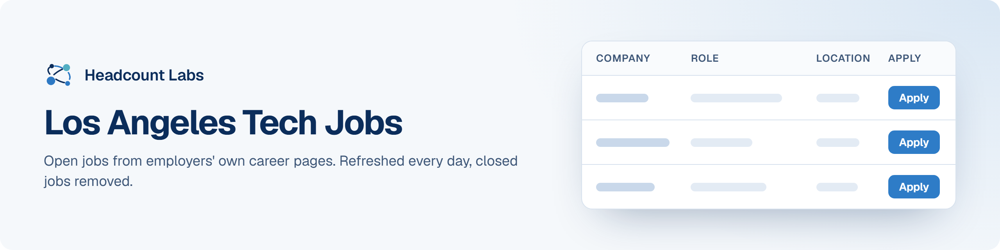

# Los Angeles Tech Jobs

Software, data, AI, product and design jobs in the Los Angeles area, sorted by field.

**400 open jobs** · 75 new since the last update · 75 removed because they closed or left the employer's board · updated October 22, 2026 at 6:17 AM EDT

This list is built and refreshed every day by [Headcount Labs](https://headcountlabs.com/?utm_source=github&utm_medium=job-list&utm_campaign=los-angeles-tech-jobs), which reads jobs straight from employers' own career pages and job boards. Every job here was still listed on its source board when we last read that board, within the past 3 days, and was posted in the past 30 days. Copies of the same job are merged into one row, and jobs that close are removed at the next update.

Want this data in your own app or agent? Use the [Headcount Labs jobs API](https://headcountlabs.com/docs/?utm_source=github&utm_medium=job-list&utm_campaign=los-angeles-tech-jobs) (free tier), the [MCP server](https://headcountlabs.com/mcp/?utm_source=github&utm_medium=job-list&utm_campaign=los-angeles-tech-jobs) for Claude, ChatGPT and other AI assistants, or the [public dataset subsets](https://huggingface.co/HeadcountLabs) on Hugging Face (the full dataset is coming soon).

**Full dataset.** A bigger, one-off snapshot dated 2026-10-19 (all matching jobs, not only the open jobs below) is on Hugging Face: [Tech and software jobs](https://huggingface.co/datasets/HeadcountLabs/tech-jobs). It loads with `datasets.load_dataset` and is under the Open Database License (ODbL) 1.0.

**Jump to:** [Software engineering (149)](#software-engineering) · [Data, AI and machine learning (94)](#data-ai-and-machine-learning) · [Product and design (118)](#product-and-design) · [Hardware and engineering (39)](#hardware-and-engineering)

**Columns.** *Apply* opens the original posting on the employer's site. *Details* opens the job on Headcount Labs, with every posting we found for it. *Remote* shows what the employer states; a dash means the posting doesn't say. *Pay* is the range the employer published.

## Software engineering

| Company | Role | Location | Remote | Pay | Posted | Apply | Details |
| --- | --- | --- | --- | --- | --- | :---: | :---: |
| **Snap Inc.** | Staff Software Engineer, iOS, Level 6 | 

4 locations
Los Angeles, CA Bellevue, WA New York, NY Palo Alto, CA
 | — | $229k–$343k/yr | Oct 21 |  | <a href="https://headcountlabs.com/catalog/jobs/acacc3ae-1d38-4609-9b6c-f3ec6f7a6d54?utm_source=github&utm_medium=job-list&utm_campaign=los-angeles-tech-jobs">via Headcount Labs</a> |
| **Generac Power Systems Inc** | Senior Staff Software Engineer- Infrastructure and Security | 

4 locations
Pewaukee, WI Oakland, CA Santa Monica, CA Toronto
 | On-site | $141k–$191k/yr | Oct 21 |  | <a href="https://headcountlabs.com/catalog/jobs/d989294c-f74a-4e63-8fc6-a608e048a7ab?utm_source=github&utm_medium=job-list&utm_campaign=los-angeles-tech-jobs">via Headcount Labs</a> |
| **ETAP Operation Technology, Inc.** | Software Engineer | Irvine, CA | — | $74k–$123k/yr | Oct 21 |  | <a href="https://headcountlabs.com/catalog/jobs/3b151d64-6f96-41d5-844d-d80f0d7c0793?utm_source=github&utm_medium=job-list&utm_campaign=los-angeles-tech-jobs">via Headcount Labs</a> |
| **EMINENT, INC.** | Product and Yarn Developer | Los Angeles, CA | — | $90k–$100k/yr | Oct 21 |  | <a href="https://headcountlabs.com/catalog/jobs/ebb43f0b-dfe2-4e04-96ab-b120b32a0d92?utm_source=github&utm_medium=job-list&utm_campaign=los-angeles-tech-jobs">via Headcount Labs</a> |
| **AXON-Networks** | Network Operations Security Engineer (US - Remote) | Irvine, CA | Remote | $120k–$175k/yr | Oct 21 |  | <a href="https://headcountlabs.com/catalog/jobs/e3376c5b-00c2-41f9-a098-36cadbc52737?utm_source=github&utm_medium=job-list&utm_campaign=los-angeles-tech-jobs">via Headcount Labs</a> |
| **Armanino Advisory LLC** | ServiceNow Business Systems Developer | 

20 locations
New York City, NY Atlanta, GA Austin, TX Bellevue, WA Boca Raton, FL Century City, CA Chicago, IL Dallas, TX Denver, CO Downtown Los Angeles, CA Garden City, NY Irvine, CA +8 more
 | — | $134k–$183k/yr | Oct 21 |  | <a href="https://headcountlabs.com/catalog/jobs/72d143b1-a13b-4fc0-b472-3d3ff9c5113e?utm_source=github&utm_medium=job-list&utm_campaign=los-angeles-tech-jobs">via Headcount Labs</a> |
| **Anduril Industries** | Senior Software Engineer, Platform Overlay &amp; Networking | Irvine, CA | — | $220k–$292k/yr | Oct 21 |  | <a href="https://headcountlabs.com/catalog/jobs/a6d383d7-2c75-40f7-960d-f9bc253cf347?utm_source=github&utm_medium=job-list&utm_campaign=los-angeles-tech-jobs">via Headcount Labs</a> |
| **330779353 CoreLogic Solutions, LLC** | Principal, Software Development Engineering | 

3 locations
Dallas, TX Austin, TX Irvine, CA
 | — | $134k–$180k/yr | Oct 21 |  | <a href="https://headcountlabs.com/catalog/jobs/e55a78c0-18af-4e99-8c0b-dd59fb7c97b3?utm_source=github&utm_medium=job-list&utm_campaign=los-angeles-tech-jobs">via Headcount Labs</a> |
| **The Boeing Company** | Senior Software Engineer | 

3 locations
El Segundo, CA Los Angeles, CA Chantilly, VA
 | On-site | $212k–$286k/yr | Oct 20 |  | <a href="https://headcountlabs.com/catalog/jobs/418d84f8-00de-4d7f-8df2-2fb27350e16c?utm_source=github&utm_medium=job-list&utm_campaign=los-angeles-tech-jobs">via Headcount Labs</a> |
| **The Boeing Company** | Experienced Hardware Emulation Software Engineer | 

2 locations
El Segundo, CA Los Angeles, CA
 | On-site | $135k–$183k/yr | Oct 20 |  | <a href="https://headcountlabs.com/catalog/jobs/d207672b-da69-4286-b170-3e3a1ce11d86?utm_source=github&utm_medium=job-list&utm_campaign=los-angeles-tech-jobs">via Headcount Labs</a> |
| **Snap Inc.** | Software Engineer, Full Stack, Level 4 | 

5 locations
Los Angeles, CA Bellevue, WA New York, NY Palo Alto, CA San Francisco, CA
 | — | $157k–$235k/yr | Oct 20 |  | <a href="https://headcountlabs.com/catalog/jobs/085954a7-d1fa-4e38-b79a-5f81da286738?utm_source=github&utm_medium=job-list&utm_campaign=los-angeles-tech-jobs">via Headcount Labs</a> |
| **Snap Inc.** | Software Engineer, ML infrastructure, Core Inference, Level 4 | 

4 locations
United States Bellevue, WA Los Angeles, CA Palo Alto, CA
 | On-site | $157k–$235k/yr | Oct 20 |  | <a href="https://headcountlabs.com/catalog/jobs/b864786c-317d-43f3-98f2-55e9cd1f7456?utm_source=github&utm_medium=job-list&utm_campaign=los-angeles-tech-jobs">via Headcount Labs</a> |
| **Millennium Space Systems** | Software Engineer Developer – Millennium Space Systems | 

2 locations
El Segundo, CA Los Angeles, CA
 | On-site | $172k–$252k/yr | Oct 20 |  | <a href="https://headcountlabs.com/catalog/jobs/e1df2f3f-5a1e-4464-ab55-7446ebf9773b?utm_source=github&utm_medium=job-list&utm_campaign=los-angeles-tech-jobs">via Headcount Labs</a> |
| **Apex Technology, Inc.** | Cybersecurity Engineer | Los Angeles, CA | On-site | $100k–$135k/yr | Oct 20 |  | <a href="https://headcountlabs.com/catalog/jobs/a8a61d6c-178d-413c-bdc6-d8aa36ab0ea2?utm_source=github&utm_medium=job-list&utm_campaign=los-angeles-tech-jobs">via Headcount Labs</a> |
| **Apex Technology, Inc.** | Cloud Security Engineer, AWS GovCloud | Los Angeles, CA | On-site | $150k–$200k/yr | Oct 20 |  | <a href="https://headcountlabs.com/catalog/jobs/96cf0283-62c7-4e11-915c-b2cce53f67bc?utm_source=github&utm_medium=job-list&utm_campaign=los-angeles-tech-jobs">via Headcount Labs</a> |
| **Apex Technology, Inc.** | Cybersecurity Lead Engineer (TS) | Los Angeles, CA | — | $160k–$200k/yr | Oct 20 |  | <a href="https://headcountlabs.com/catalog/jobs/3872be05-ece6-4d72-a84b-6f5bc964151d?utm_source=github&utm_medium=job-list&utm_campaign=los-angeles-tech-jobs">via Headcount Labs</a> |
| **Apex Technology, Inc.** | Cloud Security Engineer | Los Angeles, CA | On-site | $150k–$200k/yr | Oct 20 |  | <a href="https://headcountlabs.com/catalog/jobs/e135e0bf-7658-4b2e-aabe-318d6717aa79?utm_source=github&utm_medium=job-list&utm_campaign=los-angeles-tech-jobs">via Headcount Labs</a> |
| **Apex Technology, Inc.** | Cloud Infrastructure Engineer | Los Angeles, CA | — | $148k–$200k/yr | Oct 20 |  | <a href="https://headcountlabs.com/catalog/jobs/5d84c62e-0762-4cdb-9415-c425b8fab323?utm_source=github&utm_medium=job-list&utm_campaign=los-angeles-tech-jobs">via Headcount Labs</a> |
| **Apex Technology, Inc.** | Cybersecurity Lead Engineer | Los Angeles, CA | — | $160k–$200k/yr | Oct 20 |  | <a href="https://headcountlabs.com/catalog/jobs/10c995e0-22c0-4e5e-9e18-1e29644bad9d?utm_source=github&utm_medium=job-list&utm_campaign=los-angeles-tech-jobs">via Headcount Labs</a> |
| **Alteryx, Inc.** | Senior Software Development Engineer in Test | 

2 locations
Irvine, CA US
 | Remote | $140k–$160k/yr | Oct 20 |  | <a href="https://headcountlabs.com/catalog/jobs/fce0527f-95ec-4c4a-a1c6-3ecce584cdc8?utm_source=github&utm_medium=job-list&utm_campaign=los-angeles-tech-jobs">via Headcount Labs</a> |
| **Alteryx, Inc.** | Sr. Software Engineer, Dataplane | 

2 locations
US Irvine, CA
 | Remote | $130k–$175k/yr | Oct 20 |  | <a href="https://headcountlabs.com/catalog/jobs/baab5011-fbf1-44e1-9b59-81525241f502?utm_source=github&utm_medium=job-list&utm_campaign=los-angeles-tech-jobs">via Headcount Labs</a> |
| **Alteryx, Inc.** | Lead Software Development Engineer in Test | 

2 locations
Irvine, CA US
 | Remote | $165k–$185k/yr | Oct 20 |  | <a href="https://headcountlabs.com/catalog/jobs/69149a09-de4a-4702-98cf-dfed02a2806f?utm_source=github&utm_medium=job-list&utm_campaign=los-angeles-tech-jobs">via Headcount Labs</a> |
| **Alteryx, Inc.** | Software Engineer - Cloud Platform &amp; Data Plane Transport | Irvine, CA | — | $120k–$139k/yr | Oct 20 |  | <a href="https://headcountlabs.com/catalog/jobs/895d1343-cdbb-4d72-a39d-8dc0c60f2ae2?utm_source=github&utm_medium=job-list&utm_campaign=los-angeles-tech-jobs">via Headcount Labs</a> |
| **ALTEN Technology USA** | Lead Software Engineer, RTOS-based Automotive Platforms | Irvine, CA | On-site | $140k–$160k/yr | Oct 20 |  | <a href="https://headcountlabs.com/catalog/jobs/a8c67619-53b3-43c1-9a08-6baee428b3ff?utm_source=github&utm_medium=job-list&utm_campaign=los-angeles-tech-jobs">via Headcount Labs</a> |
| **US Internships Public Careers Site** | Frontend Software Engineering Intern - Undergraduate | 

2 locations
United States, Los Angeles, CA United States, San Mateo, CA
 | — | $45.75–$50/hr | Oct 19 |  | <a href="https://headcountlabs.com/catalog/jobs/225a28b1-0930-49a1-967b-24f469901342?utm_source=github&utm_medium=job-list&utm_campaign=los-angeles-tech-jobs">via Headcount Labs</a> |
| **US Internships Public Careers Site** | Software Engineering Intern - Master's | United States, Los Angeles, CA | — | $50.50/hr | Oct 19 |  | <a href="https://headcountlabs.com/catalog/jobs/a3b343c5-fd43-4925-998d-afde265edef5?utm_source=github&utm_medium=job-list&utm_campaign=los-angeles-tech-jobs">via Headcount Labs</a> |
| **TMS LLC** | Hiring for Senior AI Software Engineer (Agentic AI / AI Agents) &#124; 10+ years of experience &#124; USC | Los Angeles, CA | Hybrid | — | Oct 19 |  | <a href="https://headcountlabs.com/catalog/jobs/6f2890e0-d62a-4104-9735-f7d3c15402d6?utm_source=github&utm_medium=job-list&utm_campaign=los-angeles-tech-jobs">via Headcount Labs</a> |
| **TheStaffed** | GenAI DevOps Engineer /AI Engineer | Los Angeles, CA | — | — | Oct 19 |  | <a href="https://headcountlabs.com/catalog/jobs/a8c95bfa-bc08-49a7-a53b-863f10a5333b?utm_source=github&utm_medium=job-list&utm_campaign=los-angeles-tech-jobs">via Headcount Labs</a> |
| **TheStaffed** | Security Engineer (AWS Bedrock AgentCore / AI Security) | Los Angeles, CA | — | — | Oct 19 |  | <a href="https://headcountlabs.com/catalog/jobs/a365a7ef-7184-494a-953e-003859b5c1cb?utm_source=github&utm_medium=job-list&utm_campaign=los-angeles-tech-jobs">via Headcount Labs</a> |
| **Rivian and Volkswagen Group Technologies** | Senior Software Engineer - AI Platform | Irvine, CA | Hybrid | $150k–$187k/yr | Oct 19 |  | <a href="https://headcountlabs.com/catalog/jobs/2e1e2715-4254-4b61-a031-530cd46ff440?utm_source=github&utm_medium=job-list&utm_campaign=los-angeles-tech-jobs">via Headcount Labs</a> |
| **Panasonic** | MTS I, Software​ Engineer | Irvine, CA | — | $33.17–$55.29/hr | Oct 19 |  | <a href="https://headcountlabs.com/catalog/jobs/3130b433-6820-4ec8-934f-243c8cb57d6b?utm_source=github&utm_medium=job-list&utm_campaign=los-angeles-tech-jobs">via Headcount Labs</a> |
| **Panasonic** | MTS II, Software | Irvine, CA | On-site | $39–$64/hr | Oct 19 |  | <a href="https://headcountlabs.com/catalog/jobs/ffe24a65-41bc-48c6-b9bf-5a0228210a1e?utm_source=github&utm_medium=job-list&utm_campaign=los-angeles-tech-jobs">via Headcount Labs</a> |
| **Panasonic** | Software Engineer III | Irvine, CA | Hybrid | $97k–$157k/yr | Oct 19 |  | <a href="https://headcountlabs.com/catalog/jobs/ba61951e-5b79-4a88-b00f-9e485f1aabd9?utm_source=github&utm_medium=job-list&utm_campaign=los-angeles-tech-jobs">via Headcount Labs</a> |
| **Miratech** | Senior Routing Engine Developer (CX Platform) | Los Angeles, CA | Remote | — | Oct 19 |  | <a href="https://headcountlabs.com/catalog/jobs/4086f430-64cf-4b27-a01d-e53ab34d4d40?utm_source=github&utm_medium=job-list&utm_campaign=los-angeles-tech-jobs">via Headcount Labs</a> |
| **K2 Space** | Principal Security Engineer, Operations | Los Angeles, CA | — | $180k–$250k/yr | Oct 19 |  | <a href="https://headcountlabs.com/catalog/jobs/e3e0852b-a0c3-4b2e-8923-bd785c481fc1?utm_source=github&utm_medium=job-list&utm_campaign=los-angeles-tech-jobs">via Headcount Labs</a> |
| **FieldAI** | Robotics Software Engineer, Mission Evaluation &amp; Fine-Tuning | Irvine, CA | On-site | — | Oct 19 |  | <a href="https://headcountlabs.com/catalog/jobs/a44780b2-abb1-4414-99a3-1989f8bef736?utm_source=github&utm_medium=job-list&utm_campaign=los-angeles-tech-jobs">via Headcount Labs</a> |
| **FieldAI** | Robotics Software Engineer, Vision-Language Reasoning &amp; Behaviors | Irvine, CA | On-site | — | Oct 19 |  | <a href="https://headcountlabs.com/catalog/jobs/0a74e66c-312f-4006-865b-f0e9226ad831?utm_source=github&utm_medium=job-list&utm_campaign=los-angeles-tech-jobs">via Headcount Labs</a> |
| **FieldAI** | Robotics Software Engineer, Multimodal Inspection | Irvine, CA | On-site | — | Oct 19 |  | <a href="https://headcountlabs.com/catalog/jobs/004ee312-8a7e-410e-8882-1af3e192d0d8?utm_source=github&utm_medium=job-list&utm_campaign=los-angeles-tech-jobs">via Headcount Labs</a> |
| **Becton Dickinson &amp; Company** | Product Security Engineer - Embedded | 

2 locations
California Irvine, CA
 | On-site | $106k–$169k/yr | Oct 19 |  | <a href="https://headcountlabs.com/catalog/jobs/1586c600-496b-4730-b18c-701dcbe70cd9?utm_source=github&utm_medium=job-list&utm_campaign=los-angeles-tech-jobs">via Headcount Labs</a> |
| **Arcadis** | Geospatial &amp; Software Data Developer | 

3 locations
Los Angeles, CA Austin, TX New York, NY
 | On-site | $90k–$144k/yr | Oct 19 |  | <a href="https://headcountlabs.com/catalog/jobs/23ea8715-b949-4b66-b35e-ad60e2a66301?utm_source=github&utm_medium=job-list&utm_campaign=los-angeles-tech-jobs">via Headcount Labs</a> |
| **Apex Technology, Inc.** | Software Engineer, Operating Systems | Los Angeles, CA | — | $130k–$185k/yr | Oct 19 |  | <a href="https://headcountlabs.com/catalog/jobs/fb0cd1a4-b36c-4800-9455-c0d1448567ec?utm_source=github&utm_medium=job-list&utm_campaign=los-angeles-tech-jobs">via Headcount Labs</a> |
| **Northrop Grumman** | Embedded Software Engineering Manager Level 2 (AHT) | Los Angeles, CA | On-site | $161k–$242k/yr | Oct 17 |  | <a href="https://headcountlabs.com/catalog/jobs/5bf70765-9bb4-4698-aabd-29fce867a1a2?utm_source=github&utm_medium=job-list&utm_campaign=los-angeles-tech-jobs">via Headcount Labs</a> |
| **Snap Inc.** | Software Engineer, ML Infrastructure, ML Platform Level 5 | 

3 locations
Los Angeles, CA Palo Alto, CA Bellevue, WA
 | — | $209k–$313k/yr | Oct 16 |  | <a href="https://headcountlabs.com/catalog/jobs/7350aead-dad3-4257-83b4-d1c617ff0806?utm_source=github&utm_medium=job-list&utm_campaign=los-angeles-tech-jobs">via Headcount Labs</a> |
| **Quest International** | Healthcare Software Integration Engineer | 

17 locations
Irvine, CA Cincinnati, OH Denver, CO Washington, DC Chicago, IL Detroit, MI Arlington, VA Baltimore, MD Oklahoma City, OK United States Florida Union City, GA +5 more
 | Remote | $32–$35/hr | Oct 16 |  | <a href="https://headcountlabs.com/catalog/jobs/e852e68c-52c6-4e5f-bee0-27ca10f1ce39?utm_source=github&utm_medium=job-list&utm_campaign=los-angeles-tech-jobs">via Headcount Labs</a> |
| **Netflix, Inc.** | Software Engineer 5 - Ads Identity Graph | 

8 locations
New York, NY Seattle, WA Los Angeles, CA Los Gatos, CA New York Los Angeles Los Gatos Seattle
 | On-site | $388k–$558k/yr | Oct 16 |  | <a href="https://headcountlabs.com/catalog/jobs/63be30cf-a17d-474f-a058-0ea0f7f4c096?utm_source=github&utm_medium=job-list&utm_campaign=los-angeles-tech-jobs">via Headcount Labs</a> |
| **Hadrian Automation** | Software Engineer, Identity &amp; Access Management | 

3 locations
Los Angeles, CA San Francisco Bay Area, CA Seattle/Bellevue Area, WA
 | On-site | $192k–$274k/yr | Oct 16 |  | <a href="https://headcountlabs.com/catalog/jobs/f4204f9b-dda0-46f1-8213-76e9c5fbcb4c?utm_source=github&utm_medium=job-list&utm_campaign=los-angeles-tech-jobs">via Headcount Labs</a> |
| **EMINENT, INC.** | Associate Product Developer/Designer-Footwear | Los Angeles, CA | — | $70k–$95k/yr | Oct 16 |  | <a href="https://headcountlabs.com/catalog/jobs/ed0a1934-312f-4979-9d17-9317e4727f0e?utm_source=github&utm_medium=job-list&utm_campaign=los-angeles-tech-jobs">via Headcount Labs</a> |
| **Dialogue AI** | Software Engineer | Los Angeles, CA | On-site | — | Oct 16 |  | <a href="https://headcountlabs.com/catalog/jobs/903a5289-9df3-44bd-97f9-fdb6e80f4706?utm_source=github&utm_medium=job-list&utm_campaign=los-angeles-tech-jobs">via Headcount Labs</a> |
| **CoStar Realty Information, Inc.** | Associate Software Engineer - Irvine, CA | Irvine, CA | — | $100k–$105k/yr | Oct 16 |  | <a href="https://headcountlabs.com/catalog/jobs/326bddad-b508-4ce2-9993-622da7bf4f61?utm_source=github&utm_medium=job-list&utm_campaign=los-angeles-tech-jobs">via Headcount Labs</a> |
| **Axos Bank** | AVP, Software Development Manager – OutSystems | 

7 locations
San Diego, CA Centennial, CO Edison, NJ Irvine, CA Las Vegas, NV Los Angeles, CA Omaha, NE
 | — | — | Oct 16 |  | <a href="https://headcountlabs.com/catalog/jobs/9872ebe6-0bd6-4e3f-ae72-7472e2e521d6?utm_source=github&utm_medium=job-list&utm_campaign=los-angeles-tech-jobs">via Headcount Labs</a> |
| **AnySignal** | Associate Embedded Software Engineer | Los Angeles, CA | On-site | — | Oct 16 |  | <a href="https://headcountlabs.com/catalog/jobs/3824738b-a2bd-4313-a0d5-4633bfce9891?utm_source=github&utm_medium=job-list&utm_campaign=los-angeles-tech-jobs">via Headcount Labs</a> |
| **Northrop Grumman** | Software Engineer (C++ and TS Clearance) | 

2 locations
Los Angeles, CA Woodland Hills, CA
 | On-site | $92k–$138k/yr | Oct 15 |  | <a href="https://headcountlabs.com/catalog/jobs/ef45f25f-8af0-4d09-af4e-0039e897530f?utm_source=github&utm_medium=job-list&utm_campaign=los-angeles-tech-jobs">via Headcount Labs</a> |
| **Northrop Grumman** | Principal / Sr. Principal Software Engineer (C++ and TS Clearance) | Los Angeles, CA | On-site | $114k–$171k/yr | Oct 15 |  | <a href="https://headcountlabs.com/catalog/jobs/3105c32e-496c-4e1b-b418-68256d48a914?utm_source=github&utm_medium=job-list&utm_campaign=los-angeles-tech-jobs">via Headcount Labs</a> |
| **MUFG Bank, Ltd.** | Investment Banking Managing Director - Software &amp; Services | 

3 locations
New York, NY Los Angeles, CA San Francisco, CA
 | — | $275k/yr | Oct 15 |  | <a href="https://headcountlabs.com/catalog/jobs/98d06b27-72c1-4b44-a268-d115b6db42d0?utm_source=github&utm_medium=job-list&utm_campaign=los-angeles-tech-jobs">via Headcount Labs</a> |
| **Millennium Space Systems** | Ground Software Engineer (Senior) - Millennium Space Systems | 

2 locations
El Segundo, CA Los Angeles, CA
 | On-site | $188k–$280k/yr | Oct 15 |  | <a href="https://headcountlabs.com/catalog/jobs/60f86e1a-a23a-4eba-9061-7606ef84d2a8?utm_source=github&utm_medium=job-list&utm_campaign=los-angeles-tech-jobs">via Headcount Labs</a> |
| **Hadrian Automation** | Software Engineer, Cell Orchestration | Los Angeles, CA | On-site | $210k–$250k/yr | Oct 15 |  | <a href="https://headcountlabs.com/catalog/jobs/8b10cf2c-1397-4103-8d63-4cda0a00ae53?utm_source=github&utm_medium=job-list&utm_campaign=los-angeles-tech-jobs">via Headcount Labs</a> |
| **General Matter** | Summer 2027 Internship - Information Security Engineer | Los Angeles, CA | — | $32–$46/hr | Oct 15 |  | <a href="https://headcountlabs.com/catalog/jobs/c24d9f02-3ba0-4f34-9d44-186406ab1803?utm_source=github&utm_medium=job-list&utm_campaign=los-angeles-tech-jobs">via Headcount Labs</a> |
| **Disney Entertainment &amp; Sports LLC** | Sr Product Software Engineer | 

3 locations
Santa Monica, CA Glendale, CA New York, NY
 | Hybrid | $151k–$202k/yr | Oct 15 |  | <a href="https://headcountlabs.com/catalog/jobs/24243928-4e97-480b-b146-ac910d7e53be?utm_source=github&utm_medium=job-list&utm_campaign=los-angeles-tech-jobs">via Headcount Labs</a> |
| **Cprime** | Lead Developer | Los Angeles, CA | Hybrid | — | Oct 15 |  | <a href="https://headcountlabs.com/catalog/jobs/06554871-2af3-4d2d-adbe-3d22f8ed9f38?utm_source=github&utm_medium=job-list&utm_campaign=los-angeles-tech-jobs">via Headcount Labs</a> |
| **Commure** | Senior Software Engineer, Network Infrastructure | 

3 locations
Mountain View, CA Los Angeles, CA San Francisco, CA
 | Hybrid | $180k–$230k/yr | Oct 15 |  | <a href="https://headcountlabs.com/catalog/jobs/8e362058-1b60-4c47-90db-867cb9a202fa?utm_source=github&utm_medium=job-list&utm_campaign=los-angeles-tech-jobs">via Headcount Labs</a> |
| **Cast AI** | Developer Relations &amp; Experience Engineer | 

3 locations
Los Angeles, CA San Francisco, CA Seattle, WA
 | Remote | — | Oct 15 |  | <a href="https://headcountlabs.com/catalog/jobs/d093b541-f94b-4f89-ac9b-0b369a45c997?utm_source=github&utm_medium=job-list&utm_campaign=los-angeles-tech-jobs">via Headcount Labs</a> |
| **ElevenLabs** | Safety Engineer (Backend Leaning) | 

9 locations
Dublin Tokyo United States New York Los Angeles, CA London Boston, MA San Francisco, CA Washington
 | Remote | — | Oct 14 |  | <a href="https://headcountlabs.com/catalog/jobs/4ef40d07-b9fc-4700-8f76-96c3c3946b6b?utm_source=github&utm_medium=job-list&utm_campaign=los-angeles-tech-jobs">via Headcount Labs</a> |
| **Disney Entertainment &amp; Sports LLC** | Principal Product Software Engineer | 

2 locations
New York, NY Santa Monica, CA
 | Hybrid | $210k–$281k/yr | Oct 14 |  | <a href="https://headcountlabs.com/catalog/jobs/089ada99-362f-4c6d-b2c4-91362724c8cb?utm_source=github&utm_medium=job-list&utm_campaign=los-angeles-tech-jobs">via Headcount Labs</a> |
| **Crunchyroll, LLC** | Senior Software Engineer | Los Angeles, CA | Hybrid | $183k–$229k/yr | Oct 14 |  | <a href="https://headcountlabs.com/catalog/jobs/c2609fe1-1a31-4ec2-885d-fc2a16563ce5?utm_source=github&utm_medium=job-list&utm_campaign=los-angeles-tech-jobs">via Headcount Labs</a> |
| **Brown and Caldwell** | Senior Cyber Security Engineer | 

13 locations
Lakewood, CO Nashville, TN Chicago, IL Walnut Creek, CA New York City, NY Alexandria, VA Houston, TX Atlanta, GA West Palm Beach, FL Seattle, WA Los Angeles, CA Irvine, CA +1 more
 | Hybrid | $129k–$177k/yr | Oct 14 |  | <a href="https://headcountlabs.com/catalog/jobs/72235f00-1387-4188-b5ba-0e20b92af53b?utm_source=github&utm_medium=job-list&utm_campaign=los-angeles-tech-jobs">via Headcount Labs</a> |
| **AnySignal** | Embedded Software Engineer | Los Angeles, CA | On-site | — | Oct 14 |  | <a href="https://headcountlabs.com/catalog/jobs/530e00ac-cfee-437d-8949-d6a75053540f?utm_source=github&utm_medium=job-list&utm_campaign=los-angeles-tech-jobs">via Headcount Labs</a> |
| **Antares** | Senior Software Engineer, Hardware Test Platform | Los Angeles, CA | — | $160k–$210k/yr | Oct 14 |  | <a href="https://headcountlabs.com/catalog/jobs/b7c1cc9a-8015-442c-b243-1476ba99b869?utm_source=github&utm_medium=job-list&utm_campaign=los-angeles-tech-jobs">via Headcount Labs</a> |
| **AbbVie** | Lead Site Reliability Engineer - Allergan Aesthetics | Irvine, CA | Remote | $142k–$268k/yr | Oct 14 |  | <a href="https://headcountlabs.com/catalog/jobs/31f685b5-46d9-4a6b-8a3e-f995cd4c58b7?utm_source=github&utm_medium=job-list&utm_campaign=los-angeles-tech-jobs">via Headcount Labs</a> |
| **Snap Inc.** | Director, Software Engineering, Product Eng | 

4 locations
Los Angeles, CA Bellevue, WA Palo Alto, CA San Francisco, CA
 | — | $334k–$500k/yr | Oct 13 |  | <a href="https://headcountlabs.com/catalog/jobs/d3e2cc57-9a0f-4a33-8902-f54bc7140a10?utm_source=github&utm_medium=job-list&utm_campaign=los-angeles-tech-jobs">via Headcount Labs</a> |
| **Pivotal Health** | Senior Full-Stack Engineer - Case Strategy | 

3 locations
Santa Monica, CA Williamsburg, NY United States
 | Hybrid | $190k–$220k/yr | Oct 13 |  | <a href="https://headcountlabs.com/catalog/jobs/c345d8ca-43f8-453f-b8b3-b337649d4cae?utm_source=github&utm_medium=job-list&utm_campaign=los-angeles-tech-jobs">via Headcount Labs</a> |
| **Hankey Group** | AI Solutions Developer – Insurance Operations &amp; Systems Integration | Los Angeles, CA | On-site | $100k–$150k/yr | Oct 13 |  | <a href="https://headcountlabs.com/catalog/jobs/b193499b-23f7-4eaa-9bdb-212f21afa76d?utm_source=github&utm_medium=job-list&utm_campaign=los-angeles-tech-jobs">via Headcount Labs</a> |
| **Cystems Logic Inc** | SharePoint Developer (SPFx / Power Platform) - Los Angeles, CA ( 3days onsite ) - F2F interview | Los Angeles, CA | Hybrid | — | Oct 13 |  | <a href="https://headcountlabs.com/catalog/jobs/3c65812e-cafa-4de2-9cfb-56bde49e1c36?utm_source=github&utm_medium=job-list&utm_campaign=los-angeles-tech-jobs">via Headcount Labs</a> |
| **Cystems Logic Inc** | React Developer - Los Angeles, CA (onsite) - F2F interview | Los Angeles, CA | Hybrid | — | Oct 13 |  | <a href="https://headcountlabs.com/catalog/jobs/31eaa35c-f7a5-4f8a-8138-0dd6980d04ba?utm_source=github&utm_medium=job-list&utm_campaign=los-angeles-tech-jobs">via Headcount Labs</a> |
| **The Boeing Company** | Software Engineering Manager - Space Mission Systems | 

3 locations
El Segundo, CA Seal Beach, CA Los Angeles, CA
 | On-site | $172k–$232k/yr | Oct 12 |  | <a href="https://headcountlabs.com/catalog/jobs/52883e1f-e98a-4b07-86ef-1df705072430?utm_source=github&utm_medium=job-list&utm_campaign=los-angeles-tech-jobs">via Headcount Labs</a> |
| **CHAOS Industries** | Information Systems Security Engineer | Los Angeles, CA | On-site | $150k–$190k/yr | Oct 12 |  | <a href="https://headcountlabs.com/catalog/jobs/c9566931-518f-4b59-8cb6-894deb7a3e0f?utm_source=github&utm_medium=job-list&utm_campaign=los-angeles-tech-jobs">via Headcount Labs</a> |
| **AXS** | Sr. Director, Software Engineering - B2B | 

2 locations
Los Angeles, CA San Francisco, CA
 | Hybrid | $235k–$265k/yr | Oct 12 |  | <a href="https://headcountlabs.com/catalog/jobs/b74fd045-1525-4ae5-9fe5-320911b217c9?utm_source=github&utm_medium=job-list&utm_campaign=los-angeles-tech-jobs">via Headcount Labs</a> |
| **NOX METALS** | Full Stack Engineer | 

2 locations
Los Angeles, CA San Francisco
 | On-site | $154k–$170k/yr | Oct 11 |  | <a href="https://headcountlabs.com/catalog/jobs/7516bd7a-05da-4f57-8583-cb9b70d4b850?utm_source=github&utm_medium=job-list&utm_campaign=los-angeles-tech-jobs">via Headcount Labs</a> |
| **Disney Entertainment &amp; Sports LLC** | Senior Software Engineer - Build Tooling Infrastructure | 

3 locations
New York, NY Glendale, CA Santa Monica, CA
 | Hybrid | $144k–$193k/yr | Oct 11 |  | <a href="https://headcountlabs.com/catalog/jobs/ea8f05bb-35da-49c1-8982-66ec1a6810e2?utm_source=github&utm_medium=job-list&utm_campaign=los-angeles-tech-jobs">via Headcount Labs</a> |
| **Disney Entertainment &amp; Sports LLC** | Senior Software Developer - Build Tooling Development | 

2 locations
New York, NY Santa Monica, CA
 | Hybrid | $144k–$193k/yr | Oct 11 |  | <a href="https://headcountlabs.com/catalog/jobs/a3f28f76-9f02-4be2-8707-7ad63dd92a46?utm_source=github&utm_medium=job-list&utm_campaign=los-angeles-tech-jobs">via Headcount Labs</a> |
| **Scribd, Inc.** | Senior Software Engineer (Frontend), Search | 

11 locations
San Francisco, CA Toronto Los Angeles, CA Denver, CO Chicago, IL New York City, NY Vancouver Seattle, WA Austin, TX Boston, MA Dallas, TX
 | — | — | Oct 9 |  | <a href="https://headcountlabs.com/catalog/jobs/90a1fce2-3d1e-49aa-be10-e1331979f925?utm_source=github&utm_medium=job-list&utm_campaign=los-angeles-tech-jobs">via Headcount Labs</a> |
| **Rivian** | Software Engineering - Summer 2027 Internships | 

5 locations
Palo Alto, CA Atlanta, GA Irvine, CA Normal, IL Plymouth, MI
 | — | $33–$51/hr | Oct 9 |  | <a href="https://headcountlabs.com/catalog/jobs/7d965c38-7c34-43d3-a06d-87683454203c?utm_source=github&utm_medium=job-list&utm_campaign=los-angeles-tech-jobs">via Headcount Labs</a> |
| **Rivian** | Computer Vision Software - Summer 2027 Internships | 

5 locations
Palo Alto, CA Irvine, CA Plymouth, MI Atlanta, GA Normal, IL
 | — | $33–$51/hr | Oct 9 |  | <a href="https://headcountlabs.com/catalog/jobs/b6b7c592-42f9-41b0-af31-1e1bc41fb001?utm_source=github&utm_medium=job-list&utm_campaign=los-angeles-tech-jobs">via Headcount Labs</a> |
| **Rivian** | Controls, Automation &amp; Embedded Software - Summer 2027 Internships | 

2 locations
Palo Alto, CA Irvine, CA
 | — | $33–$51/hr | Oct 9 |  | <a href="https://headcountlabs.com/catalog/jobs/7c00b221-d04c-41a5-900b-d3ae73c6d994?utm_source=github&utm_medium=job-list&utm_campaign=los-angeles-tech-jobs">via Headcount Labs</a> |
| **Rivian** | Electrical &amp; Software Systems - Summer 2027 Internships | 

3 locations
Palo Alto, CA Irvine, CA Torrance, CA
 | — | $33–$51/hr | Oct 9 |  | <a href="https://headcountlabs.com/catalog/jobs/832df95d-2154-4292-9b40-0190cab6b15d?utm_source=github&utm_medium=job-list&utm_campaign=los-angeles-tech-jobs">via Headcount Labs</a> |
| **Hermeus** | Senior/Principal Mission Software Engineer | 

2 locations
Atlanta, GA Los Angeles, CA
 | On-site | $128k–$157k/yr | Oct 9 |  | <a href="https://headcountlabs.com/catalog/jobs/8c64e3b4-eda6-45cc-9b02-41d6607ac42c?utm_source=github&utm_medium=job-list&utm_campaign=los-angeles-tech-jobs">via Headcount Labs</a> |
| **Hermeus** | Senior Software Simulation Engineer | Los Angeles, CA | On-site | $150k–$190k/yr | Oct 9 |  | <a href="https://headcountlabs.com/catalog/jobs/0aa98f9f-ef44-4e63-b441-75d3e4dfd5b2?utm_source=github&utm_medium=job-list&utm_campaign=los-angeles-tech-jobs">via Headcount Labs</a> |
| **United Talent Agency** | Senior Software Development Engineer | Los Angeles, CA | On-site | — | Oct 8 |  | <a href="https://headcountlabs.com/catalog/jobs/2d310564-afb9-45ff-a985-083419bf9e61?utm_source=github&utm_medium=job-list&utm_campaign=los-angeles-tech-jobs">via Headcount Labs</a> |
| **Panasonic** | Software Engineer I – Embedded Systems | Irvine, CA | — | $33.17–$55.29/hr | Oct 8 |  | <a href="https://headcountlabs.com/catalog/jobs/04b6c468-9841-4788-88f5-ccdd81f005ff?utm_source=github&utm_medium=job-list&utm_campaign=los-angeles-tech-jobs">via Headcount Labs</a> |
| **Altruist** | Senior Back End Engineer, Data | 

2 locations
San Francisco, CA Los Angeles, CA
 | — | $200k–$240k/yr | Oct 8 |  | <a href="https://headcountlabs.com/catalog/jobs/960fe86e-7b76-4d9f-a4c2-e56afa2a66f0?utm_source=github&utm_medium=job-list&utm_campaign=los-angeles-tech-jobs">via Headcount Labs</a> |
| **TubeScience-Labs** | Staff / Principal Software Engineer [Los Angeles/Bay Area] | Los Angeles, CA | — | $120k–$200k/yr | Oct 7 |  | <a href="https://headcountlabs.com/catalog/jobs/cf12c910-ec73-4eac-a6ec-43ca9313f24d?utm_source=github&utm_medium=job-list&utm_campaign=los-angeles-tech-jobs">via Headcount Labs</a> |
| **The Boeing Company** | Product Security Engineer (Product Security Engineer) | 

2 locations
El Segundo, CA Los Angeles, CA
 | On-site | $218k–$296k/yr | Oct 7 |  | <a href="https://headcountlabs.com/catalog/jobs/80ccba6b-21ca-4933-810c-335c92c29e37?utm_source=github&utm_medium=job-list&utm_campaign=los-angeles-tech-jobs">via Headcount Labs</a> |
| **Scribd, Inc.** | Staff Software Engineer, Core Everand | 

11 locations
San Francisco, CA Toronto Los Angeles, CA Denver, CO Chicago, IL New York City, NY Vancouver Seattle, WA Austin, TX Boston, MA Dallas, TX
 | Remote | — | Oct 7 |  | <a href="https://headcountlabs.com/catalog/jobs/989134f2-462c-4355-b305-89e5ed624e62?utm_source=github&utm_medium=job-list&utm_campaign=los-angeles-tech-jobs">via Headcount Labs</a> |
| **Jacoby &amp; Meyers** | Salesforce Developer | Los Angeles, CA | Remote | $100k–$180k/yr | Oct 7 |  | <a href="https://headcountlabs.com/catalog/jobs/d44867dc-1139-4441-867d-610ae50b631b?utm_source=github&utm_medium=job-list&utm_campaign=los-angeles-tech-jobs">via Headcount Labs</a> |
| **The Metropolitan Water District of Southern California** | IT Software Developer III (Power Platform and Access Support) | Los Angeles, CA | Hybrid | $55.55–$73.07/hr | Oct 6 |  | <a href="https://headcountlabs.com/catalog/jobs/1a21f848-bafb-4dc8-89b3-8eeed08d5d72?utm_source=github&utm_medium=job-list&utm_campaign=los-angeles-tech-jobs">via Headcount Labs</a> |
| **Scribd, Inc.** | Staff Cloud Security Engineer | 

11 locations
San Francisco, CA Toronto Los Angeles, CA Denver, CO Chicago, IL New York City, NY Vancouver Seattle, WA Austin, TX Boston, MA Dallas, TX
 | — | — | Oct 6 |  | <a href="https://headcountlabs.com/catalog/jobs/f706c7f3-86ca-4993-b3d1-e0b22d8a5667?utm_source=github&utm_medium=job-list&utm_campaign=los-angeles-tech-jobs">via Headcount Labs</a> |
| **Scribd, Inc.** | Senior iOS Engineer | 

11 locations
San Francisco, CA Toronto Los Angeles, CA Denver, CO Chicago, IL New York City, NY Vancouver Seattle, WA Austin, TX Boston, MA Dallas, TX
 | — | — | Oct 6 |  | <a href="https://headcountlabs.com/catalog/jobs/3275af16-3194-4103-8b25-6ddd578c96ed?utm_source=github&utm_medium=job-list&utm_campaign=los-angeles-tech-jobs">via Headcount Labs</a> |
| **Revel** | Internship: Full Stack Software Engineer | 

2 locations
Los Angeles, CA San Francisco, CA
 | On-site | — | Oct 6 |  | <a href="https://headcountlabs.com/catalog/jobs/e9bf42ff-10d2-4e21-b2fc-adf69bc7b3d7?utm_source=github&utm_medium=job-list&utm_campaign=los-angeles-tech-jobs">via Headcount Labs</a> |
| **Revel** | Internship: Software Engineer, Test | 

2 locations
Los Angeles, CA San Francisco, CA
 | On-site | — | Oct 6 |  | <a href="https://headcountlabs.com/catalog/jobs/6153323f-56fa-493a-942b-0502a6c274a5?utm_source=github&utm_medium=job-list&utm_campaign=los-angeles-tech-jobs">via Headcount Labs</a> |
| **Revel** | Internship: Forward Deployed Engineer, Software | 

2 locations
Los Angeles, CA San Francisco, CA
 | On-site | — | Oct 6 |  | <a href="https://headcountlabs.com/catalog/jobs/2a7dfd73-73bb-445c-9883-f617dbec702e?utm_source=github&utm_medium=job-list&utm_campaign=los-angeles-tech-jobs">via Headcount Labs</a> |
| **Revel** | Internship: Embedded Software Engineer | 

2 locations
Los Angeles, CA San Francisco, CA
 | On-site | — | Oct 6 |  | <a href="https://headcountlabs.com/catalog/jobs/2720f5c1-68df-4c99-958f-2d7839405f6a?utm_source=github&utm_medium=job-list&utm_campaign=los-angeles-tech-jobs">via Headcount Labs</a> |
| **Redwood Trust Inc** | Senior Associate- Software Engineer | 

3 locations
Irvine, CA Charlotte, NC Englewood, CO
 | — | $110k–$150k/yr | Oct 6 |  | <a href="https://headcountlabs.com/catalog/jobs/ce2ac0d7-9064-496b-ab29-9047a780f343?utm_source=github&utm_medium=job-list&utm_campaign=los-angeles-tech-jobs">via Headcount Labs</a> |
| **Parallel Systems** | Backend Software Engineer II | Los Angeles, CA | — | $122k–$167k/yr | Oct 6 |  | <a href="https://headcountlabs.com/catalog/jobs/f7289fa2-9cf3-4180-a606-c4c7880008c8?utm_source=github&utm_medium=job-list&utm_campaign=los-angeles-tech-jobs">via Headcount Labs</a> |
| **General Matter** | Technical Program Manager, Software | Los Angeles, CA | — | $140k–$200k/yr | Oct 6 |  | <a href="https://headcountlabs.com/catalog/jobs/d9e974ba-a92f-4513-bef1-605da02caf82?utm_source=github&utm_medium=job-list&utm_campaign=los-angeles-tech-jobs">via Headcount Labs</a> |
| **Commure** | Senior Software Engineer, AI Integrations | 

4 locations
Mountain View, CA Los Angeles, CA New York City, NY San Francisco, CA
 | Hybrid | $180k–$230k/yr | Oct 6 |  | <a href="https://headcountlabs.com/catalog/jobs/7819d178-6918-4569-a311-6cccc75c5582?utm_source=github&utm_medium=job-list&utm_campaign=los-angeles-tech-jobs">via Headcount Labs</a> |
| **AnySignal** | Software Engineer, Ground Systems | Los Angeles, CA | On-site | — | Oct 6 |  | <a href="https://headcountlabs.com/catalog/jobs/65442b3b-4d35-4377-b64f-dc19c04131f6?utm_source=github&utm_medium=job-list&utm_campaign=los-angeles-tech-jobs">via Headcount Labs</a> |
| **AnySignal** | Embedded Software Engineer, Ground Systems | Los Angeles, CA | On-site | $130k–$200k/yr | Oct 6 |  | <a href="https://headcountlabs.com/catalog/jobs/95a54007-c9c8-4f1a-b5b4-736f48165255?utm_source=github&utm_medium=job-list&utm_campaign=los-angeles-tech-jobs">via Headcount Labs</a> |
| **Alteryx, Inc.** | Software Engineer | Irvine, CA | Remote | $105k–$140k/yr | Oct 6 |  | <a href="https://headcountlabs.com/catalog/jobs/c8556be9-ca1f-4d8a-81b4-c93605db11bf?utm_source=github&utm_medium=job-list&utm_campaign=los-angeles-tech-jobs">via Headcount Labs</a> |
| **Origence** | Sr Software Engineer | 

3 locations
Irvine, CA Ontario, CA Greenwood Village, CO
 | — | — | Oct 5 |  | <a href="https://headcountlabs.com/catalog/jobs/6d8ce176-55e3-4fae-bd3e-953938cd5e28?utm_source=github&utm_medium=job-list&utm_campaign=los-angeles-tech-jobs">via Headcount Labs</a> |
| **LegalZoom** | Senior Web Designer, Design Systems | 

3 locations
Mountain View, CA Los Angeles, CA Austin, TX
 | — | $116k–$186k/yr | Oct 5 |  | <a href="https://headcountlabs.com/catalog/jobs/53c9c54b-8db7-4298-b3ec-0856be26f860?utm_source=github&utm_medium=job-list&utm_campaign=los-angeles-tech-jobs">via Headcount Labs</a> |
| **General Matter** | Embedded Software Engineer, Motor Control &amp; Real-Time Systems | Los Angeles, CA | — | $150k–$260k/yr | Oct 5 |  | <a href="https://headcountlabs.com/catalog/jobs/d3152339-0a0b-4400-9c18-2b4dc9cdb671?utm_source=github&utm_medium=job-list&utm_campaign=los-angeles-tech-jobs">via Headcount Labs</a> |
| **Disability Community Resource Center** | Bilingual Job Developer (Spanish) | Los Angeles, CA | On-site | $18–$20/hr | Oct 5 |  | <a href="https://headcountlabs.com/catalog/jobs/efbfddff-3cf7-427a-a81e-ceea40477073?utm_source=github&utm_medium=job-list&utm_campaign=los-angeles-tech-jobs">via Headcount Labs</a> |
| **Danaher** | Sr Engineer, Systems Software Automation | Irvine, CA | On-site | $100k–$130k/yr | Oct 2 |  | <a href="https://headcountlabs.com/catalog/jobs/94e2de29-4e04-4e58-ba3f-9f36893e0265?utm_source=github&utm_medium=job-list&utm_campaign=los-angeles-tech-jobs">via Headcount Labs</a> |
| **Viant Technology** | Staff Software Engineer - Ad Serving | 

2 locations
Irvine, CA Los Angeles, CA
 | — | $160k–$200k/yr | Oct 1 |  | <a href="https://headcountlabs.com/catalog/jobs/13cd7f2a-11ee-4a64-b57d-a643d472738b?utm_source=github&utm_medium=job-list&utm_campaign=los-angeles-tech-jobs">via Headcount Labs</a> |
| **Rivian and Volkswagen Group Technologies** | Software Test Technician | Irvine, CA | On-site | $85k–$100k/yr | Oct 1 |  | <a href="https://headcountlabs.com/catalog/jobs/b1904042-ba79-4617-b31a-18f146490400?utm_source=github&utm_medium=job-list&utm_campaign=los-angeles-tech-jobs">via Headcount Labs</a> |
| **Pear Suite** | Staff/Software Software Engineer | 

6 locations
Los Angeles, CA Austin, TX Seattle, WA Portland, OR Boston, MA Denver, CO
 | Hybrid | $120k–$150k/yr | Oct 1 |  | <a href="https://headcountlabs.com/catalog/jobs/8039ac67-b983-4b79-862c-f15b72b271c3?utm_source=github&utm_medium=job-list&utm_campaign=los-angeles-tech-jobs">via Headcount Labs</a> |
| **L3HHCM20** | Specialist, Software Engineering | Los Angeles, CA | — | $97k–$180k/yr | Oct 1 |  | <a href="https://headcountlabs.com/catalog/jobs/715ff051-d964-4245-8088-a2721ca844e6?utm_source=github&utm_medium=job-list&utm_campaign=los-angeles-tech-jobs">via Headcount Labs</a> |
| **Independent Security Evaluators** | Future Opening: Embedded Studio Content Security Engineer HYBRID | Los Angeles, CA | Remote | $90k–$130k/yr | Oct 1 |  | <a href="https://headcountlabs.com/catalog/jobs/2bf199e0-b807-44ed-9ec4-131836899645?utm_source=github&utm_medium=job-list&utm_campaign=los-angeles-tech-jobs">via Headcount Labs</a> |
| **Independent Security Evaluators** | Future Opening: Embedded AI Content Security Engineer HYBRID | Los Angeles, CA | Remote | $140k–$170k/yr | Oct 1 |  | <a href="https://headcountlabs.com/catalog/jobs/1a6ff56d-f2dd-4383-8abe-9542f32214d0?utm_source=github&utm_medium=job-list&utm_campaign=los-angeles-tech-jobs">via Headcount Labs</a> |
| **Hadrian Automation** | Software Engineer, Machine Interfaces | Los Angeles, CA | On-site | $200k–$230k/yr | Oct 1 |  | <a href="https://headcountlabs.com/catalog/jobs/ebbd1176-c520-4cf0-9843-e21de66af5d2?utm_source=github&utm_medium=job-list&utm_campaign=los-angeles-tech-jobs">via Headcount Labs</a> |
| **Hadrian Automation** | Computational Geometry Software Engineer | Los Angeles, CA | On-site | $160k–$300k/yr | Oct 1 |  | <a href="https://headcountlabs.com/catalog/jobs/6bed9902-f1b0-429d-b5b3-8ba1cf7c8b1d?utm_source=github&utm_medium=job-list&utm_campaign=los-angeles-tech-jobs">via Headcount Labs</a> |
| **Gusto, Inc.** | Staff Software Engineer, Retirement Financial Platform | 

9 locations
Austin, TX Burlingame, CA Chicago, IL Denver, CO Los Angeles, CA Miami, FL New York, NY San Francisco, CA Seattle, WA
 | Remote | $163k–$204k/yr | Oct 1 |  | <a href="https://headcountlabs.com/catalog/jobs/7571fbc6-8f35-44fb-a855-5b92950cac16?utm_source=github&utm_medium=job-list&utm_campaign=los-angeles-tech-jobs">via Headcount Labs</a> |
| **Global It Communications Inc** | Senior Systems and Cloud Engineer | Los Angeles, CA | — | $105k–$125k/yr | Oct 1 |  | <a href="https://headcountlabs.com/catalog/jobs/212ba029-4036-4270-9bf9-4391bf09ba89?utm_source=github&utm_medium=job-list&utm_campaign=los-angeles-tech-jobs">via Headcount Labs</a> |
| **Bio-Rad Laboratories** | Staff Agentic Software Engineer | 

2 locations
Irvine, CA Hercules, CA
 | — | $157k–$200k/yr | Oct 1 |  | <a href="https://headcountlabs.com/catalog/jobs/e9f5c175-e575-4adf-a8ba-5cb954924585?utm_source=github&utm_medium=job-list&utm_campaign=los-angeles-tech-jobs">via Headcount Labs</a> |
| **TP-Link Systems Inc.** | Shopify Developer &amp; Designer - TP-Link D2C &amp; Omada D2B | Irvine, CA | On-site | — | Sep 30 |  | <a href="https://headcountlabs.com/catalog/jobs/8f6af055-71b7-4b68-85a7-f68e44eab42f?utm_source=github&utm_medium=job-list&utm_campaign=los-angeles-tech-jobs">via Headcount Labs</a> |
| **Taboola** | Sr Backend Engineer | Los Angeles, CA | Hybrid | $165k–$185k/yr | Sep 30 |  | <a href="https://headcountlabs.com/catalog/jobs/29e9aa5b-11af-4749-96f4-962564831491?utm_source=github&utm_medium=job-list&utm_campaign=los-angeles-tech-jobs">via Headcount Labs</a> |
| **Raydar** | Senior Software Engineer | Los Angeles, CA | — | — | Sep 30 |  | <a href="https://headcountlabs.com/catalog/jobs/24ff243c-6588-4de3-9954-ac0c52c079a8?utm_source=github&utm_medium=job-list&utm_campaign=los-angeles-tech-jobs">via Headcount Labs</a> |
| **Panasonic** | Sr. Software Engineer - Embedded / Linux | Irvine, CA | — | $100k–$167k/yr | Sep 30 |  | <a href="https://headcountlabs.com/catalog/jobs/fae709cd-00e6-4825-a8c4-771e7eabc4c8?utm_source=github&utm_medium=job-list&utm_campaign=los-angeles-tech-jobs">via Headcount Labs</a> |
| **Lab37** | Software Quality Engineer | Los Angeles, CA | On-site | $180k–$230k/yr | Sep 30 |  | <a href="https://headcountlabs.com/catalog/jobs/0026cf9e-7431-4f46-af3f-d245e3e75573?utm_source=github&utm_medium=job-list&utm_campaign=los-angeles-tech-jobs">via Headcount Labs</a> |
| **Green Dot Corporation** | Principal Software Engineer | Los Angeles, CA | — | $159k–$229k/yr | Sep 30 |  | <a href="https://headcountlabs.com/catalog/jobs/e4ddd25c-ef97-409f-af6d-4f68d161a355?utm_source=github&utm_medium=job-list&utm_campaign=los-angeles-tech-jobs">via Headcount Labs</a> |
| **ATOMS Careers page** | Software Quality Engineer | Los Angeles, CA | On-site | $180k–$230k/yr | Sep 30 |  | <a href="https://headcountlabs.com/catalog/jobs/e6cd5678-488d-4a9e-8eeb-8bc2148b8e39?utm_source=github&utm_medium=job-list&utm_campaign=los-angeles-tech-jobs">via Headcount Labs</a> |
| **USC** | Software Engineer | Los Angeles, CA | — | $110k–$134k/yr | Sep 29 |  | <a href="https://headcountlabs.com/catalog/jobs/47ba843c-5ba1-4d06-aed9-bc9794568788?utm_source=github&utm_medium=job-list&utm_campaign=los-angeles-tech-jobs">via Headcount Labs</a> |
| **StubHub** | Senior Software Engineer (Los Angeles, CA) | Los Angeles, CA | — | $95k–$250k/yr | Sep 29 |  | <a href="https://headcountlabs.com/catalog/jobs/43d95938-7113-45ee-b73e-4b59fa546905?utm_source=github&utm_medium=job-list&utm_campaign=los-angeles-tech-jobs">via Headcount Labs</a> |
| **Panasonic** | Software Engineer - Embedded / Linux | Irvine, CA | — | $33.17–$55.29/hr | Sep 29 |  | <a href="https://headcountlabs.com/catalog/jobs/97f28aff-5e3e-488f-b392-a7de8691ea13?utm_source=github&utm_medium=job-list&utm_campaign=los-angeles-tech-jobs">via Headcount Labs</a> |
| **Hermeus** | Flight Software Engineering Intern (Simulation/Hardware-In-The-Loop) - Spring &amp; Summer 2027 | Los Angeles, CA | On-site | $25–$33/hr | Sep 29 |  | <a href="https://headcountlabs.com/catalog/jobs/2c9dc94b-ccdb-419b-94a0-bf6fd9fd8a01?utm_source=github&utm_medium=job-list&utm_campaign=los-angeles-tech-jobs">via Headcount Labs</a> |
| **Comcast** | Sr. Backend Engineer (Java) - Xumo | 

3 locations
United States Irvine, CA Philadelphia, PA
 | — | $142k–$189k/yr | Sep 29 |  | <a href="https://headcountlabs.com/catalog/jobs/4aa5e4db-20a5-44a1-a201-44c4b4160a83?utm_source=github&utm_medium=job-list&utm_campaign=los-angeles-tech-jobs">via Headcount Labs</a> |
| **Becton Dickinson &amp; Company** | Staff Software Engineer | 

2 locations
California Irvine, CA
 | On-site | $130k–$207k/yr | Sep 29 |  | <a href="https://headcountlabs.com/catalog/jobs/501709af-7082-47c8-a54e-b8cadcc22f76?utm_source=github&utm_medium=job-list&utm_campaign=los-angeles-tech-jobs">via Headcount Labs</a> |
| **IMEG Consultants Corp.** | Revit API Software Engineer &#124; New York, NY | 

35 locations
Rock Island Anaheim, CA Cleveland, OH Hardin, MT Houston, TX Idaho Falls, ID Indianapolis, IN Jacksonville, FL Kansas City, MO Las Vegas, NV Long Island, NY Los Angeles, CA +23 more
 | — | — | Sep 28 |  | <a href="https://headcountlabs.com/catalog/jobs/5ec5c727-fb10-431e-bd81-25f8d33da38e?utm_source=github&utm_medium=job-list&utm_campaign=los-angeles-tech-jobs">via Headcount Labs</a> |
| **Green Dot Corporation** | Mobile Engineer | Los Angeles, CA | — | $149k–$214k/yr | Sep 28 |  | <a href="https://headcountlabs.com/catalog/jobs/ffe8ee25-9b63-466a-83c0-6399751f8641?utm_source=github&utm_medium=job-list&utm_campaign=los-angeles-tech-jobs">via Headcount Labs</a> |
| **GITAI** | Field-Deployed Software Engineering Intern – Fall 2026 / Spring 2027 | Los Angeles, CA | On-site | $28–$40/hr | Sep 28 |  | <a href="https://headcountlabs.com/catalog/jobs/07b925a8-ab06-4b44-b0de-ea825beb7270?utm_source=github&utm_medium=job-list&utm_campaign=los-angeles-tech-jobs">via Headcount Labs</a> |
| **DoorDash USA** | Software Engineer, Full Stack - Experimentation Platform | 

5 locations
San Francisco, CA Sunnyvale, CA Seattle, WA New York, NY Los Angeles, CA
 | — | $131k–$192k/yr | Sep 28 |  | <a href="https://headcountlabs.com/catalog/jobs/e5c1d210-f3f7-4c1c-8946-c5361be4b723?utm_source=github&utm_medium=job-list&utm_campaign=los-angeles-tech-jobs">via Headcount Labs</a> |
| **Anduril Industries** | Automation Test Software Engineer, Manufacturing | Irvine, CA | — | — | Sep 28 |  | <a href="https://headcountlabs.com/catalog/jobs/7c0676d9-6752-469d-a9a1-561bd7ee4817?utm_source=github&utm_medium=job-list&utm_campaign=los-angeles-tech-jobs">via Headcount Labs</a> |
| **Samson Rose** | Senior Robotics Software Engineer - Localization | Los Angeles, CA | — | — | Sep 26 |  | <a href="https://headcountlabs.com/catalog/jobs/3decaf9d-5413-40c6-892a-b1050a91e4b6?utm_source=github&utm_medium=job-list&utm_campaign=los-angeles-tech-jobs">via Headcount Labs</a> |
| **Specs Inc.** | Software Engineer, Device Security, Level 4 | 

2 locations
San Diego, CA Los Angeles, CA
 | — | $157k–$235k/yr | Sep 25 |  | <a href="https://headcountlabs.com/catalog/jobs/b1351cba-e7cc-4625-b938-8d76e82ae035?utm_source=github&utm_medium=job-list&utm_campaign=los-angeles-tech-jobs">via Headcount Labs</a> |
| **Red 6** | Staff Software Architect | 

2 locations
Santa Monica, CA Denver
 | On-site | $150k–$190k/yr | Sep 25 |  | <a href="https://headcountlabs.com/catalog/jobs/9ba77bb7-f27a-40cc-b636-c80269ab854b?utm_source=github&utm_medium=job-list&utm_campaign=los-angeles-tech-jobs">via Headcount Labs</a> |
| **Commure** | Senior Software Engineer, Air AI | 

4 locations
Mountain View, CA Los Angeles, CA New York City, NY San Francisco, CA
 | — | $170k–$230k/yr | Sep 25 |  | <a href="https://headcountlabs.com/catalog/jobs/37ca1771-dd22-470a-90f9-5ff7a7db6043?utm_source=github&utm_medium=job-list&utm_campaign=los-angeles-tech-jobs">via Headcount Labs</a> |
| **Alteryx, Inc.** | Senior Software Engineer - Orchestration &amp; Job Execution | 

2 locations
US Irvine, CA
 | Remote | $130k–$175k/yr | Sep 25 |  | <a href="https://headcountlabs.com/catalog/jobs/05484a48-972e-432c-919f-213b30df8667?utm_source=github&utm_medium=job-list&utm_campaign=los-angeles-tech-jobs">via Headcount Labs</a> |
| **AbbVie** | 2027 Business Technology Solutions Intern - Data &amp; Software Engineering (Undergraduate) | Irvine, CA | Hybrid | $21–$37.80/hr | Sep 25 |  | <a href="https://headcountlabs.com/catalog/jobs/6bbfd274-dbf2-4599-ab18-3d42913eb829?utm_source=github&utm_medium=job-list&utm_campaign=los-angeles-tech-jobs">via Headcount Labs</a> |
| **ZipRecruiter** | Software Engineer - New Grad | Santa Monica, CA | — | $130k–$150k/yr | Sep 24 |  | <a href="https://headcountlabs.com/catalog/jobs/b68ac505-fe02-4298-aaf6-0055cd1e154d?utm_source=github&utm_medium=job-list&utm_campaign=los-angeles-tech-jobs">via Headcount Labs</a> |
| **Revel** | Full Stack Software Engineer (Mid-Senior) | 

2 locations
Los Angeles, CA San Francisco, CA
 | On-site | — | Sep 24 |  | <a href="https://headcountlabs.com/catalog/jobs/47e6f00a-8ffe-4fea-b938-89aaabd49dcc?utm_source=github&utm_medium=job-list&utm_campaign=los-angeles-tech-jobs">via Headcount Labs</a> |

## Data, AI and machine learning

| Company | Role | Location | Remote | Pay | Posted | Apply | Details |
| --- | --- | --- | --- | --- | --- | :---: | :---: |
| **Tiger Analytics Inc.** | Senior Data Scientist - Pharma | 

2 locations
Los Angeles, CA San Francisco, CA
 | Remote | — | Oct 21 |  | <a href="https://headcountlabs.com/catalog/jobs/84765434-2a8a-48fe-ab93-4d019fa89020?utm_source=github&utm_medium=job-list&utm_campaign=los-angeles-tech-jobs">via Headcount Labs</a> |
| **Launch Potato** | Staff Data Scientist, Lead Generation | 

77 locations
Panama City Alajuela Cartago Heredia San Jose Belo Horizonte Brasilia Fortaleza Manaus Rio de Jaineiro Salvador Sao Paulo +65 more
 | Remote | — | Oct 21 |  | <a href="https://headcountlabs.com/catalog/jobs/dbf1ded7-c97c-4cea-918f-0c7b36613529?utm_source=github&utm_medium=job-list&utm_campaign=los-angeles-tech-jobs">via Headcount Labs</a> |
| **Launch Potato** | Lead Data Scientist, AdTech | 

77 locations
Buenos Aires Cordoba La Plata Mar del Plata Rosario Santa fe Lima Valparaíso Barranquilla Bogota Cali Medellin +65 more
 | Remote | — | Oct 21 |  | <a href="https://headcountlabs.com/catalog/jobs/99a64565-9963-4b63-b947-8f4b5b9e3472?utm_source=github&utm_medium=job-list&utm_campaign=los-angeles-tech-jobs">via Headcount Labs</a> |
| **AECOM** | Senior Plumbing Engineer/Designer, Data Centers - Remote (U.S.) | 

6 locations
Arlington, VA Chicago, IL Columbus, OH Phoenix, AZ Los Angeles, CA Dallas, TX
 | Remote | $120k–$210k/yr | Oct 21 |  | <a href="https://headcountlabs.com/catalog/jobs/fb1e3cda-73f7-4b3d-ab34-4ced82e523bd?utm_source=github&utm_medium=job-list&utm_campaign=los-angeles-tech-jobs">via Headcount Labs</a> |
| **Univision Communications, Inc** | Principal Data Engineer | 

2 locations
Miami, FL Los Angeles, CA
 | — | — | Oct 20 |  | <a href="https://headcountlabs.com/catalog/jobs/3588f8fc-ae62-479c-815b-f75b44f932da?utm_source=github&utm_medium=job-list&utm_campaign=los-angeles-tech-jobs">via Headcount Labs</a> |
| **Univision Communications, Inc** | Senior Data Engineer | 

2 locations
Miami, FL Los Angeles, CA
 | — | — | Oct 20 |  | <a href="https://headcountlabs.com/catalog/jobs/52a1e7bb-ae7a-4cbb-a060-1de73bce71ee?utm_source=github&utm_medium=job-list&utm_campaign=los-angeles-tech-jobs">via Headcount Labs</a> |
| **Snap Inc.** | Data Scientist, Level 4 | 

6 locations
Los Angeles, CA Bellevue, WA New York, NY Palo Alto, CA San Francisco, CA Seattle, WA
 | — | $157k–$235k/yr | Oct 20 |  | <a href="https://headcountlabs.com/catalog/jobs/7c80855e-89f8-4c7e-8435-80ecaa53af91?utm_source=github&utm_medium=job-list&utm_campaign=los-angeles-tech-jobs">via Headcount Labs</a> |
| **Rivian** | Staff Machine Learning Engineer- Large Driving Model (LDM), Motion Planning, Autonomy | 

2 locations
Palo Alto, CA Irvine, CA
 | — | $210k–$285k/yr | Oct 20 |  | <a href="https://headcountlabs.com/catalog/jobs/4c8e2fb2-c7c8-4aae-ad91-565a7a63f611?utm_source=github&utm_medium=job-list&utm_campaign=los-angeles-tech-jobs">via Headcount Labs</a> |
| **Environmental Resources Management, Inc.** | Consulting Associate, Scientist or Engineer | Irvine, CA | Hybrid | $70k–$81k/yr | Oct 20 |  | <a href="https://headcountlabs.com/catalog/jobs/87524adb-c5aa-4661-a9f9-a8d094adab5c?utm_source=github&utm_medium=job-list&utm_campaign=los-angeles-tech-jobs">via Headcount Labs</a> |
| **Collectors Universe, Inc.** | Staff Applied AI Engineer | Los Angeles-Long Beach-Anaheim, CA | Remote | $166k–$269k/yr | Oct 20 |  | <a href="https://headcountlabs.com/catalog/jobs/c5dd9d18-c350-47b8-98ae-fff9d94397cc?utm_source=github&utm_medium=job-list&utm_campaign=los-angeles-tech-jobs">via Headcount Labs</a> |
| **Cadent** | Lead Data Partnerships Manager | 

3 locations
New York, NY Chicago, IL Los Angeles, CA
 | — | $100k–$120k/yr | Oct 20 |  | <a href="https://headcountlabs.com/catalog/jobs/5ae8edd1-3a57-49d1-937c-9708a1b94234?utm_source=github&utm_medium=job-list&utm_campaign=los-angeles-tech-jobs">via Headcount Labs</a> |
| **Bank of Montreal** | Director, Data Foundations, Automation &amp; Infrastructure | 

4 locations
Chicago, IL Los Angeles, CA San Francisco, CA San Ramon, CA
 | — | $130k–$270k/yr | Oct 20 |  | <a href="https://headcountlabs.com/catalog/jobs/e6cd2c2d-f864-44f7-8e74-4bf943b378bc?utm_source=github&utm_medium=job-list&utm_campaign=los-angeles-tech-jobs">via Headcount Labs</a> |
| **Ares Operations LLC** | Senior Associate, Data Operations, Private Debt Data | Los Angeles, CA | — | $130k–$150k/yr | Oct 20 |  | <a href="https://headcountlabs.com/catalog/jobs/b4be98e7-8846-4103-a7a3-3b6b8caff184?utm_source=github&utm_medium=job-list&utm_campaign=los-angeles-tech-jobs">via Headcount Labs</a> |
| **AEG Worldwide** | Senior Data Analyst – Paid Media | Los Angeles, CA | — | $82k–$125k/yr | Oct 20 |  | <a href="https://headcountlabs.com/catalog/jobs/64bd1b63-5f7f-4c1d-b395-9c63c31acf46?utm_source=github&utm_medium=job-list&utm_campaign=los-angeles-tech-jobs">via Headcount Labs</a> |
| **AECOM** | Electrical Engineer, Data Centers - Remote (U.S.) | 

6 locations
Chicago, IL Arlington, VA Los Angeles, CA Dallas, TX Phoenix, AZ Columbus, OH
 | Remote | $140k–$180k/yr | Oct 20 |  | <a href="https://headcountlabs.com/catalog/jobs/56e21495-be63-4a27-9f81-1cc2becb76b1?utm_source=github&utm_medium=job-list&utm_campaign=los-angeles-tech-jobs">via Headcount Labs</a> |
| **TMS LLC** | Hiring: AI Engineer / Generative AI Engineer &#124; (Agentic AI,AWS Bedrock AgentCore,Claude Agent SDK,Langfuse) &#124; Los Angeles, CA (Hybrid) | Los Angeles, CA | Hybrid | — | Oct 19 |  | <a href="https://headcountlabs.com/catalog/jobs/c9d4cd8d-2c6b-4037-9b94-c00a591ffe46?utm_source=github&utm_medium=job-list&utm_campaign=los-angeles-tech-jobs">via Headcount Labs</a> |
| **TheStaffed** | AI Engineer (Agentic AI / AWS Bedrock) | Los Angeles, CA | — | — | Oct 19 |  | <a href="https://headcountlabs.com/catalog/jobs/65914581-e4f2-407f-b12c-0234e21a0c27?utm_source=github&utm_medium=job-list&utm_campaign=los-angeles-tech-jobs">via Headcount Labs</a> |
| **TheStaffed** | Senior Data Engineer (GenAI / AWS) | Los Angeles, CA | — | — | Oct 19 |  | <a href="https://headcountlabs.com/catalog/jobs/3fcf75f8-88df-46a3-8e8a-757bc494bebc?utm_source=github&utm_medium=job-list&utm_campaign=los-angeles-tech-jobs">via Headcount Labs</a> |
| **TelevisaUnivision Management Co.** | Principal Data Engineer | 

2 locations
Miami, FL Los Angeles, CA
 | — | — | Oct 19 |  | <a href="https://headcountlabs.com/catalog/jobs/89ca1dc7-c936-43fa-938d-c5b8c8e95e89?utm_source=github&utm_medium=job-list&utm_campaign=los-angeles-tech-jobs">via Headcount Labs</a> |
| **TelevisaUnivision Management Co.** | Senior Data Engineer | 

2 locations
Miami, FL Los Angeles, CA
 | — | — | Oct 19 |  | <a href="https://headcountlabs.com/catalog/jobs/879d265e-347d-4074-9fcb-7df8335a1614?utm_source=github&utm_medium=job-list&utm_campaign=los-angeles-tech-jobs">via Headcount Labs</a> |
| **CGCG-US CG Companies Global-US** | CAMPUS: Capital Group Rotational Program - Data &amp; Technology Track Summer Associate (2027) Los Angeles, CA | Los Angeles, CA | — | $35.50/hr | Oct 19 |  | <a href="https://headcountlabs.com/catalog/jobs/17f98538-6e08-45ab-b8dc-ec449a8796db?utm_source=github&utm_medium=job-list&utm_campaign=los-angeles-tech-jobs">via Headcount Labs</a> |
| **CGCG-US CG Companies Global-US** | CAMPUS: Capital Group Rotational Program - Data &amp; Technology Track Summer Associate (2027) Irvine, CA | Irvine, CA | — | $35.50/hr | Oct 19 |  | <a href="https://headcountlabs.com/catalog/jobs/4aa485ba-54fa-4e6d-9ece-29a3be227a5e?utm_source=github&utm_medium=job-list&utm_campaign=los-angeles-tech-jobs">via Headcount Labs</a> |
| **Cap Diagnostics LLC** | Accessioner/QC (Clinical Data Entry) | Irvine, CA | — | $18/hr | Oct 19 |  | <a href="https://headcountlabs.com/catalog/jobs/670a152e-a0dc-43cd-85df-a1892e93596c?utm_source=github&utm_medium=job-list&utm_campaign=los-angeles-tech-jobs">via Headcount Labs</a> |
| **USC University of Southern California** | Data Scientist (ITS) | Los Angeles, CA | On-site | $120k–$156k/yr | Oct 16 |  | <a href="https://headcountlabs.com/catalog/jobs/6837b7c6-69cb-45cd-b8c8-4d05a26da6e8?utm_source=github&utm_medium=job-list&utm_campaign=los-angeles-tech-jobs">via Headcount Labs</a> |
| **Taboola** | Senior Machine Learning Engineer | Los Angeles, CA | Hybrid | $138k–$195k/yr | Oct 16 |  | <a href="https://headcountlabs.com/catalog/jobs/a308930d-9492-4e1a-a2fc-0006bfeda416?utm_source=github&utm_medium=job-list&utm_campaign=los-angeles-tech-jobs">via Headcount Labs</a> |
| **Scribd, Inc.** | Principal Analytics Engineer, AI Native Self Service Analytics | 

11 locations
San Francisco, CA Toronto Los Angeles, CA Denver, CO Chicago, IL New York City, NY Vancouver Seattle, WA Austin, TX Boston, MA Dallas, TX
 | — | — | Oct 16 |  | <a href="https://headcountlabs.com/catalog/jobs/7906482c-5cb7-419d-b354-db61cb0dbeb6?utm_source=github&utm_medium=job-list&utm_campaign=los-angeles-tech-jobs">via Headcount Labs</a> |
| **Scribd, Inc.** | Lead Analytics Engineer — Payments, Identity &amp; Trust and Safety | 

11 locations
San Francisco, CA Toronto Los Angeles, CA Denver, CO Chicago, IL New York City, NY Vancouver Seattle, WA Austin, TX Boston, MA Dallas, TX
 | — | — | Oct 16 |  | <a href="https://headcountlabs.com/catalog/jobs/535cc226-ff87-45da-94d7-085537f13291?utm_source=github&utm_medium=job-list&utm_campaign=los-angeles-tech-jobs">via Headcount Labs</a> |
| **Cedars-Sinai** | Research Data Scientist - Artificial Intelligence in Medicine Research Center - Agarwal Lab | Los Angeles, CA | On-site | $97k–$164k/yr | Oct 16 |  | <a href="https://headcountlabs.com/catalog/jobs/76cf72ab-5e0e-41cf-af8b-36397aa0c85c?utm_source=github&utm_medium=job-list&utm_campaign=los-angeles-tech-jobs">via Headcount Labs</a> |
| **Boeing** | Data Platform &amp; Analytics Manager – Millennium Space Systems | 

2 locations
El Segundo, CA Los Angeles, CA
 | On-site | $173k–$255k/yr | Oct 16 |  | <a href="https://headcountlabs.com/catalog/jobs/585f6809-2b20-4dcc-b92b-cbd95e1e24b8?utm_source=github&utm_medium=job-list&utm_campaign=los-angeles-tech-jobs">via Headcount Labs</a> |
| **AbbVie** | Data Scientist - Trial Surveillance &amp; Analytics (Hybrid) | Irvine, CA | Hybrid | $110k–$208k/yr | Oct 16 |  | <a href="https://headcountlabs.com/catalog/jobs/d28ccd1f-3d1a-4530-8448-a5c376f48376?utm_source=github&utm_medium=job-list&utm_campaign=los-angeles-tech-jobs">via Headcount Labs</a> |
| **Panasonic** | Machine Learning Engineer IV | Irvine, CA | Hybrid | $142k–$230k/yr | Oct 15 |  | <a href="https://headcountlabs.com/catalog/jobs/380894ab-e487-4881-9ba6-8f65042c2a24?utm_source=github&utm_medium=job-list&utm_campaign=los-angeles-tech-jobs">via Headcount Labs</a> |
| **Hadrian Automation** | Director, Technical Data Modernization | Los Angeles, CA | On-site | $200k–$240k/yr | Oct 15 |  | <a href="https://headcountlabs.com/catalog/jobs/326fc95b-e5f3-40d6-8061-fe9029bc3ad9?utm_source=github&utm_medium=job-list&utm_campaign=los-angeles-tech-jobs">via Headcount Labs</a> |
| **Future Works** | AI-Enabled Product Manager | 

2 locations
London Los Angeles, CA
 | Remote | — | Oct 15 |  | <a href="https://headcountlabs.com/catalog/jobs/a4d0c54f-1091-46c6-874d-0f2ebd6f2bfa?utm_source=github&utm_medium=job-list&utm_campaign=los-angeles-tech-jobs">via Headcount Labs</a> |
| **Disney Entertainment &amp; Sports LLC** | Lead Machine Learning Engineer | 

3 locations
San Francisco, CA Santa Monica, CA Seattle, WA
 | Hybrid | $188k–$252k/yr | Oct 15 |  | <a href="https://headcountlabs.com/catalog/jobs/685c036e-e013-4327-b4d9-3d7618072786?utm_source=github&utm_medium=job-list&utm_campaign=los-angeles-tech-jobs">via Headcount Labs</a> |
| **Angel City** | Data Analytics Intern | Santa Monica, CA | — | $19/hr | Oct 15 |  | <a href="https://headcountlabs.com/catalog/jobs/3ddf8731-2107-4e57-9f4a-25f384206012?utm_source=github&utm_medium=job-list&utm_campaign=los-angeles-tech-jobs">via Headcount Labs</a> |
| **AbbVie** | Data Strategy Lead - Hybrid | Irvine, CA | Hybrid | $110k–$208k/yr | Oct 15 |  | <a href="https://headcountlabs.com/catalog/jobs/eb32bd8b-8ece-40ed-8541-67b32314b2f4?utm_source=github&utm_medium=job-list&utm_campaign=los-angeles-tech-jobs">via Headcount Labs</a> |
| **Fanatics Commerce** | AI Production Designer | 

2 locations
Irvine, CA Seattle, WA
 | — | — | Oct 14 |  | <a href="https://headcountlabs.com/catalog/jobs/5df391f6-beea-48ec-834f-a2e4cd8f3ae7?utm_source=github&utm_medium=job-list&utm_campaign=los-angeles-tech-jobs">via Headcount Labs</a> |
| **Disney Entertainment &amp; Sports LLC** | Sr Data Engineer | 

3 locations
Santa Monica, CA San Francisco, CA Seattle, WA
 | Hybrid | $158k–$212k/yr | Oct 14 |  | <a href="https://headcountlabs.com/catalog/jobs/6d47f4f4-11ac-45e3-85b3-4045397f399b?utm_source=github&utm_medium=job-list&utm_campaign=los-angeles-tech-jobs">via Headcount Labs</a> |
| **Nuveen Services LLC** | Equity Trader - Execution &amp; Data Analytics | 

4 locations
New York, NY Los Angeles, CA Minneapolis, MN San Francisco, CA
 | Hybrid | $150k–$185k/yr | Oct 13 |  | <a href="https://headcountlabs.com/catalog/jobs/3c4fc3e2-11ac-4c9b-9148-283902fac6b0?utm_source=github&utm_medium=job-list&utm_campaign=los-angeles-tech-jobs">via Headcount Labs</a> |
| **Cedars-Sinai** | Heart Institute - Lead Data/Report System Analyst - Dr. Susan Cheng Lab (Onsite) | Los Angeles, CA | On-site | — | Oct 13 |  | <a href="https://headcountlabs.com/catalog/jobs/d9cd8ebf-ecd5-4b8c-be3d-4f465a160afd?utm_source=github&utm_medium=job-list&utm_campaign=los-angeles-tech-jobs">via Headcount Labs</a> |
| **Boeing** | Senior Command and Data Handling/Networking Subsystem Engineers – Space Autonomy Systems | 

2 locations
El Segundo, CA Los Angeles, CA
 | On-site | $183k–$247k/yr | Oct 13 |  | <a href="https://headcountlabs.com/catalog/jobs/a30e5ad4-a8d3-4f2d-9d79-681d2869c2d5?utm_source=github&utm_medium=job-list&utm_campaign=los-angeles-tech-jobs">via Headcount Labs</a> |
| **Boeing** | Command and Data Handling/Networking Subsystem Engineers – Space Autonomy Systems - (Associate, Experienced, or Lead) | 

2 locations
El Segundo, CA Los Angeles, CA
 | — | $100k–$136k/yr | Oct 13 |  | <a href="https://headcountlabs.com/catalog/jobs/11e6ccd7-053c-4817-81c5-1e6597a5caa9?utm_source=github&utm_medium=job-list&utm_campaign=los-angeles-tech-jobs">via Headcount Labs</a> |
| **UnitedHealth Group** | Senior Data Engineer | 

3 locations
Eden Prairie, MN Minneapolis, MN Irvine, CA
 | — | $92k–$164k/yr | Oct 12 |  | <a href="https://headcountlabs.com/catalog/jobs/5733f9d5-4223-43c5-b47e-0060cb226b29?utm_source=github&utm_medium=job-list&utm_campaign=los-angeles-tech-jobs">via Headcount Labs</a> |
| **Sony Pictures Television, Inc** | Data Engineer II - Insights, Strategy &amp; Analytics | Culver City, CA | Hybrid | $120k–$160k/yr | Oct 12 |  | <a href="https://headcountlabs.com/catalog/jobs/e1ab0fcf-5f68-4e08-8162-5643db3210d8?utm_source=github&utm_medium=job-list&utm_campaign=los-angeles-tech-jobs">via Headcount Labs</a> |
| **Disney Streaming Services LLC** | Data Analyst, Engagement Analytics | 

2 locations
Santa Monica, CA New York, NY
 | Hybrid | $99k–$133k/yr | Oct 12 |  | <a href="https://headcountlabs.com/catalog/jobs/b5e69f6c-3b65-4441-a0ec-f35c8e5b3fd0?utm_source=github&utm_medium=job-list&utm_campaign=los-angeles-tech-jobs">via Headcount Labs</a> |
| **deCircle** | Future - Staff Applied AI Engineer | 

2 locations
San Francisco, CA Los Angeles, CA
 | Remote | — | Oct 12 |  | <a href="https://headcountlabs.com/catalog/jobs/678e0a68-a48a-49b2-a3a2-a65382cadea0?utm_source=github&utm_medium=job-list&utm_campaign=los-angeles-tech-jobs">via Headcount Labs</a> |
| **Alteryx, Inc.** | Director, Product Management - AI | Irvine, CA | Remote | $216k–$236k/yr | Oct 12 |  | <a href="https://headcountlabs.com/catalog/jobs/5ddd87dd-bcc8-481b-9c0a-23329b82e6b9?utm_source=github&utm_medium=job-list&utm_campaign=los-angeles-tech-jobs">via Headcount Labs</a> |
| **NOX METALS** | Machine Learning Engineer | 

2 locations
Los Angeles, CA San Francisco
 | On-site | $152k–$168k/yr | Oct 11 |  | <a href="https://headcountlabs.com/catalog/jobs/8821ebcf-41b7-433d-a6c5-966553ad0e8b?utm_source=github&utm_medium=job-list&utm_campaign=los-angeles-tech-jobs">via Headcount Labs</a> |
| **Advanced Systems Group** | Senior Airtable Data Operations Architect | 

3 locations
Culver City, CA New York, NY Seattle, WA
 | On-site | $175k–$210k/yr | Oct 11 |  | <a href="https://headcountlabs.com/catalog/jobs/dd36aa0b-409f-4cc9-ab8b-ddab380f8de3?utm_source=github&utm_medium=job-list&utm_campaign=los-angeles-tech-jobs">via Headcount Labs</a> |
| **Snap Inc.** | Principal Machine Learning Engineer, Platform Integrity Engineering, Level 7 | 

6 locations
Bellevue, WA Los Angeles, CA New York, NY Palo Alto, CA San Francisco, CA Seattle, WA
 | — | $276k–$414k/yr | Oct 10 |  | <a href="https://headcountlabs.com/catalog/jobs/fcb6a6a6-c16a-44bf-abd5-526eb64ccd6f?utm_source=github&utm_medium=job-list&utm_campaign=los-angeles-tech-jobs">via Headcount Labs</a> |
| **USC** | Associate Data Scientist | Los Angeles, CA | — | $100k–$100k/yr | Oct 9 |  | <a href="https://headcountlabs.com/catalog/jobs/671f9ef2-db71-40a4-b12e-4a0b36cdd1e3?utm_source=github&utm_medium=job-list&utm_campaign=los-angeles-tech-jobs">via Headcount Labs</a> |
| **STIIIZY** | Data Entry Operator | Los Angeles, CA | On-site | — | Oct 9 |  | <a href="https://headcountlabs.com/catalog/jobs/c943422d-4bd6-403a-894f-654697617a66?utm_source=github&utm_medium=job-list&utm_campaign=los-angeles-tech-jobs">via Headcount Labs</a> |
| **Rivian** | Artificial Intelligence, Machine Learning, &amp; Data - Summer 2027 Internships | 

5 locations
Palo Alto, CA Irvine, CA Atlanta, GA Normal, IL Plymouth, MI
 | — | $33–$51/hr | Oct 9 |  | <a href="https://headcountlabs.com/catalog/jobs/1b2d6ff6-3f07-4eff-83d9-9f4f7162e9b8?utm_source=github&utm_medium=job-list&utm_campaign=los-angeles-tech-jobs">via Headcount Labs</a> |
| **NAC Inc** | Data Engineer | Los Angeles, CA | — | $125k–$150k/yr | Oct 9 |  | <a href="https://headcountlabs.com/catalog/jobs/47f115ef-f39e-4a8f-af24-d23972052ce5?utm_source=github&utm_medium=job-list&utm_campaign=los-angeles-tech-jobs">via Headcount Labs</a> |
| **Malbon** | Data Analyst / Engineer | Santa Monica, CA | Hybrid | $120k–$140k/yr | Oct 9 |  | <a href="https://headcountlabs.com/catalog/jobs/c7950576-b5aa-42f8-b192-21544ca90316?utm_source=github&utm_medium=job-list&utm_campaign=los-angeles-tech-jobs">via Headcount Labs</a> |
| **Kaiser Permanente** | Data Reporting and Analytics Consultant IV, Programming - (Genetics) | Los Angeles, CA | — | — | Oct 9 |  | <a href="https://headcountlabs.com/catalog/jobs/7ad94b6b-ec02-47de-b02d-419875ac121d?utm_source=github&utm_medium=job-list&utm_campaign=los-angeles-tech-jobs">via Headcount Labs</a> |
| **Hadrian Automation** | Machine Learning Engineer | Los Angeles, CA | On-site | $215k–$359k/yr | Oct 9 |  | <a href="https://headcountlabs.com/catalog/jobs/9f529b87-f205-4472-8047-80b5b63c9f5b?utm_source=github&utm_medium=job-list&utm_campaign=los-angeles-tech-jobs">via Headcount Labs</a> |
| **AECOM** | Deputy Design Manager I, Data Centers - Remote (U.S.) | 

3 locations
Chicago, IL Los Angeles, CA Arlington, VA
 | Remote | $110k–$158k/yr | Oct 9 |  | <a href="https://headcountlabs.com/catalog/jobs/5f3d6ba9-d4c3-40b3-a550-074ab46876f1?utm_source=github&utm_medium=job-list&utm_campaign=los-angeles-tech-jobs">via Headcount Labs</a> |
| **Advanced Systems Group** | Data Operations Engineer (Culver City, CA) | Culver City, CA | On-site | $100k–$120k/yr | Oct 9 |  | <a href="https://headcountlabs.com/catalog/jobs/f7c049d0-eaba-44c8-8f3d-d68e4023d7fe?utm_source=github&utm_medium=job-list&utm_campaign=los-angeles-tech-jobs">via Headcount Labs</a> |
| **Accenture Federal Services** | Data Visualization Lead | Los Angeles, CA | — | $103k–$196k/yr | Oct 9 |  | <a href="https://headcountlabs.com/catalog/jobs/6b5528ed-4092-4755-9388-2a460161d608?utm_source=github&utm_medium=job-list&utm_campaign=los-angeles-tech-jobs">via Headcount Labs</a> |
| **Accenture Federal Services** | Data Scientist | Los Angeles, CA | — | $89k–$170k/yr | Oct 9 |  | <a href="https://headcountlabs.com/catalog/jobs/90783830-3c03-45a4-b9d6-ac1558ce303a?utm_source=github&utm_medium=job-list&utm_campaign=los-angeles-tech-jobs">via Headcount Labs</a> |
| **TWG Global AI** | Associate AI Data Strategist | Santa Monica, CA | On-site | — | Oct 8 |  | <a href="https://headcountlabs.com/catalog/jobs/4ab6736d-d76e-44f8-bac8-5b83b4d1b9bb?utm_source=github&utm_medium=job-list&utm_campaign=los-angeles-tech-jobs">via Headcount Labs</a> |
| **Salesforce, Inc.** | Solution Engineer (Pre-Sales) – Data Foundation (MuleSoft &amp; Informatica) | 

12 locations
New York Irvine, CA San Francisco, CA Denver, CO Atlanta, GA Chicago, IL Indianapolis, IN Boston, MA Austin, TX Dallas, TX Mclean, VA Seattle, WA
 | — | $70k–$245k/yr | Oct 8 |  | <a href="https://headcountlabs.com/catalog/jobs/333056e0-e35d-4184-89e6-ffd8c68f9a7c?utm_source=github&utm_medium=job-list&utm_campaign=los-angeles-tech-jobs">via Headcount Labs</a> |
| **Pivotal Health** | Financial Data Analyst | 

3 locations
Williamsburg, NY United States Santa Monica, CA
 | Hybrid | $125k–$170k/yr | Oct 8 |  | <a href="https://headcountlabs.com/catalog/jobs/bdbdabfa-77fb-435b-be2e-db975dd1c042?utm_source=github&utm_medium=job-list&utm_campaign=los-angeles-tech-jobs">via Headcount Labs</a> |
| **MobilityWare** | Senior Data Analyst | Irvine, CA | — | $135k–$165k/yr | Oct 8 |  | <a href="https://headcountlabs.com/catalog/jobs/73081110-da98-4f6e-8bad-3e766a0baf6b?utm_source=github&utm_medium=job-list&utm_campaign=los-angeles-tech-jobs">via Headcount Labs</a> |
| **Fortive Corporation** | GLDP Associate- Data Analytics and Engineering Track | Irvine, CA | — | $81k–$135k/yr | Oct 7 |  | <a href="https://headcountlabs.com/catalog/jobs/1986050e-e98c-4ac4-8aba-517af8c3b8b6?utm_source=github&utm_medium=job-list&utm_campaign=los-angeles-tech-jobs">via Headcount Labs</a> |
| **Cedars-Sinai** | Clinical Research Data Specialist I - Heart Institute - Ouyang Lab | Los Angeles, CA | — | — | Oct 7 |  | <a href="https://headcountlabs.com/catalog/jobs/b0cb4f03-4311-4d4a-827a-ce5313a67108?utm_source=github&utm_medium=job-list&utm_campaign=los-angeles-tech-jobs">via Headcount Labs</a> |
| **AbbVie** | Senior Manager, Clinical Data Systems | Irvine, CA | Hybrid | $124k–$236k/yr | Oct 7 |  | <a href="https://headcountlabs.com/catalog/jobs/ce24f1b8-be16-44f0-9f39-6ec41316d9b3?utm_source=github&utm_medium=job-list&utm_campaign=los-angeles-tech-jobs">via Headcount Labs</a> |
| **TubeScience** | (Senior) Analytics Engineer | Los Angeles, CA | — | $110k–$165k/yr | Oct 5 |  | <a href="https://headcountlabs.com/catalog/jobs/a44eeb60-2d07-4f30-849f-1b060d085a89?utm_source=github&utm_medium=job-list&utm_campaign=los-angeles-tech-jobs">via Headcount Labs</a> |
| **CIM Group, LP** | Sr. Data Platform Operations Lead | Los Angeles, CA | On-site | $150k–$175k/yr | Oct 5 |  | <a href="https://headcountlabs.com/catalog/jobs/69fd95c3-8015-49c6-ad23-f73b70050214?utm_source=github&utm_medium=job-list&utm_campaign=los-angeles-tech-jobs">via Headcount Labs</a> |
| **Anduril Industries** | Senior Computer Vision Engineer | Irvine, CA | Remote | — | Oct 5 |  | <a href="https://headcountlabs.com/catalog/jobs/0f188e2f-09ec-49f9-b369-3186a273d682?utm_source=github&utm_medium=job-list&utm_campaign=los-angeles-tech-jobs">via Headcount Labs</a> |
| **Danaher** | Sr Engineer, AI/Machine Learning | Irvine, CA | On-site | $140k–$170k/yr | Oct 2 |  | <a href="https://headcountlabs.com/catalog/jobs/1d831230-3169-4cc3-ab93-e9f5e4bb9cf8?utm_source=github&utm_medium=job-list&utm_campaign=los-angeles-tech-jobs">via Headcount Labs</a> |
| **Armanino Advisory LLC** | Workday PSA &amp; Financials Data Engineer | 

23 locations
New York City, NY Austin, TX Bellevue, WA Boise, ID Century City, CA Chicago, IL Dallas, TX Denver, CO Irvine, CA San Francisco, CA San Jose, CA San Ramon, CA +11 more
 | — | $119k–$162k/yr | Oct 2 |  | <a href="https://headcountlabs.com/catalog/jobs/d65633f7-ae4c-40c6-b17a-1f554eeaa6c8?utm_source=github&utm_medium=job-list&utm_campaign=los-angeles-tech-jobs">via Headcount Labs</a> |
| **AECOM** | Copy of Senior Mechanical Engineer, Data Centers - Remote (U.S.) | Los Angeles, CA | Remote | $170k–$200k/yr | Oct 2 |  | <a href="https://headcountlabs.com/catalog/jobs/f3d8e530-e138-4bb9-ba77-bc5e6fd2a531?utm_source=github&utm_medium=job-list&utm_campaign=los-angeles-tech-jobs">via Headcount Labs</a> |
| **AECOM** | Mechanical Engineering Lead, Data Centers - Remote (U.S.) | 

3 locations
Arlington, VA Los Angeles, CA Chicago, IL
 | Remote | $200k–$240k/yr | Oct 2 |  | <a href="https://headcountlabs.com/catalog/jobs/b1267a44-4b30-43d7-8fda-8795967cc2ed?utm_source=github&utm_medium=job-list&utm_campaign=los-angeles-tech-jobs">via Headcount Labs</a> |
| **The Cadmus Group, Inc.** | Senior Data Analyst | 

8 locations
United States Arlington, VA Boston, MA Boulder, CO New York, NY Portland, OR Santa Monica, CA Waltham, MA
 | — | $80k–$95k/yr | Oct 1 |  | <a href="https://headcountlabs.com/catalog/jobs/e4c5a581-41a2-497e-aab3-1fa287840e34?utm_source=github&utm_medium=job-list&utm_campaign=los-angeles-tech-jobs">via Headcount Labs</a> |
| **First Resonance** | Forward Deployed Engineer, Data | Los Angeles, CA | On-site | $150k–$190k/yr | Oct 1 |  | <a href="https://headcountlabs.com/catalog/jobs/57030fdc-fee1-4099-a1e4-4e07f8561f6c?utm_source=github&utm_medium=job-list&utm_campaign=los-angeles-tech-jobs">via Headcount Labs</a> |
| **FieldAI** | Robotics AI Engineer – Calibration, Localization, and Mapping | Irvine, CA | On-site | — | Oct 1 |  | <a href="https://headcountlabs.com/catalog/jobs/6c4879df-7606-45ae-a0f5-710c0b990729?utm_source=github&utm_medium=job-list&utm_campaign=los-angeles-tech-jobs">via Headcount Labs</a> |
| **CompassX Group** | Technical Project Manager (Data and AI) | Irvine, CA | Hybrid | $140k–$160k/yr | Oct 1 |  | <a href="https://headcountlabs.com/catalog/jobs/542eadb6-b7a8-4030-b9fc-ff22c28593a3?utm_source=github&utm_medium=job-list&utm_campaign=los-angeles-tech-jobs">via Headcount Labs</a> |
| **Glidewell Dental** | Manager - Machine Learning &amp; Artificial Intelligence | Irvine, CA | — | $152k–$200k/yr | Sep 30 |  | <a href="https://headcountlabs.com/catalog/jobs/76cf10f8-2e65-48f9-9ff0-49bef81d0aad?utm_source=github&utm_medium=job-list&utm_campaign=los-angeles-tech-jobs">via Headcount Labs</a> |
| **FASHIONPHILE** | Product Manager, Digital &amp; Data | 

4 locations
United States Carlsbad, CA Lehi, UT Los Angeles, CA
 | — | $90k–$120k/yr | Sep 30 |  | <a href="https://headcountlabs.com/catalog/jobs/1bbac31f-0a09-4c35-9a46-c51dbd6689a3?utm_source=github&utm_medium=job-list&utm_campaign=los-angeles-tech-jobs">via Headcount Labs</a> |
| **Fanatics Betting &amp; Gaming** | Manager, Data Analyst (Remote) | 

4 locations
Atlanta, GA Denver, CO Los Angeles, CA Washington, DC
 | Remote | $138k–$170k/yr | Sep 30 |  | <a href="https://headcountlabs.com/catalog/jobs/ccd2fd62-46d1-4b10-bbc1-f81d28860a2e?utm_source=github&utm_medium=job-list&utm_campaign=los-angeles-tech-jobs">via Headcount Labs</a> |
| **Erler &amp; Kalinowski** | Stormwater Engineer/Scientist | 

3 locations
Daly City, CA Portland, OR Irvine, CA
 | — | $85k–$134k/yr | Sep 30 |  | <a href="https://headcountlabs.com/catalog/jobs/f718ee9c-0e91-4293-9dd6-a9ce2b1887bf?utm_source=github&utm_medium=job-list&utm_campaign=los-angeles-tech-jobs">via Headcount Labs</a> |
| **Crowe Advisory LLC** | Machine Learning Intern | 

75 locations
Chicago, IL Austin, TX Boca Raton, FL Boston, MA Burlington, VT Charlotte, NC Cleveland, OH Columbus, OH Costa Mesa, CA Dallas, TX Denver, CO Fort Wayne, IN +63 more
 | On-site | $27–$42/hr | Sep 30 |  | <a href="https://headcountlabs.com/catalog/jobs/6709c5ca-8341-489d-b524-b041b9540fea?utm_source=github&utm_medium=job-list&utm_campaign=los-angeles-tech-jobs">via Headcount Labs</a> |
| **Crowe Advisory LLC** | Machine Learning Engineer | 

75 locations
Chicago IL USA Atlanta GA USA Austin TX USA Boston MA USA Burlington VT USA Charlotte NC USA Cleveland OH USA Columbus OH USA Costa Mesa CA USA Dallas TX USA Denver CO USA Fort Lauderdale FL USA +63 more
 | On-site | $62k–$100k/yr | Sep 30 |  | <a href="https://headcountlabs.com/catalog/jobs/c13b9dd2-faf1-408f-8989-a4888572ff08?utm_source=github&utm_medium=job-list&utm_campaign=los-angeles-tech-jobs">via Headcount Labs</a> |
| **CourtAvenue** | Customer Data Architect (Salesforce) | 

2 locations
Office - Los Angeles, CA Office - San Diego, CA
 | Hybrid | $155k–$190k/yr | Sep 30 |  | <a href="https://headcountlabs.com/catalog/jobs/48f2fc3c-a815-4615-92a2-499a75aca5d2?utm_source=github&utm_medium=job-list&utm_campaign=los-angeles-tech-jobs">via Headcount Labs</a> |
| **CIM Group, LP** | Senior Data Scientist | Los Angeles, CA | On-site | $150k–$175k/yr | Sep 30 |  | <a href="https://headcountlabs.com/catalog/jobs/feb87d69-cdd2-4ba8-abc0-6ad9002cc3cd?utm_source=github&utm_medium=job-list&utm_campaign=los-angeles-tech-jobs">via Headcount Labs</a> |
| **Becton Dickinson &amp; Company** | Staff Data Engineer | 

2 locations
Irvine, CA California
 | On-site | $161k–$258k/yr | Sep 29 |  | <a href="https://headcountlabs.com/catalog/jobs/c9b41112-63c0-4f83-bc45-a6bb044a6b93?utm_source=github&utm_medium=job-list&utm_campaign=los-angeles-tech-jobs">via Headcount Labs</a> |
| **Becton Dickinson &amp; Company** | Staff Machine Learning Engineer | 

2 locations
California Irvine, CA
 | On-site | $161k–$258k/yr | Sep 29 |  | <a href="https://headcountlabs.com/catalog/jobs/9eacc875-6b16-4240-bdaa-77dd49074433?utm_source=github&utm_medium=job-list&utm_campaign=los-angeles-tech-jobs">via Headcount Labs</a> |
| **Kia Corporation** | Data Scientist - Business Analytics &amp; ML | Irvine, CA | — | $90k–$121k/yr | Sep 28 |  | <a href="https://headcountlabs.com/catalog/jobs/196ca7dd-86af-4b26-87cc-2cfcbd0eb3d7?utm_source=github&utm_medium=job-list&utm_campaign=los-angeles-tech-jobs">via Headcount Labs</a> |
| **Environmental Resources Management, Inc.** | Senior Consultant, Air Quality Compliance Engineer or Scientist | 

5 locations
Irvine, CA Los Angeles, CA Pasadena, CA Scottsdale, AZ United States
 | Hybrid | $87k–$108k/yr | Sep 28 |  | <a href="https://headcountlabs.com/catalog/jobs/f42eea8c-df70-4516-b88e-1c2920362749?utm_source=github&utm_medium=job-list&utm_campaign=los-angeles-tech-jobs">via Headcount Labs</a> |
| **Arcadis** | QA/QC Specialist - Data Centers | Los Angeles, CA | On-site | $105k–$158k/yr | Sep 25 |  | <a href="https://headcountlabs.com/catalog/jobs/298183ac-3d06-4359-b56a-53de58cf1822?utm_source=github&utm_medium=job-list&utm_campaign=los-angeles-tech-jobs">via Headcount Labs</a> |
| **University of California, Irvine** | DATA SYS ANL 4 TX - Enterprise Data and Analytics - F/T - Days | Irvine, CA | Remote | — | Sep 24 |  | <a href="https://headcountlabs.com/catalog/jobs/00748354-993a-4308-b2a5-a937dbba7636?utm_source=github&utm_medium=job-list&utm_campaign=los-angeles-tech-jobs">via Headcount Labs</a> |
| **Givebutter** | Data Scientist, Product | 

10 locations
New York, NY Indianapolis, IN Salt Lake City, UT Nashville, TN San Francisco, CA Seattle, WA Minneapolis, MN Los Angeles, CA Austin, TX Denver, CO
 | Remote | $120k–$140k/yr | Sep 24 |  | <a href="https://headcountlabs.com/catalog/jobs/18bea536-569e-46bc-872f-6fa83c76456d?utm_source=github&utm_medium=job-list&utm_campaign=los-angeles-tech-jobs">via Headcount Labs</a> |

## Product and design

| Company | Role | Location | Remote | Pay | Posted | Apply | Details |
| --- | --- | --- | --- | --- | --- | :---: | :---: |
| **Warner Bros. Discovery** | Senior Product Manager | 

4 locations
San Francisco, CA Bellevue, WA New York, NY Culver City, CA
 | Hybrid | $126k–$234k/yr | Oct 21 |  | <a href="https://headcountlabs.com/catalog/jobs/d794c14c-afd6-4bfc-816a-1ceb1868dcc4?utm_source=github&utm_medium=job-list&utm_campaign=los-angeles-tech-jobs">via Headcount Labs</a> |
| **TP-Link Systems Inc.** | UX/UI Designer | Irvine, CA | On-site | — | Oct 21 |  | <a href="https://headcountlabs.com/catalog/jobs/81507ca6-efef-4078-90ed-1f2750748ad7?utm_source=github&utm_medium=job-list&utm_campaign=los-angeles-tech-jobs">via Headcount Labs</a> |
| **MUFG Bank, Ltd.** | Vice President, Liquidity Product Manager - Transaction Banking | 

2 locations
United States Los Angeles, CA
 | — | $109k–$168k/yr | Oct 21 |  | <a href="https://headcountlabs.com/catalog/jobs/48354278-6261-4b4f-967c-ce06cd226cbd?utm_source=github&utm_medium=job-list&utm_campaign=los-angeles-tech-jobs">via Headcount Labs</a> |
| **EMINENT, INC.** | Sr. Associate Designer | Los Angeles, CA | — | $73k–$85k/yr | Oct 21 |  | <a href="https://headcountlabs.com/catalog/jobs/b2b5905e-69eb-4681-9e7d-c7820f846773?utm_source=github&utm_medium=job-list&utm_campaign=los-angeles-tech-jobs">via Headcount Labs</a> |
| **Edgemine Inc** | Textile and Print Designer | Los Angeles, CA | On-site | $65k/yr | Oct 21 |  | <a href="https://headcountlabs.com/catalog/jobs/c499a68e-5843-4c99-a46c-9689d26f8c22?utm_source=github&utm_medium=job-list&utm_campaign=los-angeles-tech-jobs">via Headcount Labs</a> |
| **Twitch** | Sr. Product Manager, Premium Content Experience | 

4 locations
New York City Los Angeles, CA San Francisco, CA Seattle, WA
 | — | $151k–$205k/yr | Oct 20 |  | <a href="https://headcountlabs.com/catalog/jobs/f213bfde-cf64-4cc1-9143-a8538be8af5f?utm_source=github&utm_medium=job-list&utm_campaign=los-angeles-tech-jobs">via Headcount Labs</a> |
| **True Talent Solutions Partners** | Product Manager, Supply Chain | Los Angeles, CA | On-site | — | Oct 20 |  | <a href="https://headcountlabs.com/catalog/jobs/9e616bdd-40fe-40ad-ab28-decc81a9615b?utm_source=github&utm_medium=job-list&utm_campaign=los-angeles-tech-jobs">via Headcount Labs</a> |
| **Stealth Startup** | Product Designer | 

2 locations
Redwood City, CA Culver City, CA
 | On-site | $170k–$200k/yr | Oct 20 |  | <a href="https://headcountlabs.com/catalog/jobs/5dbe423b-b91c-4213-97c2-ca443503e296?utm_source=github&utm_medium=job-list&utm_campaign=los-angeles-tech-jobs">via Headcount Labs</a> |
| **Paramount** | Designer, Consumer Products | Los Angeles, CA | — | $64k–$85k/yr | Oct 20 |  | <a href="https://headcountlabs.com/catalog/jobs/f7f87971-8ebe-4f51-9ae3-4d26374590dd?utm_source=github&utm_medium=job-list&utm_campaign=los-angeles-tech-jobs">via Headcount Labs</a> |
| **Paramount** | Senior Designer, Consumer Products | Los Angeles, CA | — | $93k–$120k/yr | Oct 20 |  | <a href="https://headcountlabs.com/catalog/jobs/7bbce10e-6b8b-495e-aef9-89822de065d4?utm_source=github&utm_medium=job-list&utm_campaign=los-angeles-tech-jobs">via Headcount Labs</a> |
| **Lab37** | Product Manager - Robotic Kitchen | Los Angeles, CA | On-site | $167k–$230k/yr | Oct 20 |  | <a href="https://headcountlabs.com/catalog/jobs/a39bc61d-dc91-41ac-ad5e-35103c72694c?utm_source=github&utm_medium=job-list&utm_campaign=los-angeles-tech-jobs">via Headcount Labs</a> |
| **Jakks Pacific Inc** | Designer | Santa Monica, CA | — | $70k–$77k/yr | Oct 20 |  | <a href="https://headcountlabs.com/catalog/jobs/2d1f3449-115a-464f-a3bc-24a29ca27927?utm_source=github&utm_medium=job-list&utm_campaign=los-angeles-tech-jobs">via Headcount Labs</a> |
| **htecgroup** | Experienced Product Manager | Cupertino, Culver City, Los Angeles, CA | Hybrid | — | Oct 20 |  | <a href="https://headcountlabs.com/catalog/jobs/c421961b-0a9b-41e5-be87-7b0fd791d37f?utm_source=github&utm_medium=job-list&utm_campaign=los-angeles-tech-jobs">via Headcount Labs</a> |
| **Green Dot Corporation** | Graphic Designer | 

2 locations
Los Angeles, CA San Francisco, CA
 | — | $74k–$110k/yr | Oct 20 |  | <a href="https://headcountlabs.com/catalog/jobs/95e228bc-8400-4db8-926f-e0bd7c77f53a?utm_source=github&utm_medium=job-list&utm_campaign=los-angeles-tech-jobs">via Headcount Labs</a> |
| **FBCENT FOX Broadcasting Company, LLC** | Digital Art Director, Visual Innovation Studio (Motion Designer) | Los Angeles, CA | On-site | $114k–$140k/yr | Oct 20 |  | <a href="https://headcountlabs.com/catalog/jobs/1b7f1920-4021-4d70-97b3-83fb908afc54?utm_source=github&utm_medium=job-list&utm_campaign=los-angeles-tech-jobs">via Headcount Labs</a> |
| **Edgemine Inc** | Assistant Fashion Designer | Los Angeles, CA | On-site | $23–$27/hr | Oct 20 |  | <a href="https://headcountlabs.com/catalog/jobs/a876a0c7-cf4d-4f3b-9f60-4314459a94da?utm_source=github&utm_medium=job-list&utm_campaign=los-angeles-tech-jobs">via Headcount Labs</a> |
| **ATOMS Careers page** | Product Manager - Robotic Kitchen | Los Angeles, CA | On-site | $167k–$230k/yr | Oct 20 |  | <a href="https://headcountlabs.com/catalog/jobs/32238452-564d-44c5-8444-53ffb3db354b?utm_source=github&utm_medium=job-list&utm_campaign=los-angeles-tech-jobs">via Headcount Labs</a> |
| **Apex Technology, Inc.** | Graphic Designer, Business Development | Los Angeles, CA | — | $80k–$100k/yr | Oct 20 |  | <a href="https://headcountlabs.com/catalog/jobs/e068b53b-8ca0-44dc-b7c9-bf6e79acf951?utm_source=github&utm_medium=job-list&utm_campaign=los-angeles-tech-jobs">via Headcount Labs</a> |
| **ANINE BING** | Graphic Designer | Los Angeles, CA | — | — | Oct 20 |  | <a href="https://headcountlabs.com/catalog/jobs/1e9380af-64b0-43c7-98de-46550d02b366?utm_source=github&utm_medium=job-list&utm_campaign=los-angeles-tech-jobs">via Headcount Labs</a> |
| **Steinberg Hart** | Interior Designer 4 | Los Angeles, CA | — | — | Oct 19 |  | <a href="https://headcountlabs.com/catalog/jobs/3cddf2ba-d7da-4632-82a8-680ca8c15a43?utm_source=github&utm_medium=job-list&utm_campaign=los-angeles-tech-jobs">via Headcount Labs</a> |
| **Proper Hospitality** | Graphic Designer | Santa Monica, CA | Hybrid | $95k/yr | Oct 19 |  | <a href="https://headcountlabs.com/catalog/jobs/8b43e6c3-bd2a-41ce-82b9-e24b791963f3?utm_source=github&utm_medium=job-list&utm_campaign=los-angeles-tech-jobs">via Headcount Labs</a> |
| **Martin Brûlé Studio** | Interior Designer, LA | Los Angeles, CA | On-site | — | Oct 19 |  | <a href="https://headcountlabs.com/catalog/jobs/4ffe01a8-c6d0-4138-8310-fa0374b62a44?utm_source=github&utm_medium=job-list&utm_campaign=los-angeles-tech-jobs">via Headcount Labs</a> |
| **Joe's Jeans** | Designer, RTW - Joe's Jeans | Los Angeles, CA | — | $80k–$100k/yr | Oct 19 |  | <a href="https://headcountlabs.com/catalog/jobs/c1eb4545-9465-48f4-86ae-fc56e3f16b1d?utm_source=github&utm_medium=job-list&utm_campaign=los-angeles-tech-jobs">via Headcount Labs</a> |
| **Jazwares** | Senior Toy Designer - Collectibles Plush | Culver City, CA | On-site | — | Oct 19 |  | <a href="https://headcountlabs.com/catalog/jobs/7a8e3299-3a02-4e6a-b028-ecbb21bf581f?utm_source=github&utm_medium=job-list&utm_campaign=los-angeles-tech-jobs">via Headcount Labs</a> |
| **Jakks Pacific Inc** | Packaging Designer | Santa Monica, CA | — | $70k–$75k/yr | Oct 19 |  | <a href="https://headcountlabs.com/catalog/jobs/e8e4a94a-f193-40d5-b518-795bb7cd2b3c?utm_source=github&utm_medium=job-list&utm_campaign=los-angeles-tech-jobs">via Headcount Labs</a> |
| **Fanatics Collectibles** | Senior Product Manager, B2B (Buyer and Seller Tech) | Los Angeles, CA | — | $145k–$181k/yr | Oct 19 |  | <a href="https://headcountlabs.com/catalog/jobs/e8b99d49-28c4-4545-a235-50b68fb1b3e8?utm_source=github&utm_medium=job-list&utm_campaign=los-angeles-tech-jobs">via Headcount Labs</a> |
| **DH Dental Employment Services, LLC** | Envista Product Manager, IT Digital &amp; eCommerce (Quakertown, PA) | 

3 locations
Quakertown, PA Brea, CA Irvine, CA
 | — | $99k–$121k/yr | Oct 19 |  | <a href="https://headcountlabs.com/catalog/jobs/18531eec-2ac0-4680-9cca-317c3640d81a?utm_source=github&utm_medium=job-list&utm_campaign=los-angeles-tech-jobs">via Headcount Labs</a> |
| **Centric Brands** | Designer, RTW - Joe's Jeans | Los Angeles, CA | — | $80k–$100k/yr | Oct 19 |  | <a href="https://headcountlabs.com/catalog/jobs/5fa5dc66-4226-42df-8a56-a4994d564546?utm_source=github&utm_medium=job-list&utm_campaign=los-angeles-tech-jobs">via Headcount Labs</a> |
| **Accordion** | Presales / Product Manager (Anaplan &amp; Pigment) | 

8 locations
New York, NY Atlanta, GA Boston, MA Charlotte, NC Chicago, IL Dallas, TX Los Angeles, CA San Francisco, CA
 | — | $110k–$165k/yr | Oct 19 |  | <a href="https://headcountlabs.com/catalog/jobs/dc3f7f39-7e26-4fd1-a2e5-67c8d54bd130?utm_source=github&utm_medium=job-list&utm_campaign=los-angeles-tech-jobs">via Headcount Labs</a> |
| **Henderson Companies** | Electrical Designer / Electrical Engineer - Level II &amp; III (Multiple Openings) | 

14 locations
Los Angeles, CA Chantilly, VA Las Vegas, NV Nashville, TN Phoenix, AZ Plano, TX Lenexa, KS Houston, TX St. Louis, MO Philadelphia, PA Denver, CO New York, NY +2 more
 | On-site | — | Oct 17 |  | <a href="https://headcountlabs.com/catalog/jobs/5de629b9-11ce-475f-a299-ea26469a2257?utm_source=github&utm_medium=job-list&utm_campaign=los-angeles-tech-jobs">via Headcount Labs</a> |
| **Scribd, Inc.** | Lead Product Manager, User Acquisition (scribd.com) | 

11 locations
San Francisco, CA Toronto Los Angeles, CA Denver, CO Chicago, IL New York City, NY Vancouver Seattle, WA Austin, TX Boston, MA Dallas, TX
 | Hybrid | — | Oct 16 |  | <a href="https://headcountlabs.com/catalog/jobs/8688f56e-57fd-4afb-90c5-1b4a07285e11?utm_source=github&utm_medium=job-list&utm_campaign=los-angeles-tech-jobs">via Headcount Labs</a> |
| **Dreamhaven** | Senior UI/UX Designer | Irvine, CA | Hybrid | $105k–$174k/yr | Oct 16 |  | <a href="https://headcountlabs.com/catalog/jobs/e45f09cf-ebd3-46cd-8f85-2e748781c81a?utm_source=github&utm_medium=job-list&utm_campaign=los-angeles-tech-jobs">via Headcount Labs</a> |
| **Snap Inc.** | Product Manager, Search Platform | 

2 locations
Los Angeles, CA New York, NY
 | On-site | $173k–$259k/yr | Oct 15 |  | <a href="https://headcountlabs.com/catalog/jobs/ba32bc88-ef3d-470d-a886-134d1c68c00a?utm_source=github&utm_medium=job-list&utm_campaign=los-angeles-tech-jobs">via Headcount Labs</a> |
| **Rivian** | Technical Intern - CMF Designer, Vehicle Studio | Irvine, CA | — | — | Oct 15 |  | <a href="https://headcountlabs.com/catalog/jobs/2095a281-cd53-49b9-b4fa-c77735c140db?utm_source=github&utm_medium=job-list&utm_campaign=los-angeles-tech-jobs">via Headcount Labs</a> |
| **TYPSA INC** | Drainage Designer/EIT-2 | Irvine, CA | — | $105k–$125k/yr | Oct 14 |  | <a href="https://headcountlabs.com/catalog/jobs/1e2a0bd7-691f-4ff2-be0d-ce499a66b442?utm_source=github&utm_medium=job-list&utm_campaign=los-angeles-tech-jobs">via Headcount Labs</a> |
| **SHEIN** | Senior Digital Designer | Los Angeles, CA | — | $75k–$80k/yr | Oct 14 |  | <a href="https://headcountlabs.com/catalog/jobs/35a105cd-c4a2-4cb5-9c29-67d47fe03379?utm_source=github&utm_medium=job-list&utm_campaign=los-angeles-tech-jobs">via Headcount Labs</a> |
| **PDS Health** | Sr Mgr, Product Management and Digital Experience | Irvine, CA | — | $150k–$194k/yr | Oct 14 |  | <a href="https://headcountlabs.com/catalog/jobs/a1f1b558-a05a-4497-b447-61649abdebbe?utm_source=github&utm_medium=job-list&utm_campaign=los-angeles-tech-jobs">via Headcount Labs</a> |
| **LPA, Inc.** | Plumbing Designer | 

3 locations
Irvine, CA Sacramento, CA San Diego, CA
 | Hybrid | $68k–$99k/yr | Oct 14 |  | <a href="https://headcountlabs.com/catalog/jobs/fe5c4364-66e7-4134-8a0e-160c14f5fa71?utm_source=github&utm_medium=job-list&utm_campaign=los-angeles-tech-jobs">via Headcount Labs</a> |
| **Disney Entertainment &amp; Sports LLC** | Sr Product Manager II- Commerce Platform | 

3 locations
San Francisco, CA New York, NY Santa Monica, CA
 | Hybrid | $173k–$232k/yr | Oct 14 |  | <a href="https://headcountlabs.com/catalog/jobs/8c14e4b9-782a-4c67-a485-c60c9411dbec?utm_source=github&utm_medium=job-list&utm_campaign=los-angeles-tech-jobs">via Headcount Labs</a> |
| **Prelim** | Product Designer | 

8 locations
New York, NY Chicago, IL San Francisco, CA Los Angeles, CA Seattle, WA Atlanta, GA Austin, TX Boston, MA
 | Remote | $120k–$130k/yr | Oct 13 |  | <a href="https://headcountlabs.com/catalog/jobs/fc199061-f374-4c78-95ef-c8866c4f0759?utm_source=github&utm_medium=job-list&utm_campaign=los-angeles-tech-jobs">via Headcount Labs</a> |
| **Nen Creative** | Senior Designer | 

3 locations
New York City, NY San Francisco, CA Los Angeles, CA
 | Remote | — | Oct 13 |  | <a href="https://headcountlabs.com/catalog/jobs/3586c899-373f-4870-a15a-e3d538cd8c4e?utm_source=github&utm_medium=job-list&utm_campaign=los-angeles-tech-jobs">via Headcount Labs</a> |
| **LPA, Inc.** | Interior Project Designer: Education Studio | Irvine, CA | Hybrid | $100k–$160k/yr | Oct 13 |  | <a href="https://headcountlabs.com/catalog/jobs/77a907ef-3284-4133-ad49-f1d51b727c32?utm_source=github&utm_medium=job-list&utm_campaign=los-angeles-tech-jobs">via Headcount Labs</a> |
| **LPA, Inc.** | Structural Designer | Irvine, CA | Hybrid | $68k–$99k/yr | Oct 13 |  | <a href="https://headcountlabs.com/catalog/jobs/c9ab52f6-43e2-4a0c-ad71-f8acd0ef321d?utm_source=github&utm_medium=job-list&utm_campaign=los-angeles-tech-jobs">via Headcount Labs</a> |
| **LPA, Inc.** | Architecture Designer: Civic + Cultural | Irvine, CA | Hybrid | $64k–$87k/yr | Oct 13 |  | <a href="https://headcountlabs.com/catalog/jobs/c97f362e-c8fb-476a-a838-458d428c4a2d?utm_source=github&utm_medium=job-list&utm_campaign=los-angeles-tech-jobs">via Headcount Labs</a> |
| **LPA, Inc.** | Architecture Project Designer: Civic + Cultural | Irvine, CA | Hybrid | $100k–$160k/yr | Oct 13 |  | <a href="https://headcountlabs.com/catalog/jobs/6cfc3f6f-5bb4-440e-9d5f-58fb6c462cf4?utm_source=github&utm_medium=job-list&utm_campaign=los-angeles-tech-jobs">via Headcount Labs</a> |
| **New Allen Matkins Website Template** | Senior Designer, Creative &amp; Brand | 

5 locations
San Diego, CA San Francisco, CA Los Angeles, CA Irvine, CA New York, NY
 | Remote | $110k–$140k/yr | Oct 12 |  | <a href="https://headcountlabs.com/catalog/jobs/a4ad4906-00e5-404f-b20d-ab5004634ec2?utm_source=github&utm_medium=job-list&utm_campaign=los-angeles-tech-jobs">via Headcount Labs</a> |
| **NBBJ** | Interior Designer - Corporate, Commercial Practice | Los Angeles, CA | — | $90k–$110k/yr | Oct 12 |  | <a href="https://headcountlabs.com/catalog/jobs/5f895de5-a883-4c13-8ed8-9d33af540d5e?utm_source=github&utm_medium=job-list&utm_campaign=los-angeles-tech-jobs">via Headcount Labs</a> |
| **Glidewell Dental** | CAD/CAM Scanner &amp; Designer - CPS (Monday to Friday 9:00am to 6:00pm) | Irvine, CA | — | $18/hr | Oct 12 |  | <a href="https://headcountlabs.com/catalog/jobs/7829ec6e-7a09-4b36-b8cc-d829bd9b7adc?utm_source=github&utm_medium=job-list&utm_campaign=los-angeles-tech-jobs">via Headcount Labs</a> |
| **FIGS** | Senior Designer, Accessories | Santa Monica, CA | — | $135k–$145k/yr | Oct 12 |  | <a href="https://headcountlabs.com/catalog/jobs/69a7e91e-8a5e-4a27-bb9b-defc666350f2?utm_source=github&utm_medium=job-list&utm_campaign=los-angeles-tech-jobs">via Headcount Labs</a> |
| **FIGS** | Senior Designer - FIGS Pro, Lounge &amp; Outerwear | Santa Monica, CA | — | $135k–$145k/yr | Oct 12 |  | <a href="https://headcountlabs.com/catalog/jobs/2fb43dc9-85b2-4bcb-b994-e3e34a8fd51b?utm_source=github&utm_medium=job-list&utm_campaign=los-angeles-tech-jobs">via Headcount Labs</a> |
| **Disney Entertainment &amp; Sports LLC** | Director, Product Management - Payments &amp; Fraud | 

3 locations
New York, NY San Francisco, CA Santa Monica, CA
 | Hybrid | $221k–$296k/yr | Oct 12 |  | <a href="https://headcountlabs.com/catalog/jobs/f87fb911-5875-47f2-92e1-86dc144a5cc0?utm_source=github&utm_medium=job-list&utm_campaign=los-angeles-tech-jobs">via Headcount Labs</a> |
| **NOX METALS** | Customer &amp; Commercial Product Manager | Los Angeles, CA | On-site | $124k–$136k/yr | Oct 11 |  | <a href="https://headcountlabs.com/catalog/jobs/e44b2957-6503-4bfd-abf0-f7953a85d34e?utm_source=github&utm_medium=job-list&utm_campaign=los-angeles-tech-jobs">via Headcount Labs</a> |
| **NOX METALS** | Video Editor / Motion Designer | 

2 locations
Los Angeles, CA Detroit, MI
 | On-site | $60k–$110k/yr | Oct 11 |  | <a href="https://headcountlabs.com/catalog/jobs/7f8feb2f-3077-41c2-810e-22d5aaccbcd9?utm_source=github&utm_medium=job-list&utm_campaign=los-angeles-tech-jobs">via Headcount Labs</a> |
| **NOX METALS** | Operations Systems Product Manager | 

2 locations
Los Angeles, CA Detroit, MI
 | On-site | $152k–$168k/yr | Oct 11 |  | <a href="https://headcountlabs.com/catalog/jobs/c9c09a86-5b16-4146-bee4-34fb2380772f?utm_source=github&utm_medium=job-list&utm_campaign=los-angeles-tech-jobs">via Headcount Labs</a> |
| **Securitas** | Senior Product Manager | 

6 locations
Parsippany, NJ Austin, TX Charlotte, NC Chicago, IL Denver, CO Los Angeles, CA
 | Remote | $175k–$200k/yr | Oct 9 |  | <a href="https://headcountlabs.com/catalog/jobs/4e311420-312e-44cc-bfa0-0dc86280955c?utm_source=github&utm_medium=job-list&utm_campaign=los-angeles-tech-jobs">via Headcount Labs</a> |
| **Scribd, Inc.** | Senior Product Designer, Growth (Everand &amp; Fable) | 

11 locations
San Francisco, CA Toronto Los Angeles, CA Denver, CO Chicago, IL New York City, NY Vancouver Seattle, WA Austin, TX Boston, MA Dallas, TX
 | — | — | Oct 9 |  | <a href="https://headcountlabs.com/catalog/jobs/3ad1555a-f5b3-449a-aafd-3139a727c78e?utm_source=github&utm_medium=job-list&utm_campaign=los-angeles-tech-jobs">via Headcount Labs</a> |
| **Netflix, Inc.** | Sr. Manager, Product Management (Ad Sales Products) | 

8 locations
Los Gatos Los Angeles New York Seattle Los Gatos, CA Seattle, WA New York, NY Los Angeles, CA
 | On-site | $520k–$1,000k/yr | Oct 9 |  | <a href="https://headcountlabs.com/catalog/jobs/526e1cd6-1b62-4ead-ab61-4eb688b8ea94?utm_source=github&utm_medium=job-list&utm_campaign=los-angeles-tech-jobs">via Headcount Labs</a> |
| **Nen Creative** | Senior Brand Designer | 

3 locations
New York City, NY San Francisco, CA Los Angeles, CA
 | Remote | — | Oct 9 |  | <a href="https://headcountlabs.com/catalog/jobs/995fdb78-0bc6-4cbb-9f81-2c57fbd6177c?utm_source=github&utm_medium=job-list&utm_campaign=los-angeles-tech-jobs">via Headcount Labs</a> |
| **Hadrian Automation** | Senior Product Designer | Los Angeles, CA | On-site | $240k–$300k/yr | Oct 9 |  | <a href="https://headcountlabs.com/catalog/jobs/e4d1bf23-3379-4d8b-8841-285ba5407bc9?utm_source=github&utm_medium=job-list&utm_campaign=los-angeles-tech-jobs">via Headcount Labs</a> |
| **Hadrian Automation** | Instructional Designer | Los Angeles, CA | On-site | $70k–$95k/yr | Oct 9 |  | <a href="https://headcountlabs.com/catalog/jobs/94f6e50c-39ab-4c01-ab1a-3d25ec03f182?utm_source=github&utm_medium=job-list&utm_campaign=los-angeles-tech-jobs">via Headcount Labs</a> |
| **DLR Group** | Plumbing Designer | Los Angeles, CA | — | $93k–$144k/yr | Oct 9 |  | <a href="https://headcountlabs.com/catalog/jobs/0e8778bc-8999-4c9d-a467-e9a84174fe8e?utm_source=github&utm_medium=job-list&utm_campaign=los-angeles-tech-jobs">via Headcount Labs</a> |
| **Paramount** | Senior Designer, Toy &amp; Illustration | Los Angeles, CA | — | $86k–$93k/yr | Oct 8 |  | <a href="https://headcountlabs.com/catalog/jobs/f0b324ff-4cd3-4b0e-b635-66c492fc05f4?utm_source=github&utm_medium=job-list&utm_campaign=los-angeles-tech-jobs">via Headcount Labs</a> |
| **NoGigiddy** | Graphic Designer | 

6 locations
Austin, TX Dallas, TX Los Angeles, CA Memphis, TN Milwaukee, WI Washington, DC
 | Remote | — | Oct 8 |  | <a href="https://headcountlabs.com/catalog/jobs/5a3a9ce2-340f-4916-82f3-f4b21305c664?utm_source=github&utm_medium=job-list&utm_campaign=los-angeles-tech-jobs">via Headcount Labs</a> |
| **ZipRecruiter** | Lead Product Manager, Identity &amp; Apply | Santa Monica, CA | Remote | $200k–$255k/yr | Oct 7 |  | <a href="https://headcountlabs.com/catalog/jobs/3842d127-4676-46b8-af30-bc96e0ee6d74?utm_source=github&utm_medium=job-list&utm_campaign=los-angeles-tech-jobs">via Headcount Labs</a> |
| **ZipRecruiter** | Sr. Product Manager, Identity &amp; Apply | Santa Monica, CA | Remote | $175k–$235k/yr | Oct 7 |  | <a href="https://headcountlabs.com/catalog/jobs/958b395a-bb58-4044-b489-fe4c32e513ce?utm_source=github&utm_medium=job-list&utm_campaign=los-angeles-tech-jobs">via Headcount Labs</a> |
| **TubeScience-Labs** | (Senior) Product Manager [Los Angeles/Bay Area] | Los Angeles, CA | — | $140k–$190k/yr | Oct 7 |  | <a href="https://headcountlabs.com/catalog/jobs/c3ecff96-9a22-45b3-ba7c-b0df79e752d9?utm_source=github&utm_medium=job-list&utm_campaign=los-angeles-tech-jobs">via Headcount Labs</a> |
| **Stealth Startup** | Visual Designer | 

2 locations
Redwood City, CA Culver City, CA
 | On-site | $170k–$200k/yr | Oct 7 |  | <a href="https://headcountlabs.com/catalog/jobs/544fbbcd-eb21-4d2b-a03b-009b6b621d51?utm_source=github&utm_medium=job-list&utm_campaign=los-angeles-tech-jobs">via Headcount Labs</a> |
| **Revel** | Lead Graphic Designer | Los Angeles, CA | On-site | — | Oct 7 |  | <a href="https://headcountlabs.com/catalog/jobs/120f9d38-51dc-4370-9b80-b1160bb23f0d?utm_source=github&utm_medium=job-list&utm_campaign=los-angeles-tech-jobs">via Headcount Labs</a> |
| **Fanatics Collectibles** | Product Designer, Collector Engagement | 

2 locations
Los Angeles, CA Ciudad de México
 | — | — | Oct 7 |  | <a href="https://headcountlabs.com/catalog/jobs/19ef9270-680a-495f-ba94-160ccc345d5b?utm_source=github&utm_medium=job-list&utm_campaign=los-angeles-tech-jobs">via Headcount Labs</a> |
| **Centric Brands** | Designer, Favorite Daughter | Los Angeles, CA | — | $90k–$105k/yr | Oct 7 |  | <a href="https://headcountlabs.com/catalog/jobs/4541787b-993a-46db-81c9-3845fca90565?utm_source=github&utm_medium=job-list&utm_campaign=los-angeles-tech-jobs">via Headcount Labs</a> |
| **Centric Brands** | Assistant, Designer, Favorite Daughter | Los Angeles, CA | — | $60k–$65k/yr | Oct 7 |  | <a href="https://headcountlabs.com/catalog/jobs/3aff4c30-40e4-4469-9d3c-0a9c210d6fe2?utm_source=github&utm_medium=job-list&utm_campaign=los-angeles-tech-jobs">via Headcount Labs</a> |
| **BMW Group** | Intern, Product Management Innovations &amp; Partnerships - Spring 2027 - Summer 2027 | Santa Monica, CA | Hybrid | $32.50/hr | Oct 7 |  | <a href="https://headcountlabs.com/catalog/jobs/f2ca0a5d-65a3-4b8b-aa46-6dc7f8496e2d?utm_source=github&utm_medium=job-list&utm_campaign=los-angeles-tech-jobs">via Headcount Labs</a> |
| **Rivian** | Sr. Color Materials &amp; Finish Designer | Irvine, CA | — | $122k–$152k/yr | Oct 6 |  | <a href="https://headcountlabs.com/catalog/jobs/603ef9f6-6916-4ac2-bdeb-3bc6347b90a7?utm_source=github&utm_medium=job-list&utm_campaign=los-angeles-tech-jobs">via Headcount Labs</a> |
| **KPFF Consulting Engineers** | Structural Designer - 1-4 Years | Irvine, CA | Hybrid | $88k–$102k/yr | Oct 6 |  | <a href="https://headcountlabs.com/catalog/jobs/041025a0-89dd-4a0f-ba38-764dc52b62e5?utm_source=github&utm_medium=job-list&utm_campaign=los-angeles-tech-jobs">via Headcount Labs</a> |
| **Interior Office Solutions** | Senior Designer | Irvine, CA | — | $90k–$100k/yr | Oct 6 |  | <a href="https://headcountlabs.com/catalog/jobs/96ec509c-d615-422c-9470-9fa948921a0b?utm_source=github&utm_medium=job-list&utm_campaign=los-angeles-tech-jobs">via Headcount Labs</a> |
| **Henderson Companies** | 🌲Mechanical - Mid &amp; Experienced Designer | 

15 locations
Los Angeles, CA Lenexa, KS Manhattan, KS Chantilly, VA Las Vegas, NV Nashville, TN Phoenix, AZ Plano, TX Houston, TX St. Louis, MO Philadelphia, PA Denver, CO +3 more
 | Remote | $84k–$145k/yr | Oct 6 |  | <a href="https://headcountlabs.com/catalog/jobs/110fdf71-7114-4fed-bdaa-85e6354b2f71?utm_source=github&utm_medium=job-list&utm_campaign=los-angeles-tech-jobs">via Headcount Labs</a> |
| **FIGS** | Junior Graphic Designer | Santa Monica, CA | — | $72k–$85k/yr | Oct 6 |  | <a href="https://headcountlabs.com/catalog/jobs/e4ebe94d-8f4e-40b0-a676-7af524a62264?utm_source=github&utm_medium=job-list&utm_campaign=los-angeles-tech-jobs">via Headcount Labs</a> |
| **EMINENT, INC.** | Designer | Los Angeles, CA | — | $85k–$90k/yr | Oct 6 |  | <a href="https://headcountlabs.com/catalog/jobs/6e27b6a0-877e-406a-b0fe-fcd60e47f3a0?utm_source=github&utm_medium=job-list&utm_campaign=los-angeles-tech-jobs">via Headcount Labs</a> |
| **ZipRecruiter** | Sr. Product Manager, Employer ATS | Santa Monica, CA | Remote | $175k–$235k/yr | Oct 5 |  | <a href="https://headcountlabs.com/catalog/jobs/4d955326-2dbe-4df0-81cd-08b2eccda3fc?utm_source=github&utm_medium=job-list&utm_campaign=los-angeles-tech-jobs">via Headcount Labs</a> |
| **Wilson Sporting Goods Co.** | Technical Designer, Sportswear | Los Angeles, CA | — | $90k–$120k/yr | Oct 5 |  | <a href="https://headcountlabs.com/catalog/jobs/316c9b70-065b-4718-8ea6-0051090e7045?utm_source=github&utm_medium=job-list&utm_campaign=los-angeles-tech-jobs">via Headcount Labs</a> |
| **Rexford Industrial** | Senior Architectural Designer | 

3 locations
Costa Mesa, CA Ontario, CA Los Angeles, CA
 | Hybrid | — | Oct 5 |  | <a href="https://headcountlabs.com/catalog/jobs/8a1e8ad3-abf4-4094-9fe7-03d1eb5947f6?utm_source=github&utm_medium=job-list&utm_campaign=los-angeles-tech-jobs">via Headcount Labs</a> |
| **Myers-Holum** | MHI Talent Solutions &#124; Product Manager, Business Systems | Los Angeles, CA | — | $130k–$150k/yr | Oct 5 |  | <a href="https://headcountlabs.com/catalog/jobs/4670da66-c9a4-48c4-ae1b-97034d376db4?utm_source=github&utm_medium=job-list&utm_campaign=los-angeles-tech-jobs">via Headcount Labs</a> |
| **BKF** | CADD Designer / Drafter - Bridge &amp; Structures | 

4 locations
Los Angeles, CA Riverside, CA San Francisco, CA San Jose, CA
 | Remote | — | Oct 5 |  | <a href="https://headcountlabs.com/catalog/jobs/54c862c1-1809-45ca-8f89-641534bc6559?utm_source=github&utm_medium=job-list&utm_campaign=los-angeles-tech-jobs">via Headcount Labs</a> |
| **Altruist** | Senior Product Manager, Portfolio Reporting | 

3 locations
Dallas, TX Los Angeles, CA San Francisco, CA
 | Hybrid | $147k–$200k/yr | Oct 5 |  | <a href="https://headcountlabs.com/catalog/jobs/d31f98f8-24f4-4110-acf7-bd9cc949ceb6?utm_source=github&utm_medium=job-list&utm_campaign=los-angeles-tech-jobs">via Headcount Labs</a> |
| **EMINENT, INC.** | Assistant Designer | Los Angeles, CA | — | $20–$23/hr | Oct 3 |  | <a href="https://headcountlabs.com/catalog/jobs/d228bfa9-32f9-4cf2-b180-a40943aee986?utm_source=github&utm_medium=job-list&utm_campaign=los-angeles-tech-jobs">via Headcount Labs</a> |
| **Altruist** | Senior Product Manager, Enterprise | 

2 locations
San Francsico, CA Los Angeles, CA
 | — | $200k–$240k/yr | Oct 3 |  | <a href="https://headcountlabs.com/catalog/jobs/3a4395d2-18e2-458a-9bf0-ffe96704cfbc?utm_source=github&utm_medium=job-list&utm_campaign=los-angeles-tech-jobs">via Headcount Labs</a> |
| **Netflix Creations, LLC** | Character Designer- Ink | 

5 locations
Los Angeles Los Gatos Vancouver Los Angeles, CA Los Gatos, CA
 | On-site | — | Oct 2 |  | <a href="https://headcountlabs.com/catalog/jobs/056d74fa-00c9-43a7-ba8f-fec93262e301?utm_source=github&utm_medium=job-list&utm_campaign=los-angeles-tech-jobs">via Headcount Labs</a> |
| **Glidewell Dental** | CAD/CAM Designer - CPS (Monday to Friday 9:00am to 6:00pm) | Irvine, CA | — | $18/hr | Oct 2 |  | <a href="https://headcountlabs.com/catalog/jobs/2d380ec9-7b65-4369-83ab-e606f1cd9851?utm_source=github&utm_medium=job-list&utm_campaign=los-angeles-tech-jobs">via Headcount Labs</a> |
| **KPFF Consulting Engineers** | Entry Level - Structural Designer | 

2 locations
Los Angeles, CA Irvine, CA
 | Hybrid | $77k–$87k/yr | Oct 1 |  | <a href="https://headcountlabs.com/catalog/jobs/976100da-2605-4b33-a970-7d897c7d821c?utm_source=github&utm_medium=job-list&utm_campaign=los-angeles-tech-jobs">via Headcount Labs</a> |
| **Jakks Pacific Inc** | Sr. Packaging Designer | Santa Monica, CA | — | $77k–$82k/yr | Oct 1 |  | <a href="https://headcountlabs.com/catalog/jobs/b06974cd-90f7-4762-aa42-12640394582c?utm_source=github&utm_medium=job-list&utm_campaign=los-angeles-tech-jobs">via Headcount Labs</a> |
| **FASHIONPHILE** | Senior UX Designer | 

11 locations
United States Los Angeles, CA Carlsbad, CA Lehi, UT NV Atlanta, GA New York, NY Philadelphia, PA Dallas, TX Austin, TX Boca Raton, FL
 | — | $100k–$135k/yr | Oct 1 |  | <a href="https://headcountlabs.com/catalog/jobs/c896cb75-b12e-4d49-8e1e-a68cafbbf1c4?utm_source=github&utm_medium=job-list&utm_campaign=los-angeles-tech-jobs">via Headcount Labs</a> |
| **Regard** | Senior Technical Product Manager - Clinical Integrations | 

3 locations
New York, NY San Francisco, CA Los Angeles, CA
 | Hybrid | $185k–$205k/yr | Sep 30 |  | <a href="https://headcountlabs.com/catalog/jobs/8b0f6ebb-0e77-4de3-aa0f-cf4d17d29951?utm_source=github&utm_medium=job-list&utm_campaign=los-angeles-tech-jobs">via Headcount Labs</a> |
| **Hyundai Motor Company** | Hyundai Design Center - Interior Designer II | Irvine, CA | — | — | Sep 30 |  | <a href="https://headcountlabs.com/catalog/jobs/f8c0103b-6ebc-4f82-9674-f20b140de21d?utm_source=github&utm_medium=job-list&utm_campaign=los-angeles-tech-jobs">via Headcount Labs</a> |
| **Hyundai Motor Company** | Hyundai Design Center - Sr. Interior Designer | Irvine, CA | — | — | Sep 30 |  | <a href="https://headcountlabs.com/catalog/jobs/4f88c582-d47c-493d-8117-6778bda6c6ad?utm_source=github&utm_medium=job-list&utm_campaign=los-angeles-tech-jobs">via Headcount Labs</a> |
| **Hazen and Sawyer** | Structural CAD/BIM Designer | 

6 locations
Los Angeles, CA Concord, CA Sacramento, CA Irvine, CA San Francisco, CA San Diego, CA
 | — | $85k–$95k/yr | Sep 30 |  | <a href="https://headcountlabs.com/catalog/jobs/2b9125fa-00be-4a37-af46-a6dfc03f08a5?utm_source=github&utm_medium=job-list&utm_campaign=los-angeles-tech-jobs">via Headcount Labs</a> |
| **FASHIONPHILE** | Product Manager, E-commerce | 

4 locations
United States Lehi, UT Carlsbad, CA Los Angeles, CA
 | — | $100k–$120k/yr | Sep 30 |  | <a href="https://headcountlabs.com/catalog/jobs/5c47aa40-1b6d-4f83-91d0-1d5d67188954?utm_source=github&utm_medium=job-list&utm_campaign=los-angeles-tech-jobs">via Headcount Labs</a> |
| **FASHIONPHILE** | Technical Product Manager, E-commerce | 

4 locations
United States Carlsbad, CA Lehi, UT Los Angeles, CA
 | — | $10k–$130k/yr | Sep 30 |  | <a href="https://headcountlabs.com/catalog/jobs/d750a34f-f4f4-4ab8-af85-e0ca600b07bf?utm_source=github&utm_medium=job-list&utm_campaign=los-angeles-tech-jobs">via Headcount Labs</a> |
| **Danaher** | Sr Designer, Printed Wiring Board | Irvine, CA | On-site | $95k–$130k/yr | Sep 30 |  | <a href="https://headcountlabs.com/catalog/jobs/bca9d845-4664-4c58-b354-8ae403d2fac8?utm_source=github&utm_medium=job-list&utm_campaign=los-angeles-tech-jobs">via Headcount Labs</a> |
| **AXS** | Product Manager - Discovery &amp; Search | 

2 locations
Scottsdale, AZ Los Angeles, CA
 | Hybrid | $90k–$124k/yr | Sep 30 |  | <a href="https://headcountlabs.com/catalog/jobs/90acd838-0452-428b-b89c-568993187d2b?utm_source=github&utm_medium=job-list&utm_campaign=los-angeles-tech-jobs">via Headcount Labs</a> |
| **Axle Health** | Senior User Experience Designer | Santa Monica, CA | On-site | $150k–$180k/yr | Sep 30 |  | <a href="https://headcountlabs.com/catalog/jobs/f0620a52-dd16-48a1-9d6b-c8d3265a1937?utm_source=github&utm_medium=job-list&utm_campaign=los-angeles-tech-jobs">via Headcount Labs</a> |
| **AEG Worldwide** | Product Manager - Discovery &amp; Search | Los Angeles, CA | Hybrid | $100k–$138k/yr | Sep 30 |  | <a href="https://headcountlabs.com/catalog/jobs/a54c6974-afce-4585-ad8c-3718887a8aca?utm_source=github&utm_medium=job-list&utm_campaign=los-angeles-tech-jobs">via Headcount Labs</a> |
| **Welbehealth** | Director, Product Management | Los Angeles, CA | Remote | $160k–$224k/yr | Sep 29 |  | <a href="https://headcountlabs.com/catalog/jobs/7f9d052e-1c02-4141-9dac-9a04b15dde7c?utm_source=github&utm_medium=job-list&utm_campaign=los-angeles-tech-jobs">via Headcount Labs</a> |
| **RTS** | Partnerships Graphic Designer | 

3 locations
San Francisco, CA Los Angeles, CA Las Vegas, NV
 | Remote | $65k–$85k/yr | Sep 29 |  | <a href="https://headcountlabs.com/catalog/jobs/c2814389-8a89-4c91-be00-bd89845a75ec?utm_source=github&utm_medium=job-list&utm_campaign=los-angeles-tech-jobs">via Headcount Labs</a> |
| **NAC Inc** | Corporate Graphic Designer | Los Angeles, CA | — | $74k–$95k/yr | Sep 29 |  | <a href="https://headcountlabs.com/catalog/jobs/b9177404-1463-48bd-8395-2e2e3c918b3f?utm_source=github&utm_medium=job-list&utm_campaign=los-angeles-tech-jobs">via Headcount Labs</a> |
| **Los Angeles Philharmonic Association** | Graphic Designer | Los Angeles, CA | On-site | $68k–$75k/yr | Sep 29 |  | <a href="https://headcountlabs.com/catalog/jobs/f1b7cdd6-abed-4362-9766-69156cfea858?utm_source=github&utm_medium=job-list&utm_campaign=los-angeles-tech-jobs">via Headcount Labs</a> |
| **FASHIONPHILE** | Product Manager, Digital | 

5 locations
United States Los Angeles, CA NV Carlsbad, CA Lehi, UT
 | — | $100k–$120k/yr | Sep 29 |  | <a href="https://headcountlabs.com/catalog/jobs/c4dd72ee-61aa-427f-aee3-57ce85f3499a?utm_source=github&utm_medium=job-list&utm_campaign=los-angeles-tech-jobs">via Headcount Labs</a> |
| **Cerity Partners Management LLC** | Product Designer | 

10 locations
New York City, NY Austin, TX Boston, MA Chicago, IL Denver, CO Los Angeles, CA Louisville, KY New York San Francisco, CA Saratoga Springs, NY
 | Hybrid | $177k–$260k/yr | Sep 29 |  | <a href="https://headcountlabs.com/catalog/jobs/d14392cb-de0d-4dc2-827b-e515c20035f8?utm_source=github&utm_medium=job-list&utm_campaign=los-angeles-tech-jobs">via Headcount Labs</a> |
| **Boot Barn** | Technical Designer | Irvine, CA | — | $90k–$95k/yr | Sep 29 |  | <a href="https://headcountlabs.com/catalog/jobs/2ba63c69-747a-4665-8119-6d6b68da80dc?utm_source=github&utm_medium=job-list&utm_campaign=los-angeles-tech-jobs">via Headcount Labs</a> |
| **Boot Barn** | Associate Footwear Designer | Irvine, CA | — | $35–$40/hr | Sep 29 |  | <a href="https://headcountlabs.com/catalog/jobs/0fde88f5-d04e-45d7-b80f-7eb946269b7d?utm_source=github&utm_medium=job-list&utm_campaign=los-angeles-tech-jobs">via Headcount Labs</a> |
| **Bath Concepts Independent Dealers** | Measure Technician / Kitchen &amp; Bath Designer | Irvine, CA | On-site | $60k–$70k/yr | Sep 29 |  | <a href="https://headcountlabs.com/catalog/jobs/1cfc4754-95fa-478d-ad14-71be22beed37?utm_source=github&utm_medium=job-list&utm_campaign=los-angeles-tech-jobs">via Headcount Labs</a> |
| **ABM** | Senior Designer, Learning &amp; Talent Development | 

4 locations
Atlanta, GA Sugar Land, TX Los Angeles, CA CUMMING, GA
 | Hybrid | — | Sep 28 |  | <a href="https://headcountlabs.com/catalog/jobs/dc393975-dafb-4760-9604-422d3372e499?utm_source=github&utm_medium=job-list&utm_campaign=los-angeles-tech-jobs">via Headcount Labs</a> |
| **Suno** | Motion Designer, Paid Social (Contract) | 

2 locations
NYC Los Angeles, CA
 | Remote | $70–$90/hr | Sep 25 |  | <a href="https://headcountlabs.com/catalog/jobs/c86793d1-f322-418d-8702-4c64af6cb516?utm_source=github&utm_medium=job-list&utm_campaign=los-angeles-tech-jobs">via Headcount Labs</a> |
| **Rapt Studio** | Senior Designer (Interior Design/Architecture) | Los Angeles, CA | Hybrid | $90k–$140k/yr | Sep 25 |  | <a href="https://headcountlabs.com/catalog/jobs/82eb5a8d-113d-47ae-8ea3-c8978d08c9fa?utm_source=github&utm_medium=job-list&utm_campaign=los-angeles-tech-jobs">via Headcount Labs</a> |
| **LoopMe** | Director, Product Management - Demand | 

4 locations
Chicago, IL Los Angeles, CA New York, NY San Francisco, CA
 | Hybrid | — | Sep 25 |  | <a href="https://headcountlabs.com/catalog/jobs/20c16f7c-dcaa-473b-8898-e0765b089eef?utm_source=github&utm_medium=job-list&utm_campaign=los-angeles-tech-jobs">via Headcount Labs</a> |
| **Fanatics Collectibles** | Visual Production Designer | 

2 locations
Los Angeles, CA Ciudad de México
 | — | $70k–$85k/yr | Sep 25 |  | <a href="https://headcountlabs.com/catalog/jobs/d20a5db2-6f29-4eb9-bd03-52fcc1c74e04?utm_source=github&utm_medium=job-list&utm_campaign=los-angeles-tech-jobs">via Headcount Labs</a> |
| **Fanatics Collectibles** | Product Designer | 

2 locations
Los Angeles, CA Ciudad de México
 | — | $95k–$120k/yr | Sep 25 |  | <a href="https://headcountlabs.com/catalog/jobs/3a7cd799-4e0c-4063-a760-402cfe1c609c?utm_source=github&utm_medium=job-list&utm_campaign=los-angeles-tech-jobs">via Headcount Labs</a> |
| **BMW Group** | Junior Designer, Interaction Design | Santa Monica, CA | Hybrid | $75k–$97k/yr | Sep 25 |  | <a href="https://headcountlabs.com/catalog/jobs/4dbb2a32-d898-4177-b00e-fe41f623c38c?utm_source=github&utm_medium=job-list&utm_campaign=los-angeles-tech-jobs">via Headcount Labs</a> |
| **Revel** | Product Manager (Mid-Senior) | 

2 locations
Los Angeles, CA San Francisco, CA
 | On-site | — | Sep 24 |  | <a href="https://headcountlabs.com/catalog/jobs/66a78f98-5ce9-4b20-b243-ef147b8855ac?utm_source=github&utm_medium=job-list&utm_campaign=los-angeles-tech-jobs">via Headcount Labs</a> |

## Hardware and engineering

| Company | Role | Location | Remote | Pay | Posted | Apply | Details |
| --- | --- | --- | --- | --- | --- | :---: | :---: |
| **Ventura Foods** | Cloud Systems Engineer | Irvine, CA | Hybrid | $107k–$138k/yr | Oct 21 |  | <a href="https://headcountlabs.com/catalog/jobs/eec0adb8-1004-4cf0-a7cf-cd398ad315f9?utm_source=github&utm_medium=job-list&utm_campaign=los-angeles-tech-jobs">via Headcount Labs</a> |
| **The Boeing Company** | Mid-level Ground Systems Engineer for MILSATCOM Program | 

2 locations
El Segundo, CA Los Angeles, CA
 | On-site | $120k–$162k/yr | Oct 20 |  | <a href="https://headcountlabs.com/catalog/jobs/9ab88369-b545-490c-969c-828e45f7a622?utm_source=github&utm_medium=job-list&utm_campaign=los-angeles-tech-jobs">via Headcount Labs</a> |
| **Consertus-US** | Systems Engineer | Los Angeles, CA | On-site | $140k–$160k/yr | Oct 20 |  | <a href="https://headcountlabs.com/catalog/jobs/144b25b0-6f3a-4d4d-90ae-362532a7260c?utm_source=github&utm_medium=job-list&utm_campaign=los-angeles-tech-jobs">via Headcount Labs</a> |
| **USA-Medtronic MiniMed, Inc 1017** | Sr. Systems Engineer | Los Angeles, CA | Hybrid | $112k–$190k/yr | Oct 19 |  | <a href="https://headcountlabs.com/catalog/jobs/fff87e87-405e-4415-ae0c-fb4e6acae6b4?utm_source=github&utm_medium=job-list&utm_campaign=los-angeles-tech-jobs">via Headcount Labs</a> |
| **Panasonic** | Systems Engineer, Sr. | Irvine, CA | — | $112k–$188k/yr | Oct 19 |  | <a href="https://headcountlabs.com/catalog/jobs/aeed5a6d-8cfb-4dbd-bdac-1dce997bb4cf?utm_source=github&utm_medium=job-list&utm_campaign=los-angeles-tech-jobs">via Headcount Labs</a> |
| **GPL Technologies** | Senior Systems Engineer | Los Angeles, CA | On-site | $100k–$160k/yr | Oct 19 |  | <a href="https://headcountlabs.com/catalog/jobs/ae2634b6-c7a6-41bc-a51a-4627ac521e51?utm_source=github&utm_medium=job-list&utm_campaign=los-angeles-tech-jobs">via Headcount Labs</a> |
| **GPL Technologies** | Systems Engineer | Los Angeles, CA | On-site | $75k–$110k/yr | Oct 19 |  | <a href="https://headcountlabs.com/catalog/jobs/a9aae320-2ab0-4055-820a-8faa3db75e68?utm_source=github&utm_medium=job-list&utm_campaign=los-angeles-tech-jobs">via Headcount Labs</a> |
| **Boeing** | End-to-End Space Systems Engineer (Experienced or Lead) | 

2 locations
El Segundo, CA Los Angeles, CA
 | — | $120k–$162k/yr | Oct 19 |  | <a href="https://headcountlabs.com/catalog/jobs/66433f5e-c52b-4c2b-8eff-780ddffae673?utm_source=github&utm_medium=job-list&utm_campaign=los-angeles-tech-jobs">via Headcount Labs</a> |
| **Northrop Grumman** | SEIT CAM Systems Engineer Level 3/4 (AHT) | Los Angeles, CA | — | $114k–$171k/yr | Oct 18 |  | <a href="https://headcountlabs.com/catalog/jobs/2792fbd2-e388-4f12-b427-2b7498dc13d6?utm_source=github&utm_medium=job-list&utm_campaign=los-angeles-tech-jobs">via Headcount Labs</a> |
| **Northrop Grumman** | Principal / Senior Principal Navigation Systems Engineer | Los Angeles, CA | On-site | $114k–$171k/yr | Oct 17 |  | <a href="https://headcountlabs.com/catalog/jobs/9ee71312-bb91-4baa-8f67-ff9156dbc029?utm_source=github&utm_medium=job-list&utm_campaign=los-angeles-tech-jobs">via Headcount Labs</a> |
| **Northrop Grumman** | Navigation Systems Engineer / Principal Navigation Systems Engineer | Los Angeles, CA | On-site | $114k–$171k/yr | Oct 17 |  | <a href="https://headcountlabs.com/catalog/jobs/e02eb6c6-6a88-4450-8954-2bcf8ef4d3c8?utm_source=github&utm_medium=job-list&utm_campaign=los-angeles-tech-jobs">via Headcount Labs</a> |
| **Boeing** | IT Systems Engineer - Millennium Space Systems | 

2 locations
El Segundo, CA Los Angeles, CA
 | — | $146k–$215k/yr | Oct 16 |  | <a href="https://headcountlabs.com/catalog/jobs/c352bc5f-9e0e-488e-929e-6095fbcf0203?utm_source=github&utm_medium=job-list&utm_campaign=los-angeles-tech-jobs">via Headcount Labs</a> |
| **Advanced Systems Group** | Live Broadcast Systems Engineer | Culver City, CA | On-site | $120k–$150k/yr | Oct 16 |  | <a href="https://headcountlabs.com/catalog/jobs/5af846d8-c8c4-477e-acf8-dc30a57e6abd?utm_source=github&utm_medium=job-list&utm_campaign=los-angeles-tech-jobs">via Headcount Labs</a> |
| **Thomas Global** | Systems Engineer | Irvine, CA | On-site | $125k–$145k/yr | Oct 15 |  | <a href="https://headcountlabs.com/catalog/jobs/fa037593-359f-417a-9e31-156e36c71341?utm_source=github&utm_medium=job-list&utm_campaign=los-angeles-tech-jobs">via Headcount Labs</a> |
| **Northrop Grumman** | Principal Production Systems Engineer Level 3 (AHT) | Los Angeles, CA | — | $114k–$171k/yr | Oct 15 |  | <a href="https://headcountlabs.com/catalog/jobs/9c1e4c77-fcfc-422f-a58e-0456520ce76c?utm_source=github&utm_medium=job-list&utm_campaign=los-angeles-tech-jobs">via Headcount Labs</a> |
| **Glidewell Dental** | Systems Engineer I | Irvine, CA | — | $105k–$150k/yr | Oct 15 |  | <a href="https://headcountlabs.com/catalog/jobs/2d9cdbe9-7699-4b05-bbeb-61dbf7d67299?utm_source=github&utm_medium=job-list&utm_campaign=los-angeles-tech-jobs">via Headcount Labs</a> |
| **Boeing** | Radar Systems Engineer (Experienced, Lead, Senior) | 

2 locations
El Segundo, CA Los Angeles, CA
 | — | $120k–$162k/yr | Oct 15 |  | <a href="https://headcountlabs.com/catalog/jobs/a49a1c51-474e-45e4-884e-a894ee9ed1aa?utm_source=github&utm_medium=job-list&utm_campaign=los-angeles-tech-jobs">via Headcount Labs</a> |
| **Boeing** | Computer Systems Engineer – Space Payload Emulators – (Experienced or Lead) | 

2 locations
El Segundo, CA Los Angeles, CA
 | — | $120k–$162k/yr | Oct 15 |  | <a href="https://headcountlabs.com/catalog/jobs/9601851d-a9df-4e6c-9552-dd2f8fcfd99f?utm_source=github&utm_medium=job-list&utm_campaign=los-angeles-tech-jobs">via Headcount Labs</a> |
| **USC** | Senior Physical Security Systems Engineer | Los Angeles, CA | On-site | $132k–$144k/yr | Oct 14 |  | <a href="https://headcountlabs.com/catalog/jobs/3dab5028-bc5a-4d4c-a062-19948ce8997f?utm_source=github&utm_medium=job-list&utm_campaign=los-angeles-tech-jobs">via Headcount Labs</a> |
| **Northrop Grumman** | Staff Systems Engineer | 

2 locations
Los Angeles, CA Hills, CA
 | On-site | $177k–$266k/yr | Oct 14 |  | <a href="https://headcountlabs.com/catalog/jobs/87830fa4-5d9b-4e6c-8b52-eda7245170c6?utm_source=github&utm_medium=job-list&utm_campaign=los-angeles-tech-jobs">via Headcount Labs</a> |
| **Morrison &amp; Foerster, LLP** | Senior Cloud Systems Engineer | 

8 locations
San Francisco, CA Los Angeles, CA Austin, TX New York, NY Palo Alto, CA Boston, MA Washington, DC San Diego, CA
 | — | $140k–$185k/yr | Oct 14 |  | <a href="https://headcountlabs.com/catalog/jobs/e82e6147-4b6b-4a4e-8db5-c2aecf9c4fc1?utm_source=github&utm_medium=job-list&utm_campaign=los-angeles-tech-jobs">via Headcount Labs</a> |
| **Glidewell Dental** | Sr. Network Engineer | Irvine, CA | — | $118k–$155k/yr | Oct 14 |  | <a href="https://headcountlabs.com/catalog/jobs/dfadcde5-404a-48c9-b3d7-02f3a0cf2d61?utm_source=github&utm_medium=job-list&utm_campaign=los-angeles-tech-jobs">via Headcount Labs</a> |
| **Boeing** | Systems Architect – Model Based Systems Engineer (MBSE) (Associate, Experienced or Lead) | 

2 locations
El Segundo, CA Los Angeles, CA
 | — | $99k–$133k/yr | Oct 14 |  | <a href="https://headcountlabs.com/catalog/jobs/c21df414-60b4-4215-b47d-6fa1c64ae5f2?utm_source=github&utm_medium=job-list&utm_campaign=los-angeles-tech-jobs">via Headcount Labs</a> |
| **sweetgreen** | Retail Technology Systems Engineer | Los Angeles, CA | — | $105k–$150k/yr | Oct 13 |  | <a href="https://headcountlabs.com/catalog/jobs/8c1f719b-5d36-47cf-a99d-b3461bbfa88a?utm_source=github&utm_medium=job-list&utm_campaign=los-angeles-tech-jobs">via Headcount Labs</a> |
| **RAND The RAND Corporation** | Classified IT Network Engineer (SM) | Santa Monica, CA | On-site | $121k–$184k/yr | Oct 13 |  | <a href="https://headcountlabs.com/catalog/jobs/94195a02-0200-4a72-bb4f-2bcaa16b5ba0?utm_source=github&utm_medium=job-list&utm_campaign=los-angeles-tech-jobs">via Headcount Labs</a> |
| **Anduril Industries** | Senior Network Engineer, Air Defense | Irvine, CA | — | $146k–$194k/yr | Oct 9 |  | <a href="https://headcountlabs.com/catalog/jobs/07a7443c-087a-45e4-a0c7-3f19626ba5d7?utm_source=github&utm_medium=job-list&utm_campaign=los-angeles-tech-jobs">via Headcount Labs</a> |
| **FieldAI** | Systems Engineer, Robotics Hardware, Large Wheeled Platforms | Irvine, CA | On-site | $100k–$200k/yr | Oct 8 |  | <a href="https://headcountlabs.com/catalog/jobs/06604179-3625-4669-b274-c0a9bb3e2396?utm_source=github&utm_medium=job-list&utm_campaign=los-angeles-tech-jobs">via Headcount Labs</a> |
| **Xos, Inc.** | Electrical Systems Engineer, Energy Products | Los Angeles, CA | On-site | $110k–$145k/yr | Oct 7 |  | <a href="https://headcountlabs.com/catalog/jobs/c072a49f-6947-4b14-ab41-16bdce8d7fea?utm_source=github&utm_medium=job-list&utm_campaign=los-angeles-tech-jobs">via Headcount Labs</a> |
| **K2 Space** | RF Avionics Systems Engineer | Los Angeles, CA | — | $100k–$150k/yr | Oct 7 |  | <a href="https://headcountlabs.com/catalog/jobs/e81ef8b3-2038-4cfb-9ccf-3dff0bd68ee3?utm_source=github&utm_medium=job-list&utm_campaign=los-angeles-tech-jobs">via Headcount Labs</a> |
| **Ares Operations LLC** | Staff Engineer, Network Engineering | Los Angeles, CA | — | $160k–$180k/yr | Oct 7 |  | <a href="https://headcountlabs.com/catalog/jobs/a77719c0-4ead-4747-bd3f-9259681d969b?utm_source=github&utm_medium=job-list&utm_campaign=los-angeles-tech-jobs">via Headcount Labs</a> |
| **Anduril Industries** | Systems Engineer, Army (CUAS) | Irvine, CA | — | $146k–$194k/yr | Oct 5 |  | <a href="https://headcountlabs.com/catalog/jobs/8e988075-7b39-4c42-924f-31ba4a5fb56c?utm_source=github&utm_medium=job-list&utm_campaign=los-angeles-tech-jobs">via Headcount Labs</a> |
| **Yoh** | Staff Cloud Network Engineer | 

3 locations
San Diego, CA Greater San Diego, CA Los Angeles, CA
 | — | $95–$130/hr | Oct 2 |  | <a href="https://headcountlabs.com/catalog/jobs/2dc6338b-5be8-4a3f-a12b-9697cde64640?utm_source=github&utm_medium=job-list&utm_campaign=los-angeles-tech-jobs">via Headcount Labs</a> |
| **Lewis Brisbois** | Systems Engineer - DMS and Legal Applications | Los Angeles, CA | — | $120k/yr | Oct 1 |  | <a href="https://headcountlabs.com/catalog/jobs/81b213a5-d500-49ce-b2b2-0bf33bff274a?utm_source=github&utm_medium=job-list&utm_campaign=los-angeles-tech-jobs">via Headcount Labs</a> |
| **Iris Technology Corp** | Systems Engineer III | Irvine, CA | Hybrid | $130k–$160k/yr | Oct 1 |  | <a href="https://headcountlabs.com/catalog/jobs/e441683e-f015-4b73-a978-5be237d122a0?utm_source=github&utm_medium=job-list&utm_campaign=los-angeles-tech-jobs">via Headcount Labs</a> |
| **2K** | Build Systems Engineer | 

2 locations
Austin, TX Los Angeles, CA
 | Hybrid | — | Oct 1 |  | <a href="https://headcountlabs.com/catalog/jobs/1f37971a-aada-4433-a1de-3d3598955148?utm_source=github&utm_medium=job-list&utm_campaign=los-angeles-tech-jobs">via Headcount Labs</a> |
| **Diality Inc** | Senior Systems Engineer | Irvine, CA | — | — | Sep 29 |  | <a href="https://headcountlabs.com/catalog/jobs/4fd1d194-c374-4582-8b9e-160b8f9be89c?utm_source=github&utm_medium=job-list&utm_campaign=los-angeles-tech-jobs">via Headcount Labs</a> |
| **USC** | Credit Union Network Engineer I | Los Angeles, CA | — | — | Sep 25 |  | <a href="https://headcountlabs.com/catalog/jobs/891df6e1-024d-4816-ab73-ed9efbeae8b3?utm_source=github&utm_medium=job-list&utm_campaign=los-angeles-tech-jobs">via Headcount Labs</a> |
| **Cosm** | Senior Network Engineer | Los Angeles, CA | On-site | $160k–$175k/yr | Sep 25 |  | <a href="https://headcountlabs.com/catalog/jobs/89dc9461-c125-43bd-9b59-6a1741727e5b?utm_source=github&utm_medium=job-list&utm_campaign=los-angeles-tech-jobs">via Headcount Labs</a> |
| **LENS Inc.** | Systems Engineer | Los Angeles, CA | On-site | — | Sep 24 |  | <a href="https://headcountlabs.com/catalog/jobs/4c15fce4-6f86-4e09-a2b2-7c75e62f4832?utm_source=github&utm_medium=job-list&utm_campaign=los-angeles-tech-jobs">via Headcount Labs</a> |

## Related data on Headcount Labs

- [Job postings data for California](https://headcountlabs.com/data/job-postings-california-us/)
- [Software engineer salary data from posted pay](https://headcountlabs.com/salary-data/software-engineer/)
- [US job market report: open jobs by state, top employers, pay and remote share](https://headcountlabs.com/reports/us-job-market/)

## More lists from Headcount Labs

[Software Engineering Internships](https://github.com/HeadcountLabs/software-engineering-internships) · [Data Science, AI and Machine Learning Internships](https://github.com/HeadcountLabs/data-science-ai-internships) · [Engineering Internships](https://github.com/HeadcountLabs/engineering-internships) · [Business, Finance and Marketing Internships](https://github.com/HeadcountLabs/business-finance-internships) · [Internships in the US](https://github.com/HeadcountLabs/internships) · [New Grad Software Engineer Jobs](https://github.com/HeadcountLabs/new-grad-software-engineer-jobs) · [Entry-Level and New Grad Jobs](https://github.com/HeadcountLabs/entry-level-jobs) · [Entry-Level Data Analyst Jobs](https://github.com/HeadcountLabs/entry-level-data-analyst-jobs) · [Remote Software Engineer Jobs](https://github.com/HeadcountLabs/remote-software-engineer-jobs) · [Remote Data, AI and Machine Learning Jobs](https://github.com/HeadcountLabs/remote-data-jobs) · [Remote Product Manager Jobs](https://github.com/HeadcountLabs/remote-product-manager-jobs) · [Remote Marketing Jobs](https://github.com/HeadcountLabs/remote-marketing-jobs) · [Remote Sales Jobs](https://github.com/HeadcountLabs/remote-sales-jobs) · [Remote Customer Support and Success Jobs](https://github.com/HeadcountLabs/remote-customer-support-jobs) · [Remote Healthcare Jobs](https://github.com/HeadcountLabs/remote-healthcare-jobs) · [Remote Finance and Accounting Jobs](https://github.com/HeadcountLabs/remote-finance-accounting-jobs) · [Remote Jobs in the US](https://github.com/HeadcountLabs/remote-jobs) · [AI and Machine Learning Engineer Jobs](https://github.com/HeadcountLabs/ai-ml-engineer-jobs) · [Data Engineer Jobs](https://github.com/HeadcountLabs/data-engineer-jobs) · [Cybersecurity Jobs](https://github.com/HeadcountLabs/cybersecurity-jobs) · [Product Manager Jobs](https://github.com/HeadcountLabs/product-manager-jobs) · [Registered Nurse Jobs](https://github.com/HeadcountLabs/registered-nurse-jobs) · [Software Jobs Paying $200k+](https://github.com/HeadcountLabs/high-paying-software-jobs) · [Tech and Software Jobs in the US](https://github.com/HeadcountLabs/tech-jobs) · [Jobs with Salary Listed in the US](https://github.com/HeadcountLabs/pay-transparency-jobs) · [San Francisco Bay Area Tech Jobs](https://github.com/HeadcountLabs/bay-area-tech-jobs) · [New York City Tech Jobs](https://github.com/HeadcountLabs/new-york-tech-jobs) · [Seattle Tech Jobs](https://github.com/HeadcountLabs/seattle-tech-jobs) · [Austin Tech Jobs](https://github.com/HeadcountLabs/austin-tech-jobs) · [Boston Tech Jobs](https://github.com/HeadcountLabs/boston-tech-jobs) · [Washington, DC Tech Jobs](https://github.com/HeadcountLabs/washington-dc-tech-jobs)

## Contributing

This README is generated, so edits to it are overwritten at the next update. If a job is closed, a link is broken or a detail is wrong, [open an issue](../../issues/new) with the link and we'll fix it in the data, which fixes it everywhere. Requests for new lists are welcome too.

## License

The list data is under the [Open Database License (ODbL) 1.0](LICENSE). Our own values in it are under the [Database Contents License (DbCL) 1.0](https://opendatacommons.org/licenses/dbcl/1-0/). Credit "Headcount Labs (https://headcountlabs.com)" when you reuse it. Job description text is the employer's own text and is not licensed by us. Takedown requests: [https://headcountlabs.com/remove/](https://headcountlabs.com/remove/). Location data includes data from OpenStreetMap contributors (ODbL) and Overture Maps. The same rows are in [`data/jobs.csv`](data/jobs.csv).

Generated by Headcount Labs from the jobs API on October 22, 2026 at 6:17 AM EDT. At most 8 jobs per employer are shown in each list.
